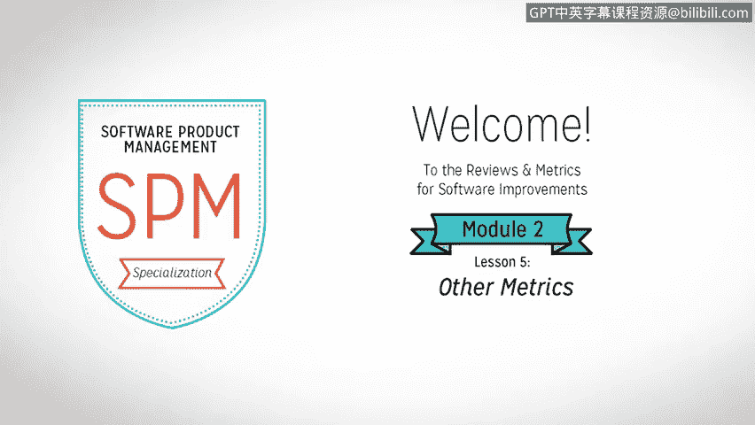
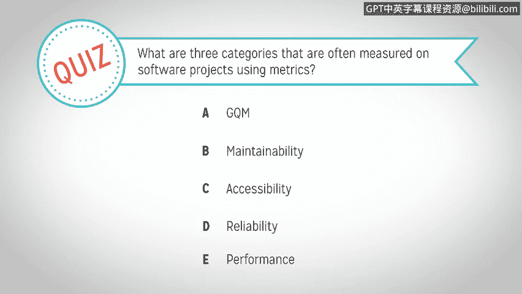

# 艾伯塔大学软件产品管理课程5：《软件改进的评审与度量》｜reviews-and-metrics-for-software-improvements｜ - P13：12_第5.2.5节 其他度量.zh - GPT中英字幕课程资源 - BV1j8411y7q1

🎼。😊。

Welcome back in the last lesson， I went over some desirable properties and metrics in general and to find the difference between a metric。

 a measure， and an indicator。In this lesson， I'm going to talk about metrics that can be used to assess your product and your project based on its non functional requirements。

In the lesson on GQM， I talked about identifying goals for your metrics。

Let's talk about some of these goals。You might want to measure maintainability， performance。

 reliability， or product success。To measure maintainability， use a complexity metric。

Complexity metrics measure the complexity of your product source code。

This is shown by the number of logical branches there are in your source code。In basic terms。

 a larger number of logical branches will translate to higher complexity in your project。

Software of higher complexity is more difficult to maintain， so if your code is too complex。

 you might want to think about reducing that complexity in order to improve your product's maintainability。

You could also assess your product's performance。To do this。

 it's possible to use metrics such as response time。

Response time is a metric that describes how long it takes for a task complete once it is being executed。

If it takes your application three seconds to display data after a request in the server is executed。

 then your response time is three seconds。You can average this measurement over multiple executions to get an average response time。

Reliability is also measured。To measure the reliability of a product。

 you could use measurements such as your product's uptime。

That's a measure of how long your product is up and available to your users。

Uptime is measured in percentages。For example， the standard uptime from databases is upwards of 99%。

The database is available to receive and send information more than 99% of the time that's pretty good。

Finally， there are product success metrics。These are metrics that were talked about earlier in this course。

 like customer satisfaction。Customer satisfaction， for example。

 could be measured by getting a rating out of five from users and averaging that rating from all users over the number of users。

You can also measure the correctness of your product， but that's more of a functional requirement。

The best way to measure a product's correctness is through defect analysis。

 that's what I'm going to talk about in the next lesson。

What are three categories that are often measured on software projects using metrics？A GQM。B。

 maintainability。C， accessibility。D， reliability or E performance。

The answers are B， D， and E。Maintainability， reliability。

 and performance are all things that are often measured on a software project。

