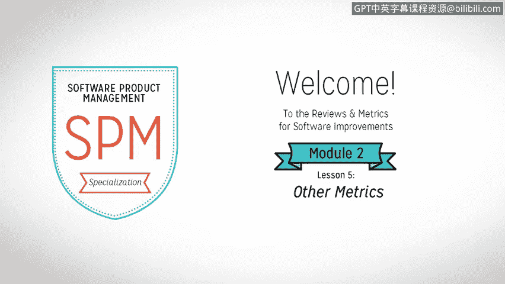
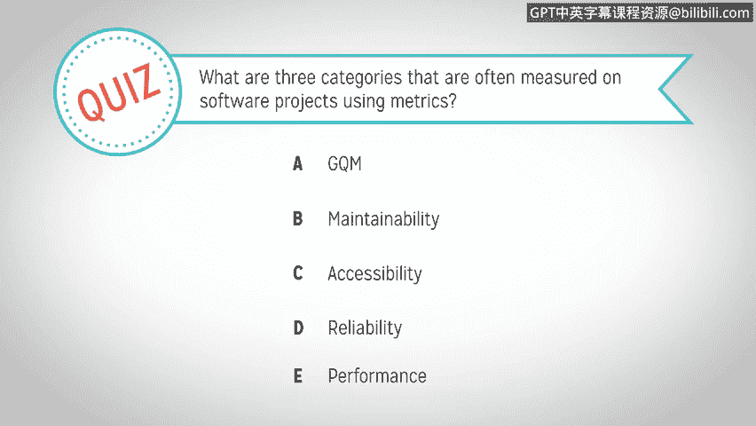

# 软件产品管理：5.2.5：其他度量

## 概述
在本节中，我们将学习如何运用度量来评估软件产品在非功能性需求方面的表现。我们将探讨可维护性、性能、可靠性和产品成功等关键领域的度量方法。

在上一节中，我们介绍了度量的一般理想属性，并区分了度量、测量和指标。本节中，我们来看看如何基于非功能性需求来评估你的产品和项目。

在关于GQM的课程中，我们讨论了为度量设定目标。现在，我们来谈谈其中一些具体目标。你可能希望度量可维护性、性能、可靠性或产品成功。

## 度量可维护性
要度量可维护性，可以使用复杂度度量。复杂度度量衡量的是产品源代码的复杂程度。这通常通过源代码中逻辑分支的数量来体现。简单来说，逻辑分支数量越多，项目的复杂度就越高。复杂度更高的软件更难以维护。因此，如果你的代码过于复杂，你可能需要考虑降低复杂度以提高产品的可维护性。

## 度量性能
你也可以评估产品的性能。为此，可以使用诸如响应时间这样的度量。响应时间是一个描述任务开始执行后需要多长时间才能完成的度量。例如，如果你的应用程序在服务器执行请求后需要三秒钟来显示数据，那么你的响应时间就是三秒。你可以对多次执行进行平均，以获得平均响应时间。

## 度量可靠性
可靠性同样可以被度量。要衡量产品的可靠性，可以使用诸如产品正常运行时间这样的测量。正常运行时间衡量的是产品能够启动并可供用户使用的时长。正常运行时间通常以百分比表示。例如，数据库的标准正常运行时间通常在99%以上。这意味着数据库在超过99%的时间内都可以接收和发送信息，这是一个相当好的水平。

## 度量产品成功
最后，还有产品成功度量。这些度量在本课程前面已经讨论过，例如客户满意度。客户满意度可以通过从用户那里获取五分制评分，然后对所有用户的评分进行平均来计算。你也可以衡量产品的正确性，但这更多属于功能性需求。衡量产品正确性的最佳方法是通过缺陷分析，这将是下一节要讨论的内容。

## 总结
本节课中，我们一起学习了如何运用不同的度量来评估软件产品的非功能性需求。我们了解了如何通过复杂度度量评估可维护性，通过响应时间评估性能，通过正常运行时间评估可靠性，以及通过客户满意度等指标评估产品成功。掌握这些度量方法，有助于你更全面地管理和改进软件产品。

---

**问题**：在软件项目中，通常使用度量来衡量的三个类别是什么？
A. GQM
B. 可维护性
C. 可访问性
D. 可靠性
E. 性能

**答案**：B, D, E。可维护性、可靠性和性能都是在软件项目中经常被衡量的方面。