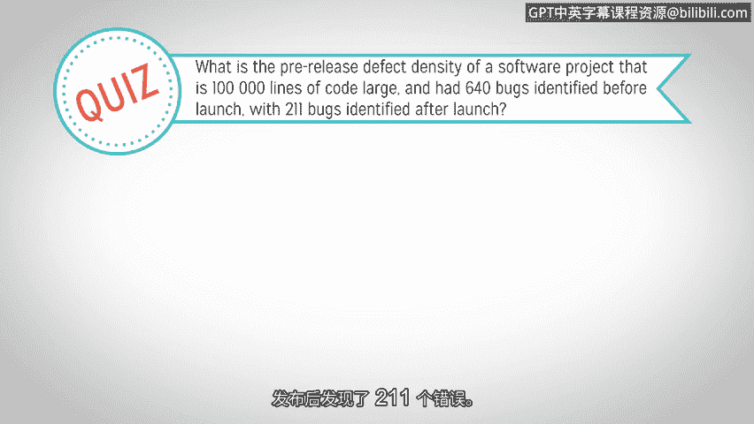

# 艾伯塔大学软件产品管理课程5：《软件改进的评审与度量》｜reviews-and-metrics-for-software-improvements｜ - P14：13_第5.2.6节 缺陷分析.zh - GPT中英字幕课程资源 - BV1j8411y7q1

🎼。😊，Welcome back。In this lesson， I'm going to talk about a very useful and frequently used tool in the industry。

Defect analysis。Defect analysis is a way to assess product quality。As the name suggests。

 defect analysis is used when you want to analyze the number of errors in your product。

An error is something that fails in your product。This can usually be traced back to your source code。

 but that isn't always the case。One way to do defect analysis is by tracking the number of defects in your code and comparing that number to the amount of defects that have been fixed。

As I said a few lessons ago， you can find the number of defects in your code by tabulating all the reported errors in your system。

Ideally， this could come from a specific group of internal software testers so that your system is not released with many bugs。

However， these numbers can also come from end users once you release the product。

There are many tools that exist to help you track your product bugs， issues and errors in general。

When using these tools， it's also easy to track the progress of these issues in terms of whether they've been fixed or not。

 and any updates that have be made to them。You can compare this number over time as well。

If you take the number of bugs found per week versus the number of bugs fixed per week and track that number over time。

 you can see if you should focus more effort on fixing current problems before creating new features。

This is called your rate of defects found versus defects fixed。

If the number of bugs found per week far outweighs the number of bugs that are being fixed each week。

 then it might be a good idea to invest time into fixing those problems。

As a metric that meets all the desirable properties metrics should。

 this metric allows you to track your progress as well。If you focus your efforts on fixing defects。

 then you're going to end up seeing the number of defects fixed per week rise。

By tracking the rate of defects bound versus defects fixed over time。

 you can see how your product's internal quality is faring。Hopefully。

 the further along in your project you get， the more defects you're fixing versus finding。

 and fewer defects that remain in your product。If， however。

 you're creating as many defects as you're fixing， you're running into what's called a software barrier。

And like I said earlier， it's probably time to make a change。

Running into a software barrier is an indicator that your product is not ready for release and that you should spend more time investing in fixing bugs before you do。

Defect analysis is a way for you to assess your products。A productivity。B size。C。

 user satisfaction or D quality。The answer is D， quality。

Defect analysis is primarily done in order to understand the current status of your project as far as quality is concerned。

You can also divide fixed defects among different components of the product called subsystems。

Essentially， all you have to do to know your defects in your subsystems。

 is to track the subsystem that is associated with each fixed defect。

You can then count the number of fixed defects for each subsystem to see the areas in your product that need attention。

This should be divided by the size of each subsystem for a fair comparison。

Big subsystems will naturally have more defects， which leads us to defect density。

Defect density is a standard way of determining the number of defects your whole product has。

To calculate defect density， simply take a ratio of the number of defects bound in your code to the size of your code。

The size can be measured in thousands of lines of code。

An industry average for structured programming techniques is about 15 to 50 defects per thousand0 lines of code。

You can use this metric to make some interesting predictions about your project's readiness to release。

Imagine that you're building a software product and are working on a third release with your team。

Your first version had 900 defects found prerelease and 100 defects found post release。With 100。

000 lines of code。This makes your product defect density for release number one。

 10 defects per thousand lines of code。In release2， your team added an additional 50。

000 lines of code and 400 defects were found pre releasele with 45 found post release。

This puts version number two's increment， having a defect density at 8。

9 defects per thousand0 lines of code。Now you're planning on releasing version 3。

Your team has built an additional 100，000 lines of code and 600 defects have been found in this code so far。

This puts your defect density at six defects per thousand lines of code in its increment。

Given the fact that the previous two released increments had between 8。

9 and 10 defects per thousand liness of code， is your product ready for release this time around？

Well， no。Unless your development processes have improved since the second release。

 you can expect to find 8。9 to 10 defects per thousand lines of code in the third increment。

That's about 890 to 1，000 defects per100，00 lines of code。In the previous releases。

 you found in fixed 90% of the defects pre releasele。

This means that you can expect to see about 801 to 900 defects per thousand0 lines of code in this release。

So by only finding 600， you can expect to find 201 to 300 more defects in your product in pre releaselease。

It's always better to find defects before your product is released。

 and therefore your product is probably not fit for release quite yet。

What is the prerelesed defect density of a software project that is 100。

000 lines of code large and had 640 bugs identified before launch。

 with 211 bugs identified after launch？A， 2。1 defects per thousand lines of code。

B，6。4 defects per thousand lines of code。C，7。51 defects per thousand0 lines of code。Or D，0。

00751 defects per line of code。The answer is B 6。4 defects per thousand lines of code。 remember。

 we're only counting defects from pre releaselease here。

Let's look at an example of defect analysis in action。

The Space Shuttle Flight software has one of the best reputations for being virtually error free。

 it has to be， or else people could die and billions of dollars could be lost。

So how did the onboard shuttle group who wrote the software achieve this level of perfection？Well。

 for them， it's not enough just to find a defect， fix it， and call it a day。When a defect is found。

 there exists protocols that make it mandatory to analyze that defect。

Identify other similar areas where that defect might occur and adjust the process to avoid such defects in the future。

For example， the space shuttle has a famous Canadian component called the Canadar。

 a robotic arm that assists with complex tasks in the harsh environment of space。

If a bug is found in the way the wrist of the cannaar rotates。

 then other code that is also involved with hardware rotation could also be checked for similar errors。

So by doing defect analysis， a similar bug could be caught on a completely separate subsystem that rotates a communication antenna。

 avoiding potential disaster。

In fact， this was an actual scenario that happened with the space shuttle software and helped to save a lot of work。

 a lot of time， and a lot of money。By implementing this rigorous testing and revision procedure。

 the onboard shuttle group was able to achieve a perfect status when it comes to its running software。

If you'd like to read more about their processes， please check out the resources in the course notes。

And that's the effect analysis， it's a simple technique to help you make sure that you understand your project's quality and are're making good decisions around its testing and releases。

😊，That's also it for this module， we covered a lot in this module， so let's do a review。😡，First。

 I talked about some review techniques for software products like code walkthroughs and requirements technical reviews。

Then I talked about some common issues with monitoring software projects and identified some metrics that are commonly used。

 but aren't very valuable。After that， I talked about the framework of goal， question metric， or GQM。

 and how implementing it can help you ensure that you're using appropriate metrics on your project。

Then it was on to desirable properties of metrics where we covered what makes a metric good。

After that， I talked about some popular metrics used in the industry today。

And then jumped right into defect analysis。These activities help to ensure the product is done right with work that is reviewed and measured。

In the next module， Morgan is going to talk to you about how to make sure your projects are managed right by talking about the daily Scrum。

 recapping velocity， and showing you what a burndown chart is Go check it out。

