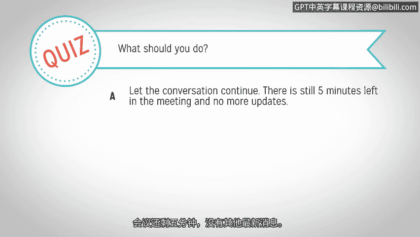

# 软件产品管理：5.3.1：每日站立会议 🎯

在本节中，我们将学习如何通过每日站立会议来确保产品开发过程得到有效管理。我们将了解会议的目的、结构、参与规则以及如何高效地运行它，以保持项目按计划进行并维持可持续的开发节奏。

## 概述

每日站立会议，通常称为每日Scrum或站会，是敏捷开发中用于同步团队工作、识别障碍并保持项目进度的关键实践。本节将详细介绍其运作方式、核心规则以及常见误区。

## 会议目的与结构

每日站立会议的核心目标是同步开发团队的工作，并为新的一天设定正确的方向。它不是一个向管理层汇报的状态会议，而是团队内部的协调会议。

会议结构非常简单，每位核心参与者需要依次回答三个问题：
1.  昨天完成了什么？
2.  今天计划做什么？
3.  遇到了什么障碍？

## 参与者角色：“猪”与“鸡”

为了确保会议高效，需要明确参与者的角色。这里引用一个经典比喻来区分：

> 一只鸡和一头猪在聊天。鸡建议：“嘿，猪，我们一起开家餐厅吧。”猪同意了：“好主意，鸡。但我们该叫它什么呢？”鸡建议：“叫‘火腿蛋’怎么样？”猪回答：“不了，谢谢。那样我是全身心投入，而你只是参与其中。”

在每日站会中：
*   **“猪”**：指对项目有实质性承诺、必须发言的人。通常是开发团队成员，以及有重要更新需要同步的产品负责人。
*   **“鸡”**：指可以旁听但不应发言的人。可能包括其他团队的开发者、想了解状态的高管，或没有重要更新的产品负责人。

## 会议内容：什么该说，什么不该说

以下是你在站会中更新内容时应该遵循的原则。你的发言应严格围绕三个核心问题。

**正确的更新内容应包括：**
*   A. 昨天，你完成了数据库结构的设计。
*   C. 今天，你将要开始设计用户界面。
*   D. 储藏室没纸了，导致你无法绘制用户界面的草图（这是一个障碍）。

**不应在站会中提及的内容有：**
*   B. 昨天，你下班后看了一部很酷的电影（与工作无关）。
*   E. 我对产品有一个功能改进建议（站会不是讨论未来改进的场合）。

## 会议实践与流程

上一节我们明确了会议内容，本节中我们来看看会议的具体执行流程和最佳实践。

会议通常按以下步骤进行：
1.  **开始**：所有人在无障碍的圆圈中站立，不携带笔记本电脑或手机。
2.  **轮流发言**：每位“猪”依次回答三个问题。一个典型的更新可能是：“大家好。昨天我完成了用户个人资料页的所有单元测试。今天我将开始编写该功能的源代码。我目前的障碍是对这个编程语言不太熟悉，今天有人愿意和我结对编程这个功能吗？”
3.  **视觉辅助**：会议通常在任务板或看板前进行，以便团队在需要时移动任务状态。
4.  **时间盒**：会议严格限时15分钟。
5.  **处理跑题**：如果对话偏离三个问题，Scrum Master应中断讨论，并将其加入“停车场”列表，邀请相关人员在会后讨论。
6.  **记录障碍**：Scrum Master负责记录会议上未直接解决的障碍，并确保后续有人处理。
7.  **明确结束**：会议结束时应有明确的信号（如团队口号），避免大家尴尬地不知是否散会。

## 场景应对：如何处理未完成的承诺

每日站会旨在建立开放的沟通渠道，而非问责攻击。当团队成员未能完成昨日承诺时，应以协作精神应对。

假设在站会中，开发者Danny昨天承诺完成登录功能的源代码，但今天他表示昨天已着手处理并计划今天完成，且没有提及任何障碍。

**正确的做法是：**
*   B. 礼貌地询问Danny为何未能完成，并询问团队是否可以提供帮助（例如建议结对编程）。

**不恰当的做法包括：**
*   A. 对他发火。
*   C. 什么都不做。
*   D. 指派其他人完成该功能。

## 场景应对：如何处理跑题讨论

作为Scrum Master，维护会议纪律和效率是你的职责。当会议中出现跑题讨论时，你需要果断干预。

假设会议进行顺利，仅用时10分钟，最后一位开发者的更新引发了大家的跑题讨论。

**此时你应该：**
*   D. 中断讨论，将其加入待议事项列表，并建议任何想继续讨论的人可以在会后进行。

**其他选项均不合适：**
*   A. 让讨论继续，因为会议还有时间。（这会养成坏习惯）
*   B. 让讨论继续，并允许超时。（违反了时间盒规则）
*   C. 中断讨论并直接散会。（不利于团队开放沟通）

## 总结

本节课中我们一起学习了每日站立会议。我们了解到它是一个简短的、面向开发团队的同步会议，核心是回答三个问题。我们明确了“猪”和“鸡”的角色区别，以确保会议高效。同时，我们掌握了会议的标准流程、Scrum Master维护会议纪律的方法，以及如何以协作而非问责的方式处理未完成的承诺。正确实施每日站会能有效保持团队同步，及时发现障碍，并维持积极的工作节奏。