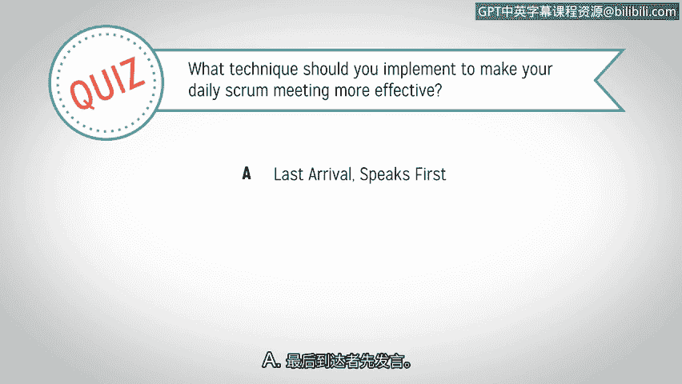
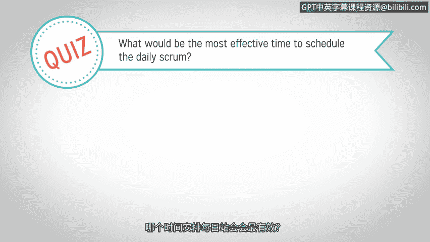

# 艾伯塔大学软件产品管理课程5：《软件改进的评审与度量》｜reviews-and-metrics-for-software-improvements｜ - P16：15_第5.3.1a节 每日站立会议挑战.zh - GPT中英字幕课程资源 - BV1j8411y7q1

🎼。😊，What if your daily scrum isn't working？Maybe you're constantly exceeding the time box。

 Maybe no one is sharing。 maybe it's unenthusiastic。

Let's go over some common problems that arise with daily scrubrums and how you can fix them。

One problem you may encounter is that no one wants to start the daily scrum or knows the speaking order。

Your team is always looking to the Scrum master to begin the meeting。

The Scma may call the meeting to order， but they should not always be responsible for beginning the meeting。

As much as possible， the Scrum masters should try and remove themselves from conducting the meeting as it makes it seem more like a status meeting and not a synchronization meeting。

A technique to resolve this issue would be to implement a last arrival Sps first rule。

This means that the last person to join the meeting must start the meeting。

While this may encourage punctuality， the last one to arrive is normally the least prepared to speak。

 so this technique may not be as effective。Many teams have a token that they pass around。

This could be a ball， a plush toy or an item from office supplies。

Passing the token around usually makes the meeting a bit more fun。

 encourages participants to pay attention and eliminates the issue of who speaks next。😊。

When one person completes their update， they toss the token to another person in the circle。

This may not always work as many people want to bring their morning coffee to the daily Scrum。

 or if you have a large team， it's hard to remember who hasn't spoken yet。

You could use the round Robbin technique where one person volunteers to start the meeting。

 and then you go around the circle until each person completes their update。

Your scrum team is constantly late for the daily scrum。And when people finally arrive。

 no one wants to start the meeting。What technique should you implement to make your daily Scrum meeting more effective？

A last arrival speaks first， B， pass the token or C， round Robbin。

Implementing the last arrival Sp's first technique will encourage the team to be more punctual。

It will also force someone to start the meeting。 therefore， A is the correct answer。

A very common problem with the daily Scrum is that it often exceeds the 15 minute time box。

We've already covered that you can reduce the length of your daily scrum by making sure that only the pigs are speaking。

We also suggested that any off topic conversations be added to a list of discussion topics for after the meeting。

If you are still exceeding the time box， then here are some additional techniques that you could try。

The first is to make sure that your team is standing throughout the meeting。

If your daily scrum occurs around a conference table with comfy chairs。

 this encourages people to hang around and drag out the meeting。😊，By having them stand。

 they will be uncomfortable and want to finish the meeting sooner。

Another technique includes the addition of a small timer。

The 15 minute time box for the meeting is divided amongst each person。And when time is running out。

 the person speaking will know to wrap up quickly。You can also get creative by using the past the token technique we talked about earlier。

But instead of using just any token， use a heavy exercise ball。

This will encourage them to want to get rid of it。If that is still not working。

 have them hold the ball with their arms extended in front of them。

They'll definitely want to get rid of the ball in this case。

Another issue you may experience would be that no one communicates impediments。

It could be the case that your team is not encountering blockers， but that's uncommon。

It should raise a red flag if no one brings forward impediments。

 but you are constantly missing deadlines。One way that you could combat this would be to include small impediments in your own updates so that the team knows that they are encouraged to bring forward any impediments。

 no matter how small。You could also prompt them with questions like。

I there anything that I or the team can do to make your day easier？

Another issue is that not all team members are present in the morning。This is common in offices。

 with flex hours。😊，In this case， you should schedule the meeting at a time when everyone will be there。

Be aware that if you start the meeting later in the morning。

 the normally productive work does not get done before the meeting。

A late meeting usually means starting the day late and losing productive work hours。

It is most effective to have the meeting at the beginning of the day。But if that is not possible。

 schedule the meeting for after lunch or another time later in the day。

 where the meeting is not associated with the start of the day。

The last issue we will examine is if the meeting feels like a status meeting。

If the team is reporting to the Scrum master or product owner and not to the rest of the development team。

 then this represents a status meeting and not a synchronization meeting。To remedy this。

 remind the person giving their update to share with the development team。

You could suggest that the person giving the update avoid eye contact with their supervisor。

This encourages them to look at the rest of the development team。

Your office has flex hours， which means that employees can work at any time during the day as long as they meet their required hours。

Two of your developers usually arrive at 10 am after they have dropped their kids off at school。

One developer likes to get an early start to the day and is promptly at the office at 7 o'clock every morning。

Your last developer likes to come in around noon and stay late。

What would be the most effective time to schedule the daily scrum？

A， 10 a and just update the last developer on what happened。B。

 directly after lunch when all developers are present or C。

 don't have a daily scrum at all since there isn't a time in the morning that works for everyone。

You want to make sure that the entire scrum team is present for the meeting。

 so 10 AM is not effective。Having a daily scrum later in the day is more effective than not having one at all。

Therefore， B is the correct answer。Daily scrums are a great practice， regardless of when they happen。

Having the meeting after lunch encourages productive afternoons and is far enough away from the beginning of the day。

 that team members won't associate the meeting with the start of their work day。😊。

The daily Scrum is intended to start the day off well， improve team support， encourage improvement。

 reinforce the sense of team and act as another communication channel。

It is a very effective practice that is easy to implement。

If you are trying to slowly implement agile practices into your workplace。

 a daily scrum is a good starting point， try it out with your team。

Have you ever participated in a daily Scrum， were they effective？

What techniques could you have implemented to make them more effective。

What advice do you have about daily scrums that have worked for you in the past？

If you haven't participated in a daily scrum， do you think that they would have been effective for a team you've worked with。

 why or why not？Let's talk about it in the course discussion。In the next module。

 we are going to go over how velocities are used to ensure your project is managed right。

