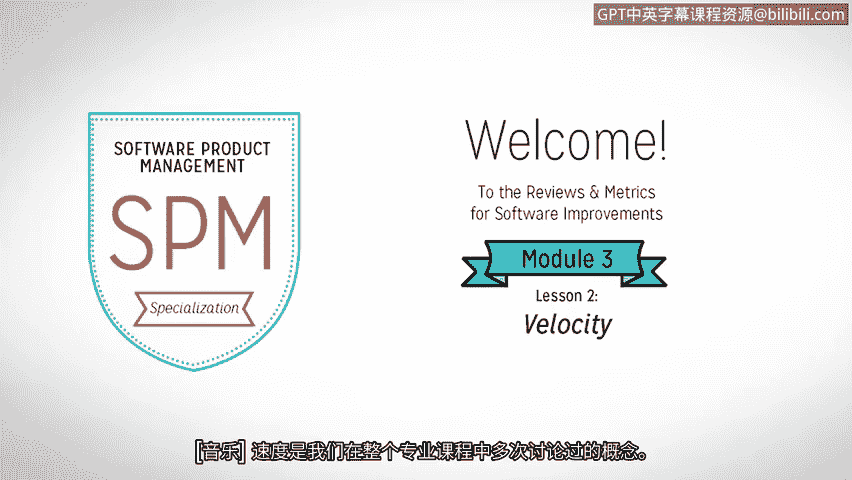
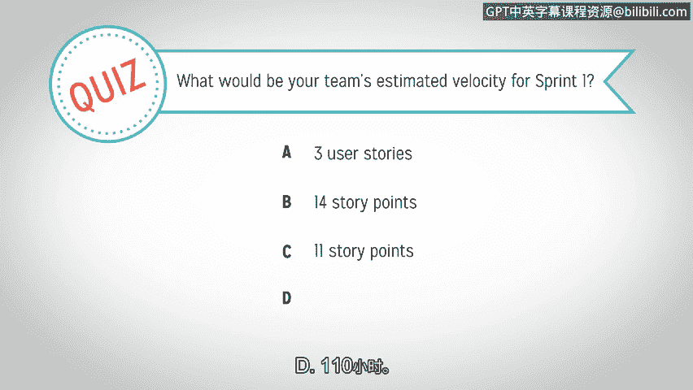

# 软件产品管理课程5：《软件改进的评审与度量》：5.3.2：速度

## 概述
在本节中，我们将详细探讨敏捷项目管理中的一个核心概念：**速度**。速度是衡量团队在特定时间段内完成工作量的指标，对于确保项目正确管理至关重要。

---

## 什么是速度？
速度是一个简单的概念。它衡量的是团队在给定时间间隔内完成的工作单位数量。这通常以**每个冲刺周期完成的故事点数**来衡量。

我们在《敏捷规划与软件需求》课程中讨论过故事点及其如何用于估算用户故事的规模。如果你不熟悉这个概念，可能需要回顾一下那节课。

关于速度，有几点需要明确：
*   首先，一个用户故事必须根据团队对“完成”的定义完成，其故事点才能计入团队的速度。
*   其次，速度应在用户故事层面进行衡量，而不是在任务层面。

---

## 速度计算练习
现在，我们来计算你的团队在特定冲刺周期内实现的速度。以下哪项应计入团队的速度？
A. 在该冲刺周期内完成的用户故事数量。
B. 在该冲刺周期内完成的用户故事的故事点数。
C. 一个已完成一半任务的功能，因此可以计入其一半的故事点数。
D. 一个已完成编程和文档记录但尚未测试的功能的故事点数。

**正确答案是 B**。只有满足团队“完成”定义的用户故事，其故事点数才能计入团队的速度。不应计入半成品功能或任务的故事点数。因此，只有在该冲刺周期内完成的用户故事的故事点数才能计入速度。

---

## 如何估算速度？
估算速度并不十分精确。在《软件产品敏捷规划》课程中我们曾简要讨论过这一点。理想情况下，估算的速度应基于以往的工作。如果团队和产品相似，你可以使用之前的项目来估算速度。

但如果你没有此类信息怎么办？一种估算速度的方法是将工作分解为任务。将计划在冲刺周期内完成的用户故事分解为工作分解结构。你需要确保估算的任务时间与团队可用时间相符。如果不符，可能需要增加或移除用户故事。

一旦确定了冲刺周期内将完成哪些用户故事，将这些用户故事的故事点数相加，结果就是你第一个冲刺周期的**目标速度**。这个目标速度将用作你第一个冲刺周期的估算速度。

---

## 速度估算练习
你和你的团队正在为开发的第一个冲刺周期做准备。你想计算一个估算速度，但你的团队从未合作过，并且他们也没有此类产品的经验。

你计划在本冲刺周期完成四个用户故事：
*   用户故事 A 被分配了 3 个故事点。
*   用户故事 B 和 C 各被分配了 5 个故事点。
*   用户故事 D 被分配了 1 个故事点。

你将用户故事分解为任务并估算了任务时间。你估计这些故事总共需要 110 小时完成。你的开发团队在本冲刺周期只有 95 个可用小时。你决定从冲刺周期中移除用户故事 A，因为它估计需要 15 小时。

那么，你的团队在第一个冲刺周期的估算速度是多少？
A. 3 个用户故事
B. 14 个故事点
C. 11 个故事点
D. 110 小时
E. 95 小时

**正确答案是 C**。速度估算应基于用于用户故事的规模度量单位。在这个例子中，我们使用故事点。因此，答案 A、D 和 E 都不正确，因为它们是以用户故事或小时来衡量的。在根据任务估算确定团队没有时间完成用户故事 A 后，你决定将其移除。因此，你的速度估算将基于用户故事 B、C 和 D 的故事点之和，即 11 个故事点。

---

## 实际速度与稳定性
团队在每个冲刺周期实现的实际速度可能会因各种原因而波动。你团队的第一个冲刺周期速度可能低于其他冲刺周期。如果团队仍在学习如何协作，或者在学习新技术，就可能发生这种情况。你还会遇到可能影响团队速度的错误或其他风险。

然而，随着时间的推移，团队的速度应该会趋于稳定。一个相对稳定的速度表明你的团队遵循了敏捷原则，即**保持可持续的开发节奏**。

实际速度用于创建发布和迭代燃尽图。这将是我们在本模块接下来两节课中要学习的内容。

---

## 总结
本节课我们一起学习了速度的概念及其在敏捷项目管理中的重要性。我们明确了速度是基于**已完成用户故事的故事点数**来计算的，并探讨了如何估算速度以及实际速度可能波动的原因。稳定的速度是团队健康运作的标志。接下来，我们将开始应用速度的概念来创建燃尽图。