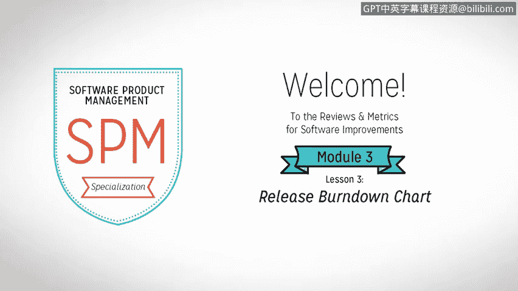
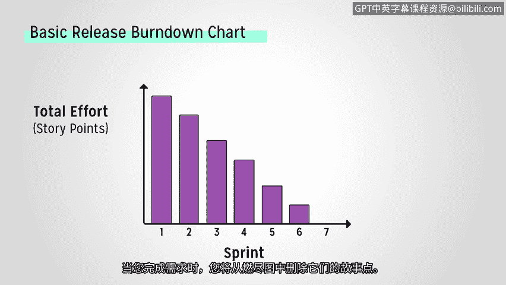
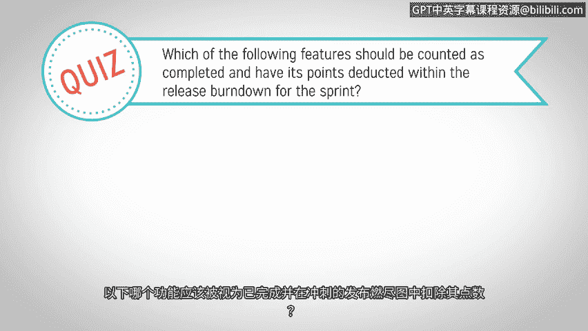

# 艾伯塔大学软件产品管理课程5：《软件改进的评审与度量》｜reviews-and-metrics-for-software-improvements｜ - P18：17_第5.3.3节 发布燃尽图.zh - GPT中英字幕课程资源 - BV1j8411y7q1

🎼。😊。

A release burn down chart is a visual monitoring tool that is very common in the Scrum methodology。

A release burn down chart will show you how much work the development team has completed。

 how much is left to complete， the team's velocity in each sprint。

 and when you should expect to finish the product。As you can imagine。

 it's an excellent tool for ensuring your project is managed right。

Since the release burn chart can show you all that information。

 I bet you're pturing a pretty complicated chart。But that's the beauty of a release burndown。

 it's a simple concept。Let's take a look at a basic release burn down chart。As you can see。

 we have our sprints listed horizontally。This project depicted has six sprints。Vertically。

 we have the total effort。This would be described with whatever measure your team has chosen to size your requirements。

We're going to use story pointss in our examples。Each bar in the graph that corresponds with a sprint represents the total number of story points that are still remaining at the beginning of the sprint。

Naturally， at the beginning of Sprint1， we have all the story pointss remaining because we have not started completing them yet。

This would represent your total effort。Your total effort is the combined total of the story points for all the user stories that you intend to complete in the project。

As you complete requirements， you remove their story points from the burn down chart。

Your development team is about to start their sixth and final sprint。

This is the release burn chart for the project。How many story points has your team completed and how many do they have remaining。

A100 story pointss completed， 15 story points remaining。B，100 story pointss completed。

 zero story points remaining。C， 85 story pointss completed 15 story pointss remaining， or D。

 85 story pointss completed zero story pointss remaining。In this project。

 there were 100 total story points。 We know this because there were 100 story points at the beginning of Sprint 1。

At the beginning of sprint 6， which is the last sprint of the project。

 there are 15 story pointss remaining。Since we started with 100 story points and have 15 remaining。

 that means that the team has completed 85 story points； therefore C is the correct answer。

Let's say that our total effort was 90 story points。

And we completed 15 story points in the first sprint。From the release burned down。

 we can see that our velocity for the sprint was 15 points。

We can also see that the work remaining is 75 points。

We also know that we are starting Sprint2 with 75 story pointss remaining。

If we wanted to predict how many sprints this product will take to complete。

 we can draw a line through the bars to predict that。We call this line the prediction line。

Since we're basing this off of one sprint with a velocity。

 we are going to make our predictions of that value。Based on our prediction line。

 it says that it should take six sprints。You may be thinking that the line is pointing to seven sprints。

 but remember that the release burn down is based on how many story points remain at the beginning of each sprint。

That means that there would be no story points to complete at the beginning of Sprint 7。

 which means that you wouldn't need that sprint。You can also use the prediction line to see if you are on track with development。

Let's say we have just completed Sprint4 and our release burn down chart looks like this。

In the first sprint， we completed 15 story points。We wanted to maintain that pace。

 so that is the prediction line。However， in Sprint2， we only completed five story points。

As you can see， our bar for Sprint3 is now above the prediction line。In Sprint 3。

 we completed 15 story points。 We got our velocity back to the initial value。

 but we are still behind schedule because of Sprint 2。At the beginning of Sprint 4。

 we should have completed 45 story points altogether and be halfway through development。

But as you can see， our bar for Sprint 4 is above the prediction line。

We are behind 10 story pointss from where we wanted to be。

Let's now say that at the beginning of the Sprint4。

 we hired two more developers because we saw that our project was behind schedule。In Sprint 4。

 we completed 25 story pointss。This put our project back on schedule。In Sprint 5。

 we completed 25 story pointss again。This now put our project ahead of schedule。As you can see。

 our bar for the beginning of Sprint 6 is now below the prediction line。

This means that your team might be able to complete a few more requirements for the product。

In reality， it would be extremely rare that your release burn down looks like this。

It is much more common that your release burn down looks something like this。

Consider this release burn down chart。You have completed your first sprint。

If you maintain the initial velocity from this sprint。

 how many sprints do you expect to need to finish the work？A 5 sprints， B，6 sprints， C，7 sprints， D。

8 sprints， or E， you need more information。If you maintain this velocity。

 your prediction line indicates that you will have no story points to complete at the beginning of Sprint 6。

This means that you will have completed the project in five sprints。 Therefore。

 a is the correct answer。Since a release burnout chart is measuring completed story points。

 you can imagine that your team's definition of done is very important。In Agile。

 we measure progress by working software， so in order to mark story pointss as complete。

 that requirement must meet your team's definition of done。

I've worked on teams that were not focused on working software。

We are developing a product that had a database connection。

Half of our team was working on developing the database。

 and the other half was working on developing the product user interface。

Even though many of the features were programmed for the interface and the database was being developed。

 we could not mark any of our requirements as done because we were waiting for the database to be developed and connected to the application。

Our burn down chart ended up looking something like this。As you can see from our burn down chart。

 it looks as if we did nothing for three sprints and then worked really hard in Sprint 4。

We knew that wasn't the case， but a burn down chart will show if your team is working towards completing features entirely before moving on to new ones。

Otherwise， a burn down chart is not a good representation of a product's progress。

You are working on a team that is developing a mobile application。

You have just completed your third sprint。Your team's definition of done includes only features that are programmed。

 documented， and tested， and ready for market。Which of the following features should be counted as completed and have its points deducted within the release burned down for the sprint？

A， a feature that was developed and documented， but failed testing in the last sprint has now received a minor fix and has passed tests in the current sprint。

B a feature that you did not have time to test， but you are sure that it works。See。

 an interface feature that is programmed， documented， and tested。

 but has not been connected to the database yet。And or D。

 a feature that works perfectly has passed all its tests in the sprint and is properly documented。

Only features that have met the team's definition of done can be marked as complete for the release burn down。

Answers B and C are both features that have not met the definition of done。

 Therefore must not be marked as complete for the release burned down。

Answer A demonstrates a feature that did not meet the definition of done last sprint， but now does。

 so it can be marked as complete on this sprint for the release burn down。

Answer D also meets the team's definition of done， therefore can be marked as completed for the release burned down。

A and D are the correct answers。