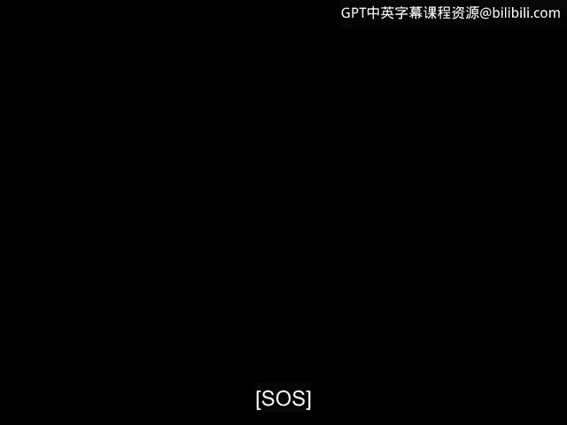
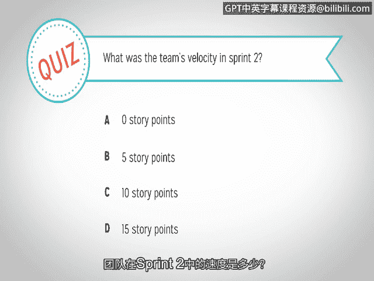
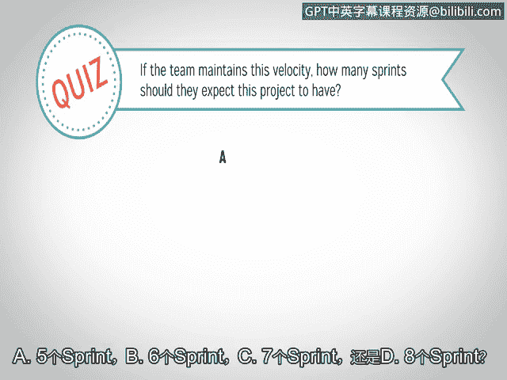

# 艾伯塔大学软件产品管理课程5：《软件改进的评审与度量》｜reviews-and-metrics-for-software-improvements｜ - P19：18_第5.3.3a节 发布燃尽图变更需求.zh - GPT中英字幕课程资源 - BV1j8411y7q1

🎼。😊。

One thing that is not apparent in the basic release burned down chart is the effect of changing requirements。

As you know by now， requirements change constantly。

Maybe the estimate of story points for a requirement changes。

We need a way to represent that in a burn down chart。

Imagine that we are at the beginning of Sprint4 in a project and our burn down chart looks like this。

Let's say that in Sprint4， the team completed 15 story pointss of work。

But before the beginning of Sprint 5， there were two user stories worth five points each。

Our burn down chart would now look something like this。

It looks like the development team only completed five story points in Sprint 4。

 which was not the case。There are two common ways to demonstrate changing requirements in a release burn down chart。

The first is to show the total work done in each sprint above the bars for work remaining。

This would look like this。In the burndown chart， we have the total work remaining on the bottom and the total work completed on top。

You can see that there were no story points added or removed for Sprint 2。

 Since the height of the work remaining and were completed at the beginning of Sprint 2 is the same height as the total amount of work at the beginning of sprint 1。

At the beginning of Sprint 3， there were 10 story points added。

We can see this because the total amount of work remaining and work complete is now greater than the last sprint。

The total number of story points remains unchanged until the beginning of Sprint 5。At that point。

 there is fewer total story points， since the sum of work remaining and were completed is now less than the sprint before。

This burn down now shows your team's velocity， as well as the change in story pointss。

Consider this total work done， release burn down chart。What was the team's velocity in sprint to？

A0 story points， B，5 story points， C，10 story points， or D 15 story points。

In order to determine the velocity for sprint2， we look at the bar for the start of sprint 3。

Remember， the lower portion of the bar represents the remaining story points。

 while the total height of the bar represents all story pointss。

Sprint 2 started with 75 story points remaining， and Sprint 3 starts with 65 story points remaining。

It seems evident that 10 story points appear to have been completed in Sprint2。However。

 the total height of sprint 2 was 90 story points， and the total height of sprint 3 is 85 story points。

 So five story points worth of work was removed。Therefore。

 of the10 story points that appear to have been done。

 subtracting five story points that were removed tells you that the velocity for sprint 2 was five story points。

The second way that you can demonstrate a change in story points is by using an adjustable floor。

In this type of release burn down， you demonstrate the change in story points along the bottom of the chart。

This type of burndown looks like this。This is the same burn down that we used in the example before the quiz。

We have no change in story pointss at the beginning of Sprint2。

You can see that because the bar for sprint2 is still along the axis axis。

At the beginning of Sprint 3， we have new story points added。

We can tell this because we have story points appear below the X axis now。

The number of story points remains unchanged for Sprint 4。And then in Sprint 5。

 we see another change in story points。 We have now removed story points。

We can see this because the bar for Sprint 5 is now higher than it was in the previous sprint。

You also need to adjust the prediction line to align with the adjustable floor。

If we had never removed story points at the beginning of Sprint 5。

 the prediction line would look like this。Based on this release burn down chart and the prediction line that was calculated based on the first two sprints。

 If the team maintains this velocity， how many sprints should they expect this project to have。

A 5 sprints， B，6 sprints， C，7 sprints， or D，8 sprints。

If this were a basic release burn down chart， you could expect the project to have six sprints。

Since the prediction line indicates that there would be no work for a seventh sprint。

Since this is an adjustable floor release burn chart。

 we have to take into account the change in story pointss。At the beginning of Sprint 3。

 there were many story points added to the project。If you are going to maintain the same velocity。

 this means that the project will take longer to complete。

If you extend the baseline and the prediction line to meet。

 you would find no stories left to be completed in the eighth sprint。

The team could expect that the project will take seven sprints。 therefore， C is the correct answer。

When would it be appropriate to use the basic release burn down and when should you use the total work done or adjustable floor burn down。

Well， the basic form is a great way to demonstrate how much total work is left to complete。

If you are not concerned with tracking your team's velocity， then go for the simple version。

If you are intending to use the release burndown to provide more information。

 then you should use either the total work done release burndown or the adjustable floor release burndown。

Both of those release burn downs demonstrate the same information。

 so it doesn't make a difference which one you use。 It's just a matter of preference。

Another important thing to note is that sometimes release burn downs are drawn as line charts and not as bar graphs like I used in this demonstration。

In that case， your basic release burn down would go from looking like this。To looking like this。

And the total work done release burndown would go from looking like this。To look in like this。

And finally， the adjustable floor release burndown would go from looking like this。

To looking like this。Release burn down charts are an excellent way to visualize your entire development progress。

One simple chart can demonstrate the total work done for a project， the work that has been completed。

 the work that is still remaining， when you can expect to be finished and the changes in story points and your team's velocity。

A burn down chart can also give you early warning that your project is not going as planned。

Burn down charts are not only a tool that you can use for a release。

 you can also use them at the iteration or sprint level。

That's what we are going to be talking about in the next lesson。

