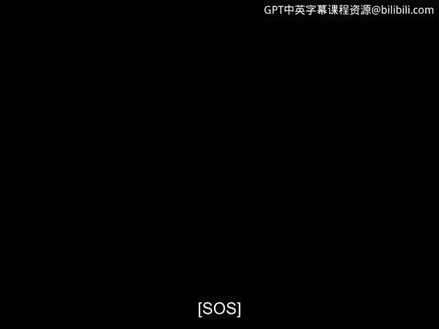
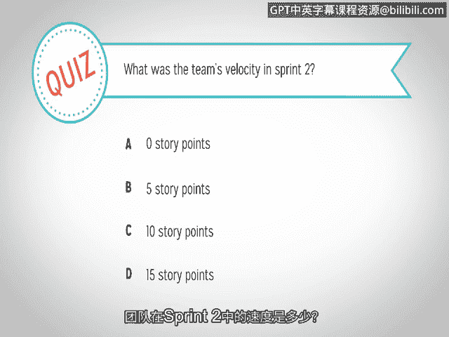
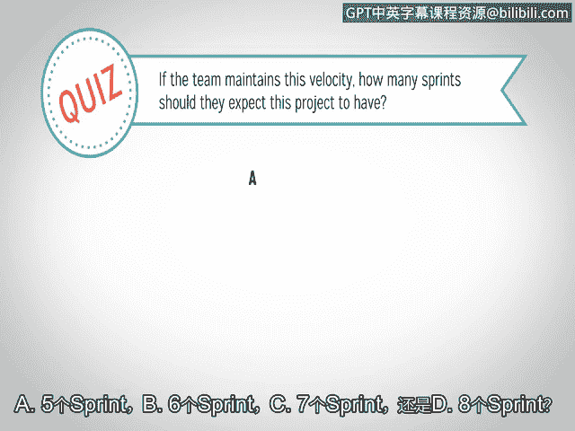

# 软件产品管理：5.3.3a：发布燃尽图与需求变更

在本节课中，我们将要学习如何在发布燃尽图中清晰地展示需求变更的影响。需求变更是软件开发中的常态，它可能表现为用户故事点数的调整。我们将探讨两种主流的可视化方法，并学习如何解读这些图表。

## 基础燃尽图的局限性

上一节我们介绍了基础的发布燃尽图。基础燃尽图中不明显的一点是**需求变更**的影响。

如你所知，需求是持续变化的。可能某个需求的**故事点**估算发生了改变。我们需要一种方法在燃尽图中表示这种变化。

想象我们正处于一个项目的**Sprint 4** 开始时，我们的燃尽图看起来是这样的。假设在 Sprint 4 中，团队完成了 **15** 个故事点的工作。但在 Sprint 5 开始前，新增了两个用户故事，每个价值 **5** 个故事点。

我们的燃尽图现在看起来会是这样。图表显示开发团队在 Sprint 4 只完成了 **5** 个故事点，但这并非事实。

## 展示需求变更的两种方法

以下是两种在发布燃尽图中展示需求变更的常用方法。

### 方法一：显示“总工作量完成”图

第一种方法是在表示剩余工作的柱状图上方，显示每个冲刺完成的**总工作量**。图表会呈现如下效果。

在这种燃尽图中，底部是**剩余总工作量**，顶部是**已完成总工作量**。你可以看到在 Sprint 2 开始时，故事点没有增减，因为 Sprint 2 开始时的剩余工作量和已完成工作量之和，与 Sprint 1 开始时的总工作量高度相同。

在 Sprint 3 开始时，新增了 **10** 个故事点。我们可以看出这一点，因为此时剩余工作量和已完成工作量之和大于上一个冲刺。故事点总数保持不变，直到 Sprint 5 开始。此时，总故事点数变少了，因为剩余工作量和已完成工作量之和现在小于前一个冲刺。

这种燃尽图现在同时展示了团队的**速率**以及故事点的变化。

> **思考题**：观察这个“总工作量完成”发布燃尽图。团队在 Sprint 2 的速率是多少？
> A. 0 个故事点
> B. 5 个故事点
> C. 10 个故事点
> D. 15 个故事点

为了确定 Sprint 2 的速率，我们需要看 Sprint 3 开始时的柱状图。请记住，柱状图的**下半部分**代表剩余故事点，而**柱子的总高度**代表所有故事点。

Sprint 2 开始时剩余 **75** 个故事点，Sprint 3 开始时剩余 **65** 个故事点。表面上看，Sprint 2 似乎完成了 **10** 个故事点。然而，Sprint 2 的总高度是 **90** 个故事点，而 Sprint 3 的总高度是 **85** 个故事点，这意味着有 **5** 个故事点的工作被移除了。

因此，从看似完成的 **10** 个故事点中，减去被移除的 **5** 个故事点，可以得出 Sprint 2 的速率是 **5** 个故事点。所以正确答案是 **B**。

### 方法二：使用“可调整基线”图

第二种展示故事点变化的方法是使用**可调整基线**。在这种发布燃尽图中，你在图表底部展示故事点的变化。这种燃尽图看起来是这样的。

这是我们测验前示例中使用的同一个燃尽图。在 Sprint 2 开始时，故事点没有变化，你可以看到 Sprint 2 的柱子仍然紧贴 X 轴。

在 Sprint 3 开始时，我们新增了故事点。我们可以看出这一点，因为现在 X 轴下方出现了故事点。故事点数量在 Sprint 4 保持不变。然后在 Sprint 5，我们看到故事点再次发生变化——这次是移除了故事点。我们可以看到这一点，因为 Sprint 5 的柱子现在比前一个冲刺的柱子更高。

你还需要调整**预测线**，使其与可调整的基线对齐。如果我们从未在 Sprint 5 开始时移除故事点，预测线会是这样的。

> **思考题**：基于这个发布燃尽图以及根据前两个冲刺计算的预测线，如果团队保持这个速率，他们预计这个项目会有多少个冲刺？
> A. 5 个冲刺
> B. 6 个冲刺
> C. 7 个冲刺
> D. 8 个冲刺

如果这是一个基础发布燃尽图，你可以预期项目有 **6** 个冲刺，因为预测线表明第七个冲刺将没有工作。但由于这是一个可调整基线的发布燃尽图，我们必须考虑故事点的变化。

在 Sprint 3 开始时，有许多故事点被添加到项目中。如果你要保持相同的速率，这意味着项目需要更长的时间才能完成。如果你延长基线和预测线直到它们相交，你会发现直到第八个冲刺才没有剩余故事需要完成。因此，团队可以预期项目将需要 **7** 个冲刺。正确答案是 **C**。

## 如何选择燃尽图类型

那么，何时适合使用基础发布燃尽图，何时应该使用“总工作量完成”或“可调整基线”燃尽图呢？

基础形式是展示**剩余总工作量**的绝佳方式。如果你不关心跟踪团队的速率，那么选择简单版本即可。

如果你打算使用发布燃尽图来提供更多信息，那么你应该使用“总工作量完成”发布燃尽图或“可调整基线”发布燃尽图。这两种发布燃尽图展示了相同的信息，因此使用哪一种没有区别，这只是一个偏好问题。

另一个需要注意的重要点是，有时发布燃尽图被绘制成**折线图**，而不是我在演示中使用的柱状图。在这种情况下，你的基础发布燃尽图会从这样变成这样。“总工作量完成”发布燃尽图会从这样变成这样。最后，“可调整基线”发布燃尽图会从这样变成这样。

## 总结

本节课中我们一起学习了发布燃尽图如何可视化整个开发进度。一张简单的图表可以展示项目的总工作量、已完成的工作、剩余的工作、预期的完成时间、故事点的变化以及团队的速率。燃尽图还可以在你项目未按计划进行时提供早期预警。

燃尽图不仅可用于发布层面，也可用于迭代或冲刺层面。这就是我们下一节课将要讨论的内容。