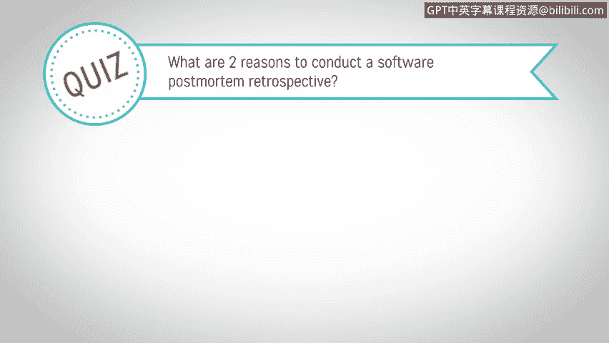

# 软件产品管理：5.4.1：回顾

欢迎来到本课程的最后一个模块。在本模块中，我将讨论回顾。

让我们开始吧。回顾是软件开发社区中使用的一个术语，用于描述反思项目中已完成和未完成工作的行为。

回顾主要有两种基本类型：**冲刺回顾**和**项目回顾**。

回顾的基本理念是反思项目中进展顺利的部分、进展不顺利的部分，以及未来可以采取哪些措施来改进流程。

在冲刺回顾中，这是通过反思上一个冲刺中发生的事情来完成的。还记得在《敏捷规划与软件项目》课程中，我谈到了时间盒法，摩根谈到了迭代规划吗？这两种实践都引入了将时间组织成小而可管理的块的想法。在这些时间盒块之后，至少在敏捷项目中，安排一次计划内的自我评估会议也很重要。这就是冲刺回顾。

在冲刺回顾中，从团队自我评估中获得的见解会被应用到下一个冲刺中，这使得项目能够持续改进。团队选择什么是重要的，什么应该被关注。这赋予了团队对改进的贡献感，并让他们拥有改进的所有权。它帮助团队从内部获得成功的动力，他们不需要外部力量来推动他们改进。

在项目回顾中，有时也称为事后分析，团队会在整个项目被认为完成时，回顾整个项目。项目回顾的一个主要区别在于，没有下一个冲刺可以将回顾中获得的经验教训应用其中。但这不应阻止你进行项目回顾。尽管当前项目可能没有下一个冲刺，但团队成员很可能还会参与其他项目。这些项目可能是团队共同参与的其他项目，或者团队解散后成员加入其他项目。这并不重要。重要的是整个团队有机会反思整个项目，并将学到的经验教训带入未来的工作中，无论团队是否在一起。

进行项目回顾的另一个非常重要的原因是，它能让团队释放积压的情绪能量。在大多数项目中，都会存在个性差异、分歧和妥协。如果在项目结束时，这些问题没有得到解决，可能会产生不健康的影响。进行项目回顾使团队能够在协作、开放、无评判的氛围中解决分歧。我们将在下一课中讨论如何确保营造这种氛围。

> **进行软件项目事后回顾的两个原因是什么？**
>
> A. 将先前项目中学到的经验教训应用到未来项目中。
> B. 保证先前项目中的问题不再发生。
> C. 让团队成员修复彼此受损的关系。
> D. 根本不应该进行事后分析。
>
> 答案是 **A** 和 **C**。事后分析是将经验教训应用于未来项目的好方法，同时也让人们有机会公开谈论他们的经历并修复关系。

进行回顾的价值是显而易见的。但当你避免进行回顾时会发生什么？设想一个没有进行冲刺回顾的Scrum项目。每个冲刺之后会发生什么？团队很可能会计划下一个冲刺并直接投入开发。事实上，这种情况经常发生。然而，如果不允许反思，这些项目往往会延续之前的状态，没有明确意识到项目中哪些进展顺利，哪些不顺利。人们可能有自己的感受，并且可能经常表达这些感受。但如果没有全团队的回顾来捕捉这些感受，就很难就哪些需要改变、哪些应该保持不变做出团队决策。请记住，无论你的团队多么优秀，总有改进的空间。没有人是完美的，我们不是机器。因此，与其在项目中回避反思，不如鼓励反思。由此产生的改进通常是切实可见的。

以上我们介绍了回顾是什么以及为什么要使用它们。在下一课中，我将讨论围绕回顾的一些问题。我们下节课见。