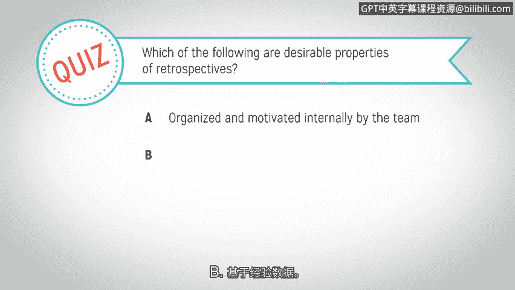

# 艾伯塔大学软件产品管理课程5：《软件改进的评审与度量》｜reviews-and-metrics-for-software-improvements｜ - P22：21_第5.4.2节 回顾问题.zh - GPT中英字幕课程资源 - BV1j8411y7q1

Welcome back。

In the last lesson， I described what a retrospective is and why they're valuable。

I introduced the concept of a sprint retrospective， as well as a project retrospective。

In this lesson， I'm going to talk more about issues that surround retrospectives。

Some of which are the reason why some teams don't use retrospectives at all。

I'm also going to explain how to get over these issues so that you can successfully put retrospectives to work on your projects。

What are some common issues with retrospectives？Why don't some teams implement them to their advantage？

There are many reasons why a team wouldn't do a retrospective。And they're all equally valid。

Although that doesn't mean that they're good excuses。

Some teams might just be doing retrospectives for the wrong reasons。

Like if they were required to be done for an audit。Some teams might not have enough time。

Some might want to look ahead rather than behind。Others don't want to talk about rhythm themselves。

 whereas others could be simply burnt out and just don't want to think about the project anymore。

One of the main blockers to implementing retrospectives properly is that the team does not feel as though it is safe for them to participate。

That's not to say that the main thing blocking teams from doing retrospectives is that they're afraid of the meeting room collapsing or someone being violent。

It means that they don't feel emotionally or professionally safe。

Feeling safe means feeling as though you can express yourself in a genuine and truthful manner without fearing a negative response from your peers or management。

It's the ability to communicate openly with your teammates by knowing that you will be heard and that you will be supported by them。

 regardless of what you have to say。Okay， so that might be difficult to picture if this concept is new to you。

Here's an example。Pierre is a developer working with a team on a software project。

They're in a daily scrum talking about what was done the previous day。

What is planned to be done that day and what their blockers are？

Pierre had been unproductive for the past few days because he was feeling burnt out from working too much and had difficulty gathering the will to contribute to the project。

In the daily scrum， Pierre tells the rest of his teamness because he knows that he will not be punished for his poor productivity。

 He's just burnt out。Pierre feels safe enough to talk openly about his feelings to his team。

Now let's look at the flip side of that。What would it look like if Pierre felt unsafe？

Instead of telling his team that he had an unproductive week because of feeling burnt out。

 Pierre might be more inclined to embellish the work that he did do in the past day to make himself appear more productive。

Pierre might， for example， go into an unnecessary amount of detail on the research that he did into a specific software tool set。

 as opposed to saying that his issues actually were about being burnt out。

This would be an indicator that Pierre is feeling unsafe in his work environment。

 and that he doesn't feel as though he can express himself completely。

Serena is a manager on a software team， building a mobile app。At the end of each sprint。

 she has a strict policy that her developers conduct a sprint retrospective。At this retrospective。

 she tries to entice her developers to speak by offering compliments。

She also criticizes her developer' work heavily at these meetings。

 and her developers do not feel that her compliments are sincere。

What could Serena do to make her developers feel more safe during their retrospective meetings？A。

 offer more criticism on both good and bad things。B， give more compliments to the developers。C。

 stop openly criticizing her developers work in front of the group。D。

 make more thorough feedback on developers performance and or E， not attend future retrospectives。

The answers are C and E。Serena should stop openly criticizing her developers in front of the group and consider not attending future retrospectives。

If Serena found any of her developer' behavior or performance to be an issue。

 addressing it in front of the group is not the most effective way to fix those problems。

A retrospective is a way to reflect on what the team has done and to make the appropriate changes going forward。

It's important that everyone feels safe enough to communicate openly about the project。

Why is it important that team members feel safe？As he might have taken from the last example。

 if team members don't fully communicate with their team。

 issues can often fly under the radar and remain unresolved。In Pierre's case。

 burnout was the cause of his lack of productivity if he didn't communicate this with the team。

 it might be difficult for others to know what was going on。

 and therefore nearly impossible for anyone to do anything about it。

So not only would Pierre be miserable， his productivity would likely sink lower still。

 and the project would suffer。How then do you ensure that your team feels safe？

You must create a safe environment in which your developers can work。

There are a lot of different organizations out there with similar techniques for achieving this。

Let's cover a few of the big ones。First of all， let your team know that you intend to encourage such an environment。

Tell them that you want to encourage a culture of open communication that doesn't frown upon the generation of new ideas or perspectives。

Everyone on your team is going to have an opinion， and it's important that everyone has the right to express that opinion so long as it isn't harmful to other group members or a functional team culture in general。

Make sure that you show your appreciation for contributions。

It's not always easy to express yourself in a group setting。Without feedback。

 it can be difficult to know whether your input is appreciated or not。

Worse still is that without feedback， many people assume that their input isn't appreciated。

This is why it's important to show appreciation for contributions。

That's not to say that you have to agree with everything everyone says。

 it's just that people need to know that their contributions are valuable。

One way to do this is to directly tell each person that their input is appreciated。However。

 this can sometimes come off as insincere if done improperly。

What's often more effective is encouraging feedback on your own perspectives and ideas。

 as well as offering feedback on others。A great way to show appreciation for someone's idea is to build ideas off of it and then attribute the original idea back to the person who originally thought of it。

This not only gives validity to the idea， but also affirms the person who thought of the idea。

Another key to encouraging a safe environment is positive leadership。As a product manager。

 that leadership usually starts with you。Be a role model within your team by showing your appreciation for others and keeping a positive attitude。

Don't let small troubles get in the way of the big picture。

And definitely don't let your personal beliefs get in the way of giving each team member an equally high level of respect。

A great attribute to any manager is the ability to lead a team。

 and a large part of that comes from leading by example。Here's an example。Katie is a product manager。

 working with Pierre and the rest of the development team。

When Pierre gives his stand up and says that he was unproductive， what do you think Katie should do？

She shouldn't chastise him for poor performance， especially not in front of the team。

Even if she was frustrated with pure's performance。

Katie's first response should be one of appreciation。After all。

 it probably took a lot of guts for Pierre to be able to admit a fault like that。

Then Katie could offer a suggestion that perhaps Pierre could take some time away from his problem to refresh in mind。

Maybe someone else is feeling the same way and would like to trade duties for a little while。

This would give Pierre a fresh new problem to solve。

If this problem is because he's burnt out from work in general。

 she could perhaps suggest that he takes some time off to recuperate his energy。

It really depends on the situation and the people involved。To make it even better for Pierre。

Katie could finish by complimenting him on the good work that he's done so far and telling him that she looks forward to hearing how things turn out over the next few days。

By affirming Pierre like this， Katie not only is giving him the encouragement to take care of himself。

 she's also helping him to be a more productive team member overall。Not only that。

 Pierre is far more likely to talk openly again the next time something comes up。Effectively。

 what Katie has done is made Pierre feel safe。Reflect on the narrative I just gave you。

In this scenario， should Pierre have discussed how unproductive he was or simply have addressed himself without bringing it up to the group？

A， Pierre should have kept his unproductivity to himself。B。

 Pierre should have told his team about his unproductivity。C。

 Pierre should have told only his manager about his unproductivity。Or D。

 Pierre should not have been unproductive in the first place。The answer is B。

Pierre should have told his team about his unproduct。Even though this can be a hard thing to do。

 it's important for the team to be able to communicate about these issues openly and effectively。

If the team is able to do this。Then they're better able to avoid these issues as a team in the future。

Let's look at this as it applies to retrospectives。

What can you do to make sure that the safe environment you create facilitates open collaboration in retrospective meetings？

First， you need to have a functional team culture as opposed to a dysfunctional culture。

A functional culture is one in which everyone on the team tries to make everyone else look good。

There's no secrets or guarded language。No hiding of information or jockeying for position to be the team superstar。

On a functional team， everyone shares ownership of the work。

 and so everyone shares ownership of the glory。Everyone looks good。On a functional team。

 the individual team members drive the productivity of the meeting， not the managers。

Because the team knows that their actions impact the project。

And because the team takes ownership of the project。

They're motivated to make steps toward this improvement。Because of this。

 meetings on a functional team are constructive and decision making comes from the group。

Which of the following are desirable properties of retrospectives？A。

 organized and motivated internally by the team。B， driven by empirical data。

C， done regularly by the development team。And or D， driven by developer feelings and perceptions。

The answers are A， B， and C。While developer feelings and perceptions can certainly be addressed in retrospectives。

 they should not be the driving factor for them。Instead。

 retrospectives should be driven by real empirical data。

Another important thing to note is that people don't go into a project to sabotage it。

They do the best they can given the skills they have and the circumstances into which they were placed。

A good way to think about this is like an incident investigation for airline flight disasters。

Instead of blaming the pilots for simply being bad at their job。

 the airlines and transportation authorities look into all the factors that LED to failure。

 even if the failure was due to human error。Factors they would look into would be things like whether or not the pilots follow procedures。

If not， was it because of a lack of training？A lack of concentration。

Perhaps the pilots didn't get enough sleep。By reflecting on the incident in such an objective and measurable way。

 it's easier to make future improvements。In summary， a retrospective isn't meant to be a blame game。

It's not a time for people to point fingers and get into fights。 In fact。

 this can be a time to mend feelings and build trusting relationships。If done right。

 retrospectives become powerful tools in the software product Manager's toolbox that can be used on nearly every project。

Now that you're aware of some of the issues that surround retrospectives。

 let's dive into how to carry out a successful retrospective。

That's what I'm going to cover in the next lesson， see there。

