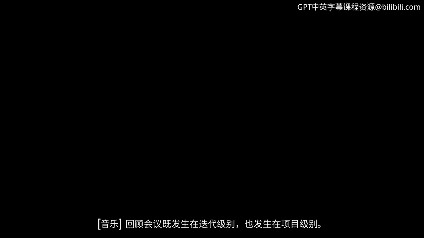
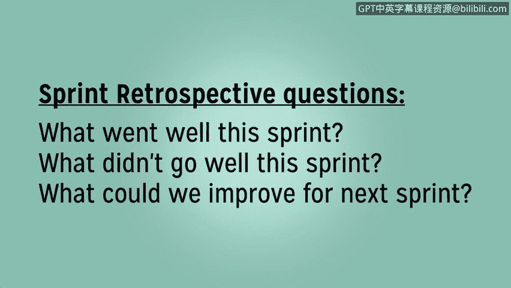

# 艾伯塔大学软件产品管理课程5：《软件改进的评审与度量》｜reviews-and-metrics-for-software-improvements｜ - P23：22_第5.4.3节 冲刺回顾.zh - GPT中英字幕课程资源 - BV1j8411y7q1

🎼。😊。

Retrospecpecttives occur at both the iteration level and at the project level。In this lesson。

 we're going to examine the sprint retrospective meeting。

A sprint retrospective meeting should be the last thing that occurs in a sprint。

It normally follows the Sprint review meeting。A sprint review meeting is used to demo the product to the client or the product owner。

A sprint retrospective meeting is also where the process is evaluated。

Agile requires that you not only review and adapt your product。

 but you also review and adapt your process。It's an opportunity to review how well the product is being built。

 what is working and what could be improved。It's important that a sprint retrospective is safe and allows for open conversation。

Participants need the freedom to express how they really felt about the sprint。

If the team doesn't honestly express what went wrong， no effective solution will arise。

Sprint retrospective meetings should be time boxed at an hour。However。

 it's not as strict as the other scrum events。You want to keep your meetings short and effective。

But if a major issue arises， you don't want to bury that issue for the sake of maintaining a scheduled time box。

You're facilitating your Team sprint retrospective meeting。

Which of the following would be appropriate conversations in the meeting？A。

 a developer says that they're not happy with a product's user interface。B。

 a developer identifies that the team underestimated tasks in the last sprint。C。

 you highlight the excellent work that the team accomplished last sprint。D。

 a developer suggests that they implement an iteration burndown chart next printprint。And or E。

 the product owner suggests a feature to be implemented in the next sprint。

You want to make sure that the Sprint retrospective meeting highlights a process and does not focus on the product。

Therefore， answers A and E are incorrect。A sprint retrospective meeting is a great place to discuss what went well with the development process。

 what didn't go well， and what could be improved。Therefore， answers B， C and D are correct。

In a sprint retrospective meeting， three major questions are posed。One， what went well this sprint？2。

 what didn't go well， this sprint and three， what could we improve for the next sprint。

I would recommend posing the questions in this order。

The scrum master should start the meeting on a positive note。

That gives appreciation and recognition to the team for the work that they've accomplished。Often。

 criticism is not taken well by others。The scrum master should facilitate the meeting so that people do not feel attack。

The conversation should be open and honest， but still respectful。Finish the meeting constructively。

This will also round out the meeting so that people are not leaving the meeting with a negative feeling。

Completing the meeting with aspects to improve gives the team something to look forward to and will start the next sprint off on the right foot。

This is especially important if a sprint didn't go as intended。

You do not want the next sprint to be affected by the feeling of defeat from the previous sprint。

Sometimes you have to look back in order to move forward。In the next lesson。

 we'll expand on the retrospective meeting by examining what happens during a project retrospective meeting。

