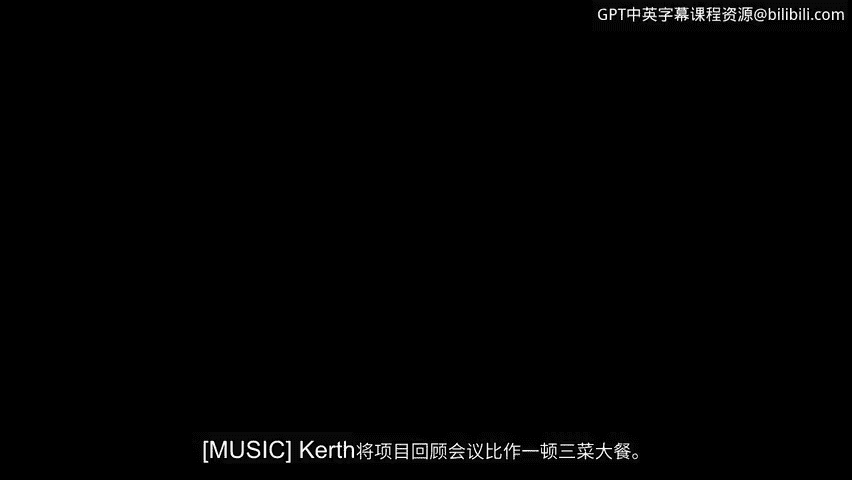
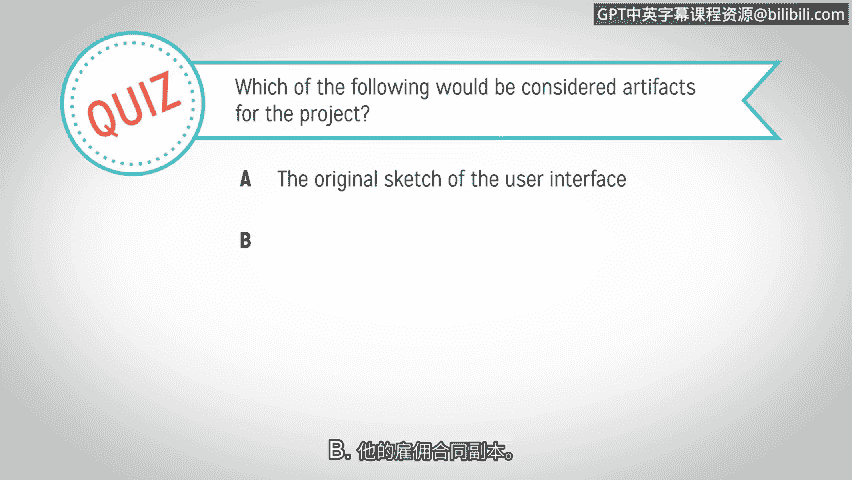

# 艾伯塔大学软件产品管理课程5：《软件改进的评审与度量》｜reviews-and-metrics-for-software-improvements｜ - P24：23_第5.4.4节 项目回顾练习.zh - GPT中英字幕课程资源 - BV1j8411y7q1

🎼。😊。

Kurth compares a project retrospective meeting to a three course meal。

The first course is the appetizer， it's the Reading course。

It's intended to build trust among the team， make the team realize what they accomplished。

 and to lay some ground rules。Next， we have the main， the past course。In this part of the meeting。

 the team reviews everything that has occurred during the life cycle of the product。

This is an opportunity to share what actually happened。

It's common that everyone on the team is not aware of everything that occurred during development。

This puts everyone on the same page and helps to identify the root cause of some of the issues。

Finally， we have dessert， the future course。This is an opportunity for the team to look forward and to suggest areas for improvement。

Any good meal requires some preparation。So there's also some prep work that must occur before the courses。

In this lesson， we're going to talk about some of the exercises that a retrospective facilitator could use in each of the courses The lesson is described as if you took on this role as an outsider to another project。

You're conducting a project retrospective meeting after the release of a product。

At the end of the project， there were a few features that were not implemented on time。

Which of the following should be topics the Project retrospective meeting covers。A。

 details about the features that didn't get implemented on time。B。

 why the features didn't get implemented on time？C。

 the things the team could improve for next time to ensure all features get implemented。Or D。

 the things that worked to get the features implemented on time。Similar to a sprint retrospective。

 a project retrospective aimed to discover what went well， what didn't go well。

 and what could be improved。You do not want to talk about any specific features。You do， however。

 want to talk about how they got implemented and whether that worked or not。

You should also identify areas that could be improved for next time， therefore， answers B。

 C and D are all correct。Like I said before， every good meal requires some prep work before the meeting。

The first is a retrospective pre work handout。This is a handout that is emailed to everyone that is invited to participate in the retrospective。

It poses some questions that can identify any general patterns that might arise during the meeting。

It also encourages participants to share more in the actual retrospective meeting。

They will be more likely to share something that they have already written down。

It also gets them thinking about the project prior to the meeting。

The pre work handout should ask the following questions。

For us to learn the most from this experience， what topics need to be discussed？

What do you hope will happen during the retrospective？

What long term impact do you hope this retrospective will have？What reservations， concerns。

 or worries do you have about this retrospective？What emotions do you feel as you think about this meeting？

What else should I ask and how would you respond？The responses to these questions should be returned to the facilitator。

Participants should be ensured that their responses remain in confidence and are only used to look for general trends。

If you are facilitating a retrospective as an outsider to the team。

 introduce yourself to the team beforehand。This will establish trust and gives you the chance to discuss the project in person。

Maybe identify some of the trends that you noticed in a pre work hand。

It also gives you a chance to remind people to complete the prewear Can。

It's natural that people will ignore this step and depend on their memories。

Another bit of prep work you will need to do is to encourage participants to bring artifacts to the meeting。

These artifacts could be anything that played a role in the project。Memos， schedules。

 burn down charts， random posted notes， mementos， pictures， gifts， notes， etc。

You want to encourage participants to bring as many artifacts as possible。

Perhaps even set up a competition and have awards or prizes for whomever can bring the most artifacts or the most creative or unusual artifact。

And the most important artifact。You're preparing for the Project retrospective meeting。

You tell the development team to bring any artifacts that relate to the project。

One of the developers is confused about what would be considered an artifact and wants to show you what he was thinking about bringing。

Which of the following would be considered artifacts for the project？A。

 the original sketch of the user interface。B， a copy of his employment contract。

C， a small trophy that someone left on his desk after solving a major problem。D。

 a movie that inspired the product， which he borrowed from the client。And or E。

 an old memo that summarized the progress of the time。Artacts are meant to be inclusive。

 This means that anything that someone deemed important or significant to the project can be considered an artifact。

 Therefore， all answers are correct。