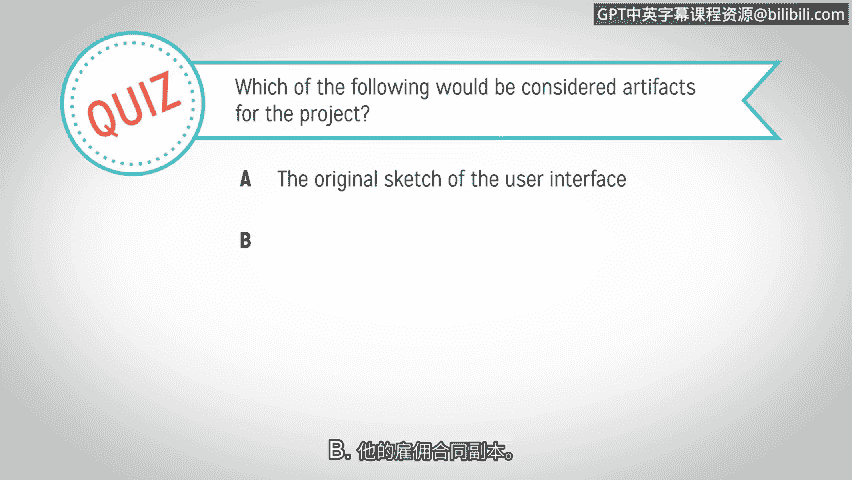

# 软件产品管理课程5：《软件改进的评审与度量》：5.4.4：项目回顾练习

## 📖 概述
在本节课中，我们将学习如何组织一场有效的项目回顾会议。我们将把回顾会议比作一顿包含三道菜的大餐，并详细介绍每道“菜”对应的具体练习活动，以及会前需要做的准备工作。

---

## 🍽️ 项目回顾会议：一顿三道菜的大餐
Kurth 将项目回顾会议比作一顿包含三道菜的大餐。

第一道菜是开胃菜，即“阅读”环节。其目的是在团队中建立信任，让团队认识到他们完成了什么，并制定一些基本规则。

接下来是主菜，即“回顾过去”环节。在会议的这一部分，团队将回顾产品生命周期中发生的一切。这是一个分享实际发生情况的机会。团队中并非每个人都清楚开发过程中发生的所有事情，这种情况很常见。这个环节能让所有人信息同步，并有助于找出一些问题的根本原因。

最后是甜点，即“展望未来”环节。这是团队向前看、提出改进领域的机会。

任何一顿美餐都需要一些准备。因此，在“上菜”之前也必须做一些准备工作。

在本节中，我们将讨论回顾会议引导者可以在每道“菜”中使用的一些练习。本课程假设你以外部人员的身份为另一个项目担任此角色。你在产品发布后主持一场项目回顾会议。

---

## 🧩 回顾会议应涵盖的主题
在项目结束时，有几个功能未能按时实现。以下哪些应该是项目回顾会议涵盖的主题？
A. 关于未按时实现的功能的细节。
B. 为什么功能没有按时实现？
C. 团队下次可以改进哪些方面以确保所有功能都能实现。
D. 为按时实现功能而采取的有效措施。

与冲刺回顾类似，项目回顾旨在发现哪些方面做得好、哪些方面做得不好以及哪些方面可以改进。你不应该讨论任何具体的功能细节。然而，你应该讨论它们是如何被实现的，以及这种方式是否有效。你还应该确定下次可以改进的领域。因此，答案 B、C 和 D 都是正确的。

---

## 📋 会前准备工作：第一道“开胃菜”
正如之前所说，每顿美餐在会议前都需要一些准备工作。第一项是回顾会议会前准备材料。这是一份通过电子邮件发送给所有受邀参加回顾会议的人员的材料。它提出了一些问题，可以帮助识别会议期间可能出现的任何普遍模式。它还鼓励参与者在实际的回顾会议上分享更多内容。他们更有可能分享他们已经写下来的东西。这也能让他们在会前就开始思考这个项目。

会前准备材料应提出以下问题：
*   为了让我们从这次经历中学到最多，需要讨论哪些主题？
*   你希望在回顾会议期间发生什么？
*   你希望这次回顾会议产生什么样的长期影响？
*   你对这次回顾会议有什么保留意见、担忧或顾虑？
*   当你想到这次会议时，你有什么感受？
*   我还应该问什么？你会如何回答？

这些问题的答复应返回给引导者。应确保参与者的答复保密，并且仅用于寻找普遍趋势。

如果你作为团队的外部人员引导回顾会议，请事先向团队介绍自己。这将建立信任，并让你有机会亲自讨论项目。或许可以指出你在会前准备材料中注意到的一些趋势。这也给了你一个机会提醒人们完成会前准备材料。人们忽略这一步而依赖记忆是很自然的。

---

## 🧳 会前准备工作：鼓励携带项目制品
你需要做的另一项准备工作是鼓励参与者携带项目制品参加会议。这些制品可以是项目中发挥作用的任何东西：备忘录、时间表、燃尽图、随意的便利贴、纪念品、图片、礼物、笔记等。

你应该鼓励参与者尽可能多地携带制品。甚至可以设置一个竞赛，为能带来最多制品、或最具创意、最不寻常制品、以及最重要制品的人颁发奖项或奖品。

---

## ❓ 什么是项目制品？
你正在为项目回顾会议做准备。你告诉开发团队携带任何与项目相关的制品。一位开发人员对什么会被视为制品感到困惑，想让你看看他考虑要带的东西。以下哪些会被视为项目制品？
A. 用户界面的原始草图。
B. 他的雇佣合同副本。
C. 解决一个重大问题后有人留在他桌上的一个小奖杯。
D. 启发产品灵感的一部电影，是他从客户那里借来的。
E. 一份总结当时进展的旧备忘录。

制品的定义是包容性的。这意味着任何被某人认为对项目重要或有意义的东西都可以被视为制品。因此，所有答案都是正确的。

---

## ✅ 总结
本节课中，我们一起学习了如何将项目回顾会议结构化为一顿包含“开胃菜”（建立信任与规则）、“主菜”（回顾过去）和“甜点”（展望未来）的大餐。我们明确了会议应关注过程而非具体功能细节，并重点介绍了会前准备的关键步骤：分发会前问卷以收集初步想法，以及鼓励团队成员携带多样化的项目制品来激发讨论和回忆。这些方法有助于确保回顾会议富有成效，真正服务于团队的持续改进。