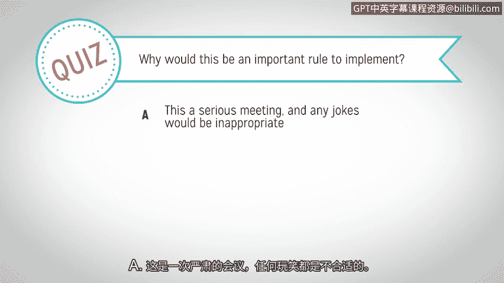

# 艾伯塔大学软件产品管理课程5：《软件改进的评审与度量》｜reviews-and-metrics-for-software-improvements｜ - P25：24_第5.4.4a节 项目回顾练习准备.zh - GPT中英字幕课程资源 - BV1j8411y7q1

🎼。😊。

First， we'll start with the ready in course exercises。

It's important to recognize that not all exercises need to be executed in every project retrospective。

Like most things we talk about。You need to consider your team and adapt the meeting to your team。

The first exercise is the introduction exercise。This exercise occurs at the beginning of the retrospective and should take about 30 minutes。

It's a good time to make sure that everyone has been introduced。

If you suspect or know that the team is not completely acquainted with you or each other。

 now would be a good time for a round of introductions。

You should also establish a general schedule and agenda for the meeting。

Keep in mind that things may change depending on how the meeting progresses。

A good way to start off the introduction would be to get people to define the term wisdom。

What does it mean to be wise？How does one become wise？

Why is it that a 75 year old man would be considered more wise than a 16 year old boy？

This gets the conversation started by recognizing that wisdom is gained by learning from experience。

 and that is exactly what this meeting is aiming to do。Next。

 you should establish and stress this is not a blame game。

This is a good opportunity to introduce the Keth Prime directive。Regardless of what we discover。

 we must understand and truly believe that everyone did the best job he or she could。

 given what was known at the time， his or her skills and abilities。

 the resources available and the situation at hand。

Why is it important to complete the exercises in the Reading course？A。

 to establish trust amongst the team。B， to convince the team that this meeting will have a positive outcome。

C， to design ground rules that create a safe environment。

And or D to fill time so that the meeting lasts the full three days。The Reading course creates trust。

 a positive goal for the project， and establishes guidelines to maintain a safe environment for the team。

It's not a way to waste time， therefore answers A， B， and C are the correct answers。Next。

 we'll look at the defining success exercise。This exercise intends to define what the team considers to be successful。

 determine if the team thinks their project was a success and to identify what they could have done to consider the project a success。

At the project retrospective， all your team can remember from the project is the recent struggle and push to get it complete。

They will be focused on what went wrong。It's useful to take a step back and realize the successes of the team and what the team accomplished。

Even if the project failed， there was a lot that the team should be proud of。

This part of the retrospective should take between 30 minutes to an hour。

Start off this group discussion by asking the team， was this project a success？Record the responses。

Then you want to demonstrate to the group everything they accomplished。

Show them the effort they put into the project。Finally。

 you want to close this exercise with this definition of success。

A successful project is one on which everyone says。

 I wish we could do that over again the very same way。

Ask the team if this project meets this definition of success。If it does not。

 what could the team have done to make it meet this definition？

This definition will highlight many areas of the project that were not a success。

 as well as suggests many improvements。Safety is an important thing to establish in a retrospective meeting。

The team will not effectively share everything that needs to be shared if they feel like there will be repercussions。

What are some ways that you could establish safety in the retrospective meeting？A。

 setting ground rules。B， how the team recognized the goal of the meeting。C。

 making exercises optional， and or D， easing into the difficult topics。

These are all ways that you can establish safety in the retrospective meeting。

 and we're going to cover how you can implement these in your meetings to create a safe environment for your team。

Now， let's move on to the creating safety exercise。

This exercise is intended to make sure that everyone on the team feels safe enough to share their feelings about the project。

If the team is already quite comfortable with each other or with the practice of participating in a retrospective。

 then you could consider skipping this exercise。The first thing that you should establish is that every exercise in the retrospective is optional。

If people feel they're a forced to participate， then they're more likely to say what they think they should say and not really what they think。

Then you should take a secret ballot poll to determine how safe the team feels。

Have them write a number between one and five that represents how safe they feel。

A one would indicate that they do not feel safe and that they will not share how they actually feel。

A5 indicates that they feel safe enough to share anything。

If each team member indicates a three or above， then you're safe to move forward with the meeting。

You should then establish some ground rules for the retrospective。

How the team create the rules that would encourage them to feel more safe。

If the team does not come up with it and their own。And you should add these rules。

All participation in the retrospective is optional。We will not make jokes about anyone in the room。

And the final rule should be。The ground rules can be amended after any break。

One of the rules that you should add to the list created by the team is。

We will not make jokes about anyone in the room。Why would this be an important rule to implement？A。

 this is a serious meeting and any jokes would be inappropriate。

B， it's sometimes hard to tell whether the joke is meant to be playful or hurtful。C。

 it discourages people from sharing if they think they could experience a joke at their expense。

And or D。You want to focus on making jokes about those who are not in the room。

It's sometimes hard to identify the intentions of a joke。Or it might be interpreted wrong。

What could be meant as a playful joke could be interpreted by the receiver as hurtful。

It's safest to just simply avoid them。This rule is also important because people might be discouraged from sharing if they think that a joke might be made at their expense。

Therefore， answers B and C are correct。The final readying exercise we'll talk about in this lesson is the Arts contest exercise。

I mentioned the artifacts earlier in this lesson。Participants were encouraged to bring any and all artifacts they could find relating to the project。

This exercise should take one to two hours。This will depend on the number of people on the team and the number of artifacts they bring。

Start off by having people explain their artifacts。Why was it important to them or the project？

Ask questions about artifacts and encourage others to do the same。

After all the artifacts have been presented， it's time to vote on the artifacts。

First identify the largest collection of artifacts。

 then have people nominate and vote for the most creative or unusual artifact。

 and the most important artifact。You should have small prizes for the winners of these categories。

The artifacts help everyone to see everything that they accomplished during the project。

It helps them remember the good times and the good work that they did。

It also encourages the team to think of the entire project and not just the last push。

