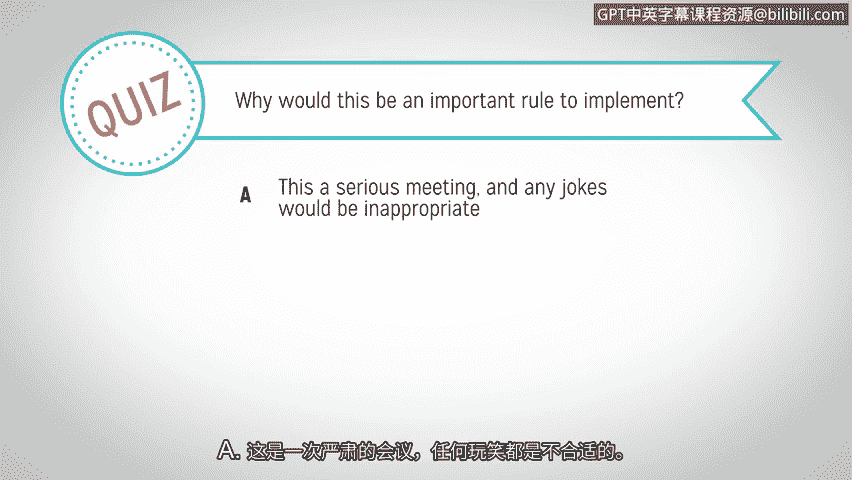

# 软件产品管理课程5：《软件改进的评审与度量》：5.4.4a：项目回顾练习准备

在本节课中，我们将学习如何为项目回顾会议做准备，特别是几个关键的“准备性”练习。这些练习旨在为回顾会议营造合适的氛围，建立团队信任，并帮助团队全面审视项目。

## 概述：准备性练习的重要性

首先，我们从准备性练习开始。需要认识到，并非每个项目回顾都需要执行所有练习。正如我们讨论的大多数事情一样，你需要考虑你的团队，并使会议适应你的团队。

## 介绍练习

第一个练习是介绍练习。这个练习发生在回顾会议的开始，大约需要30分钟。这是确保每个人都已被介绍的好时机。如果你怀疑或知道团队成员之间或与你并不完全熟悉，现在就是进行一轮介绍的好时机。你还应该为会议建立一个大致的时间表和议程。请记住，事情可能会根据会议的进展而改变。

开始介绍的一个好方法是让人们定义“智慧”这个词。什么是智慧？一个人如何变得智慧？为什么一个75岁的男人会比一个16岁的男孩被认为更有智慧？这通过认识到智慧是从经验中学习获得的来开启对话，而这正是本次会议旨在做的事情。

接下来，你应该建立并强调这不是一场指责游戏。这是介绍“凯斯首要指令”的好机会：**无论我们发现什么，我们都必须理解并真正相信，每个人在当时已知的情况、他或她的技能和能力、可用资源以及当时的情况下，都已经尽了最大努力。**

> **为什么完成准备课程中的练习很重要？**
> A. 在团队中建立信任。
> B. 让团队相信这次会议将产生积极的结果。
> C. 设计创造安全环境的基本规则。
> D. 消磨时间，使会议持续整整三天。

准备课程旨在建立信任、为项目设定积极目标，并建立指导方针以维护团队的安全环境。它不是浪费时间的方式，因此正确答案是A、B和C。

## 定义成功练习

上一节我们介绍了如何开启会议，本节中我们来看看如何定义项目的成功。这个练习旨在定义团队认为什么是成功，确定团队是否认为他们的项目是成功的，并找出他们本可以做些什么来使项目被视为成功。

在项目回顾中，你的团队能记住的可能只是最近为完成项目所做的挣扎和冲刺。他们会专注于出错的地方。退一步认识到团队的成功和成就是很有用的。即使项目失败了，团队也有很多值得骄傲的地方。

回顾会议的这一部分应花费30分钟到1小时。通过询问团队“这个项目成功吗？”来开启小组讨论。记录回答。然后，你想向团队展示他们完成的一切，向他们展示他们为项目付出的努力。最后，你想用这个成功定义来结束这个练习：**一个成功的项目是每个人都说‘我希望我们能以完全相同的方式再做一次’的项目。**

询问团队这个项目是否符合这个成功定义。如果不符合，团队本可以做些什么来使其符合？这个定义将突出项目中许多不成功的领域，并提出许多改进建议。

> **在回顾会议中建立安全感很重要。团队如果觉得会有不良后果，就不会有效地分享所有需要分享的内容。你可以通过哪些方式在回顾会议中建立安全感？**
> A. 设定基本规则。
> B. 团队如何认识会议的目标。
> C. 使练习成为可选项。
> D. 逐步引入困难话题。

这些都是你可以在回顾会议中建立安全感的方式，我们将介绍如何在你的会议中实施这些方法，为你的团队创造一个安全的环境。

## 建立安全感练习

现在，让我们继续讨论建立安全感练习。这个练习旨在确保团队中的每个人都感到足够安全，可以分享他们对项目的感受。如果团队彼此之间已经相当熟悉，或者已经习惯参与回顾会议，那么你可以考虑跳过这个练习。

你应该建立的第一件事是回顾会议中的每个练习都是可选的。如果人们觉得是被迫参与，他们更可能说他们认为应该说的话，而不是他们真实的想法。然后，你应该进行一次无记名投票，以确定团队感到的安全程度。让他们写一个1到5之间的数字，代表他们感到的安全程度。1表示他们感到不安全，不会分享真实感受。5表示他们感到足够安全，可以分享任何事情。如果每个团队成员都表示3或以上，那么你就可以安全地继续会议。

接着，你应该为回顾会议建立一些基本规则。团队如何创建能鼓励他们感到更安全的规则？如果团队自己没有提出，你应该添加这些规则：**回顾会议中的所有参与都是可选的。我们不会拿房间里的任何人开玩笑。** 最后一条规则应该是：**基本规则可以在任何休息后修改。**

> **你应该添加到团队创建的规则列表中的一条规则是：“我们不会拿房间里的任何人开玩笑。”为什么这是一条重要的规则？**
> A. 这是一个严肃的会议，任何玩笑都是不合适的。
> B. 有时很难判断一个玩笑是出于好玩还是伤人。
> C. 如果人们认为可能会有人拿他们开玩笑，这会阻碍他们分享。
> D. 你想专注于拿不在房间里的人开玩笑。

有时很难判断一个玩笑的意图，或者它可能被误解。一个本意是好玩的玩笑可能被接收者理解为伤人的。最安全的方式就是完全避免它们。这条规则也很重要，因为如果人们认为可能会有人拿他们开玩笑，他们可能会不愿意分享。因此，正确答案是B和C。

## 项目成果竞赛练习

本课我们将讨论的最后一个准备性练习是项目成果竞赛练习。我在本课早些时候提到过项目成果。鼓励参与者带来他们能找到的与项目相关的任何及所有成果。这个练习应花费一到两个小时，具体取决于团队人数和他们带来的成果数量。

首先让人们解释他们的成果。为什么它对个人或项目很重要？询问关于成果的问题，并鼓励其他人也这样做。在所有成果都展示完毕后，是时候对成果进行投票了。首先确定最大的成果集合，然后让人们提名并投票选出最具创意或最不寻常的成果，以及最重要的成果。你应该为这些类别的获胜者准备小奖品。

成果帮助每个人看到他们在项目期间完成的一切。它帮助他们记住美好的时光和出色的工作。它也鼓励团队思考整个项目，而不仅仅是最后的冲刺阶段。

## 总结

本节课中，我们一起学习了为项目回顾会议做准备的几个核心练习。我们了解了**介绍练习**如何开启对话并设定基调，**定义成功练习**如何帮助团队从积极角度审视项目，**建立安全感练习**如何通过设定基本规则（如“参与可选”、“不开玩笑”）来营造安全的分享环境，以及**项目成果竞赛练习**如何通过展示实物成果来帮助团队回忆成就、全面看待项目。这些练习共同为深入、有效的项目回顾奠定了基础。