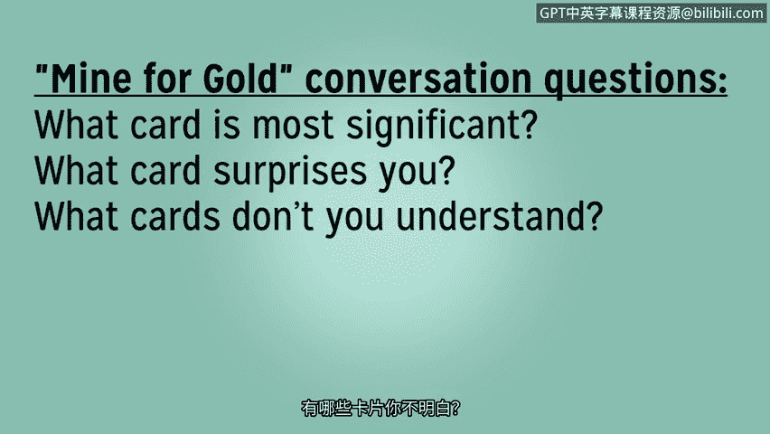

# 艾伯塔大学软件产品管理课程5：《软件改进的评审与度量》｜reviews-and-metrics-for-software-improvements｜ - P26：25_第5.4.4b节 项目回顾练习过去.zh - GPT中英字幕课程资源 - BV1j8411y7q1

🎼。😊。

It's now time for the main course， the past course。

The first exercise we'll talk about is the creative timeline exercise。In this exercise。

 you're going to timeline all the significant events from the project。

This is going to force the team to think back to the beginning of the project and everything that occurred since then。

Clear a wall or whiteboard and cover it in paper。Give everyone a stack of index cards or post it notes。

They are going to use these to place significant events on the timeline。If applicable。

 start off with team members placing a card on the timeline when they join the project。

If team members left prior to the end of the project。

 place their start and end date cards on the timeline。Then。

 have the team start creating significant events。This should be an inclusive list。

If anyone deems an event a significant， then it should be added to the timeline。

At the end of this activity， you should have a visual representation of the entire project and everything that happened。

After the timeline has been created， the next exercise is the Min for gold exercise。In this exercise。

 the team is going to review the timeline in periods chronologically。For each period。

 the team will review the significant events and start talking about each of them。In the room。

 there should be five whiteboards or pieces of chart paper labeled with the topics。

What worked well that we don't want to forget？What we learned。

What we should do differently next time。What still puzzles us。What we need to discuss in more detail。

As the periods of the timeline get discussed， people can suggest to add things to these topics。

When you're reviewing the periods， you should ask the following questions to spark conversation amongst them。

What card is the most significant？What card surprises you？What cards don't you understand？

Do you see any patterns emerging？What card should we discuss next？What card still needs discussion？

This exercise should take time。It should take between five to eight hours。

 preferably spread over two days。This should be an in depth investigation of everything that happened in the project。

I mentioned that the creative timeline exercise should be spread over two days。

Why do you think that it's important to do so？A， because eight hours is a long time to talk about one topic。

B。Gives the team time to reflect on the project。And or C so that the meeting lasts longer。

This exercise is the bulk of the retrospective meeting。

Eight hours is a long time to focus on one topic， so breaks will be important。

Having the evening to reflect will also produce better results。Therefore。

 answers A and B are correct。Once the timeline has been created in mind。

 you can conduct the emotion seismograph exercise。This activity helps to explore the events that trigger emotions。

This can help to build meaning about the project。In this exercise。

 have participants draw a line below the timeline that represents their emotions at the time。

This will help to identify the significant events from the project。

The final exercise that we're going to examine for the past course is the offer Appations exercise。

This exercise can be conducted as many times as you need and at any time in the retrospective meeting。

The offer Apps exercise is a chance for the team to express appreciations for one another。

When giving someone an appreciation， it should be worded like Shana。

 I appreciate you for helping me learn Java， instead of I appreciate Shana for helping me learn Java。

By wording it as I appreciate you for， it's more personable。In this exercise。

 everyone stands in a circle and someone starts off by offering an appreciation to someone else。

The person who received the appreciation then offers someone else an appreciation。

 This continues until everyone has received an appreciation。😊。

This can help mend relationships and builds team morale。

