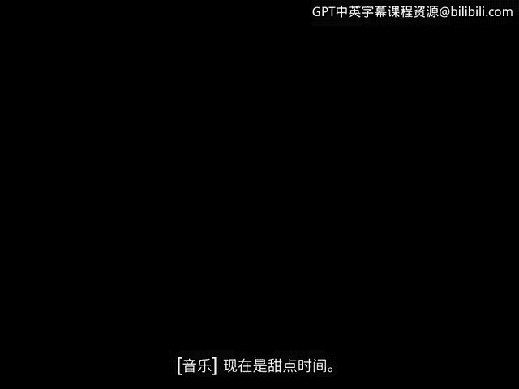
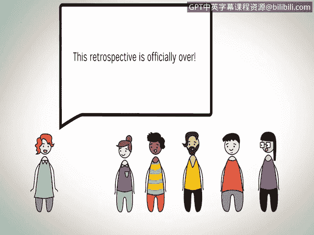

# 艾伯塔大学软件产品管理课程5：《软件改进的评审与度量》｜reviews-and-metrics-for-software-improvements｜ - P27：26_第5.4.4c节 项目回顾练习未来.zh - GPT中英字幕课程资源 - BV1j8411y7q1

Now it's time for dessert， the future course。

This course is focused on looking to the future and identifying ways to improve things for the next project。

The first exercise for this course is making the magic happen exercise。Usually。

 at this point in the retrospective， topics have emerged that people are avoiding talking about。

This exercise is designed to initiate a discussion about a sensitive subject。

At this late stage in the retrospective， the team tends to be comfortable sharing their feelings。

 and they have a better collective understanding about the project。

The team also begins to realize that the retrospective is wrapping up。

 and if they don't bring up a sensitive topic， it might not get talked about at all。As a facilitator。

 you need to invite the difficult conversation and then sit back and let it happen。

 This is where the magic happens。People will generally start sharing whatever they have been avoiding。

You can start this conversation by asking something along the lines of this retrospective is coming to an end。

This would be a good time to bring up anything that you are hoping you will get to， but haven't。

Or you could make a reference to something that you've gotten hints of throughout the retrospective。

If neither of those works， you could just outright bring it up。

Say something like we have spent days talking about everything except one really important issue。

Let the team discuss the issue or issues and have them try to come up with a solution。

Watch it unfold and guide it in the right direction。

The team is in the making the magic happen exercise。They're discussing a sensitive topic。

One of the developers feels that they're overworked and taken advantage of。

The discussion is starting to get aggressive and hurtful。

What should you do to get the discussion back to a respectful place？A。

 stop the discussion completely。B， review the guidelines that were established。C， let it continue。

 they'll work it out。And or D， start asking questions about how the actions make them feel or why they acted in a certain way。

It's important that this discussion continues， but it has to continue in a respectful manner。

If people are actively breaking the guidelines that were established。

 remind them of the rules and why they were established。If that doesn't work。

 you can guide the discussion by asking people how certain actions made them feel or why they acted a certain way。

In most cases， people don't act maliciously， and there's some misunderstanding that occurred。

Direct the discussion to uncover that misunderstanding。Therefore。

 answers B and D are the correct answers。The final exercise we're going to look at is the closing the retrospective exercise。

This activity wraps up the retrospective and ties up any loose ends。

Start off this exercise by handing out paper and pens to everyone on the team。

Have them write down a hope or wish that they would like to see happen after the retrospective。

Tell them to write down something you might care to share anonymously with the team。

Collect all the cards， and shuffle them。Pass out a card to each person and let them read it。

Pass the cards around the group until everyone has read all the cards。

Once everyone has read all the cards， conclude the meeting with an upbeat phrase。

 such as I think we've made a lot of progress over the past few days。

 I think a lot of these hopes and wishes will come true。 Now， it's up to you。 make it happen。

Then you want to conclude the meeting by saying this retrospective is officially over。

So that summarizes many of the exercises that you can implement in your project retrospective meetings。

If you want to read more about exercises or if you want to read about these in more detail。

 you can check out Normanel Kurt book， Project Retrotives， a handbook for team reviews。

And that concludes this course， the final one before the capstone。

I'm really excited to see you there， and I hope you'll join me。😊。

