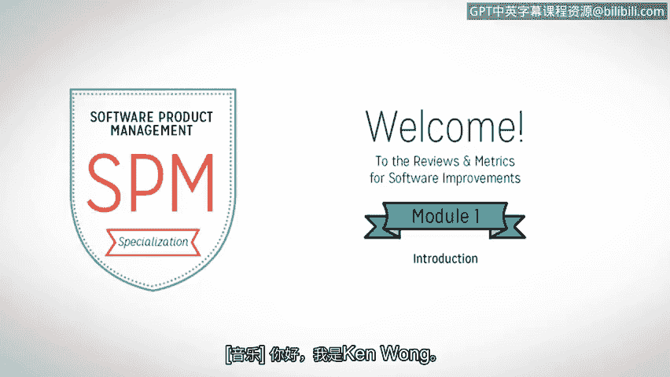

# 艾伯塔大学软件产品管理课程5：《软件改进的评审与度量》｜reviews-and-metrics-for-software-improvements｜ - P2：1_评审指标简介以改进软件.zh - GPT中英字幕课程资源 - BV1j8411y7q1

Hi， I'm Ken Wang。

Welcome to Review and metricss for Software Improv course within the software product management and specialization。

This course tend to be taken after you've taken the course in Agile planning for software products。

This course serves as the arms of a oaksh that depicts the structure of our specialization。

 built atop the body and legs。Suppose you're working on software product。

 You've identified a product opportunity。Talk to potential users。Define amazing requirements。

Map total releases， and the developers are designing and implementing the product。

Is everything on target？Falling agile what needs to change。

I've previously outlined that better software involves three goals。The right product。

 done right and magrate。But how do you know you're aligned with these goals？Also。

 how to improve on your ability to form the right product while doing and managing it right。

For each of these goals， you need to de the insights for improvements from continuous feedback in specific types。

 reviews and metrics。There'll be a blend of subjective and objective data to analyze when considering improvements to the product itself。

underlying process and the overall project。For the right product， you need to demo it。

To gain early feedback。You need to observe how users are using the product。

 engage their effectiveness and efficiency。You need to collect data about user satisfaction。

And signs of the price level of success in the market。

You use all this information to identify what to improve in the project's features。Now。

 for doing the process right， the developers need to review and inspect the work products they create to catch and repair issues early。

They need to monitor data regarding important quality factors like correctness in terms of defect rates。

They use all this information to identify what to improve within the project implementation。

And what to adjust in the process for the desired quality。For managing the project right。

 the development team needs to meet briefly each day to update and synchronize with each other。

They need to track measurements like velocity。They need to monitor and communicate the completion of planned user stories and tasks so everyone knows what the project status is。

They apply all this information to coordinate work and to identify what to improve to complete work more effectively without waste。

This course covers civil practices to reveal potential product， process and project issues early。

 regularly and continuously。As issues get resolved。

 the result is great software it gets better with each iteration。

There are four modules in this course。In the first module。

 Morgan Petzel will focus on the goal of the right product。

She will discuss more about sprint review meetings where the product is demoed and reviewed。

 produced feedback。Then she will describe user studies to observe how effective and efficient users are with the product。

She also outlined example measures for product success。

And talk about processes used in industry to create successful， well designed products。

In a second module， B Poette will focus on the goal of doing the process right。

It will describe peer review techniques done by developers to inspect and improve their work。

It will explain the purpose of metrics and how they address specific questions that align with goals inherent to the product or process。

Who outline desirable properties of useful software metrics？

Present popular metrics and finish with a discussion of defect related metrics。In the third module。

 Morgan returns to focus on our goal of managing the project right。

She will describe a common agile practice called the Daily Scrum。And recap the notion of velocity。

She'll detail the release burnt on chart used to track complete user stores in successive sprints。

She'll also describe a task board and iteration burn down chart to track the complete tasks within the sprint。

These practices help discover work is half done and not effectively brought to a finish。

In the fourth module， Brad returns to talk about retrospectives。

A practice to determine lessons learned， which can be applied at the Ava Sprint or at the AFA project。

It will describe exercises within a project retrospective。To identify successes， reveal shortcomings。

Visit what happened？Recognize all the contributors and produce constructive lessons to carry on into future projects。

By the end of the course， you have learned an effective set of reflective practices to improve your project。

 process， and project。This knowledge will help you to create a great software product。

 the right product， done right and match right。😊。