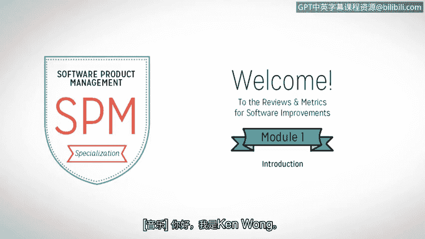

# 软件产品管理课程5：《软件改进的评审与度量》｜课程5.1：评审指标简介以改进软件

在本节课中，我们将要学习如何通过评审和度量来持续改进软件产品。我们将探讨如何确保开发出“正确的产品”，并以“正确的方式”执行和管理开发过程。

## 概述

假设你正在开发一个软件产品。你已经识别了产品机会，与潜在用户进行了沟通，定义了明确的需求，规划了整体发布计划，并且开发团队正在进行设计与实现。但一切都在正轨上吗？在敏捷开发中，什么需要改变？

我之前概述过，更好的软件涉及三个目标：**正确的产品**、**正确地执行**以及**正确地管理**。但你如何知道自己是否与这些目标保持一致？又如何提升自己在这三方面的能力？

对于每一个目标，你都需要从特定类型的评审和度量所获得的持续反馈中，获取改进的见解。在考虑改进产品本身、底层流程和整体项目时，你需要分析主观和客观数据的混合信息。

## 三个目标与对应的反馈机制

上一节我们介绍了软件改进的三个核心目标，本节中我们来看看每个目标分别对应哪些具体的反馈活动。

### 1. 正确的产品

为了确保开发出“正确的产品”，你需要获取关于产品是否满足用户和市场需求的反馈。

以下是获取此类反馈的关键活动：

*   **产品演示**：向利益相关者展示产品，以获得早期反馈。
*   **用户研究**：观察用户如何使用产品，评估其有效性和效率。
*   **满意度数据收集**：收集关于用户满意度的数据。
*   **市场成功指标监测**：关注产品在市场上取得初步成功的迹象。

团队利用所有这些信息来确定产品功能中需要改进的部分。

### 2. 正确地执行

为了确保开发过程“正确地执行”，开发团队需要关注工作产出的质量和开发流程的效率。

以下是确保过程正确的关键实践：

*   **同行评审**：开发人员审查和检查他们创建的工作产品，以便及早发现和修复问题。
*   **质量指标监控**：监测与重要质量因素相关的数据，例如以缺陷率衡量的正确性。

团队利用这些信息来确定在项目实现过程中需要改进什么，以及为了达到期望的质量水平需要对流程进行哪些调整。

### 3. 正确地管理

为了确保项目“正确地管理”，开发团队需要关注工作进度、团队协作和任务完成情况。

以下是支持有效项目管理的关键实践：

*   **每日站会**：团队每天进行简短会议，同步更新彼此的工作进展。
*   **速率跟踪**：跟踪测量团队的工作速率。
*   **进度监控与沟通**：监控并沟通计划内用户故事和任务的完成情况，让每个人都知道项目状态。

团队应用这些信息来协调工作，并确定如何改进才能更有效、无浪费地完成工作。

## 本课程结构

本课程涵盖了一系列实践，旨在及早、定期且持续地揭示潜在的产品、流程和项目问题。随着问题得到解决，软件会在每次迭代中变得更好。

本课程包含四个模块：

1.  **第一模块**：聚焦于“正确的产品”目标。将详细讨论**冲刺评审会议**、**用户研究**以及衡量产品成功的示例指标。
2.  **第二模块**：聚焦于“正确地执行”目标。将描述开发人员用于检查和改进工作的**同行评审技术**，解释度量的目的，并介绍有用的软件度量应具备的属性，最后讨论与缺陷相关的度量。
3.  **第三模块**：回归到“正确地管理”目标。将描述名为**每日站会**的常见敏捷实践，回顾**速率**的概念，并详细介绍用于跟踪连续冲刺中已完成用户故事的**发布燃尽图**，以及用于跟踪冲刺内任务完成的**任务板**和**迭代燃尽图**。
4.  **第四模块**：讨论**回顾会议**。这是一种用于总结经验教训的实践，可以在每个冲刺结束后或整个项目结束后进行。将描述项目回顾会议中的练习，以识别成功、揭示不足、复盘过程、认可所有贡献者，并产生建设性的经验教训以应用于未来项目。

## 总结

本节课中，我们一起学习了软件改进的三个核心目标（正确的产品、正确地执行、正确地管理）及其对应的反馈机制。通过本课程，你将学习到一套有效的反思性实践，用以改进你的产品、流程和项目。这些知识将帮助你创造出优秀的软件产品——一个正确的产品，以正确的方式完成，并得到正确的管理。😊