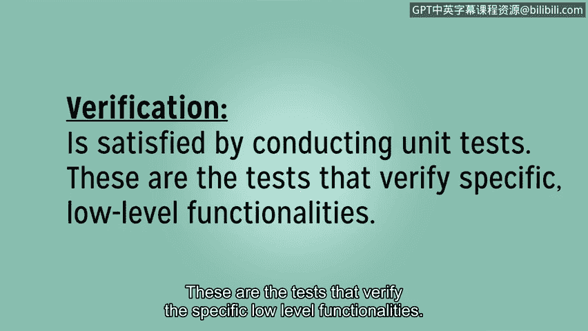
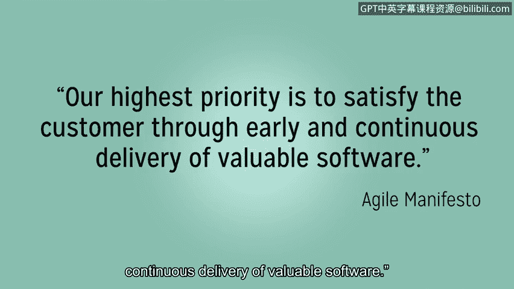
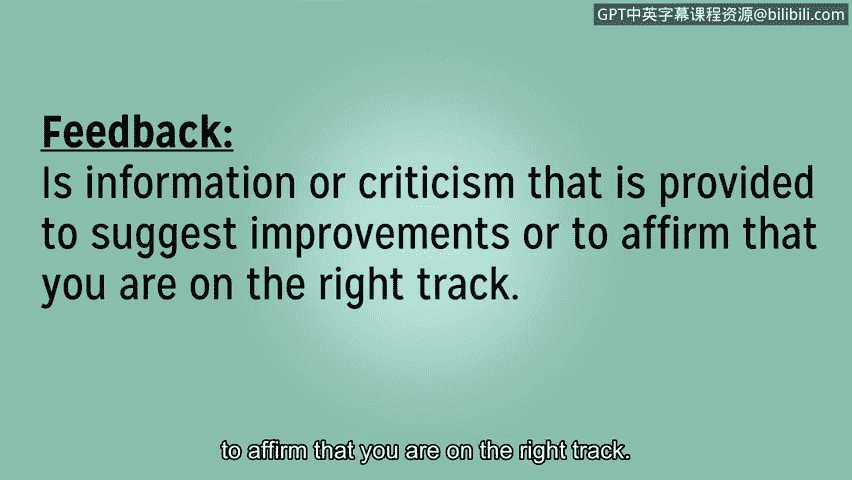

# 软件产品管理课程5：《软件改进的评审与度量》｜ 章节1：课程介绍与核心概念

在本节课中，我们将要学习如何定义、交付和管理正确的软件产品。我们将介绍验证与确认的区别，并引入监控、度量和反馈等核心概念，为后续学习具体的评审方法奠定基础。

## 核心概念：验证与确认

在之前的课程中，我们介绍了两个关键术语：验证和确认。这两个概念在本课程中将频繁出现，理解它们的区别至关重要。

**验证** 是指软件产品满足所有**规定要求**的情况。它关注的是“是否正确地构建了产品”。验证通常通过单元测试来完成，这些测试在测试驱动开发中，甚至在编写功能源代码之前就已写好。

**代码示例：单元测试（验证）**
```python
# 示例：一个验证加法函数是否正确的单元测试
def test_addition():
    assert add(2, 3) == 5  # 验证功能是否按规格工作
```

**确认** 是指发布的软件产品让**客户和/或用户**感到满意。它关注的是“是否构建了正确的产品”。确认可以通过向客户频繁演示、保持开放沟通，或进行用户研究、调查和焦点小组讨论来获得。




**公式表示：**
*   **验证**：产品功能 == 规格要求
*   **确认**：产品体验 >= 用户/客户期望



简单来说，**验证确保你正确地构建产品，而确认确保你构建了正确的产品**。本模块的重点是交付正确的产品，因此确认是本模块的一个关键。

## 引入新概念：监控、度量与反馈


上一节我们介绍了验证与确认，本节中我们来看看在开发过程中用于确保质量的其他核心实践：监控、度量和反馈。

在软件开发中，**监控** 包括在整个开发过程中跟踪、评审和评估产品及流程。监控对于确保你“交付正确的产品、正确地交付并正确地管理”至关重要。敏捷开发强调提高透明度，而各种监控技术使之成为可能。

**度量** 是一种测量事物的方法。在开发中，你可以使用度量来衡量产品、流程和项目的各个方面。度量是一种能产生可量化结果的、有效的监控方式。但请注意：并非所有可被计算的东西都重要，也并非所有重要的东西都可被计算。

监控和度量有助于提供**反馈**。反馈是提供的信息或批评，用以建议改进或确认你正走在正确的道路上。

以下是反馈在软件开发中的几种形式：
*   计算结果
*   用户研究的结果
*   团队提出的建议
*   客户的反应

反馈可以是定性或定量的信息。它是识别产品改进方向的绝佳方式。敏捷致力于尽可能频繁地持续改进，这可能意味着改进产品、沟通、流程或所用实践。反馈也可用于其他场景，例如在精益方法中权衡不同方案时，你可以利用反馈来决定哪个选项是正确的。



## 课程内容预告

现在，我们已经为开始本课程做好了准备。在下一课中，我们将讨论第一种评审类型：冲刺评审。这是你从客户那里获得关于产品确认的关键环节。

本节课中我们一起学习了验证与确认的核心区别，并引入了监控、度量和反馈的概念。理解这些是掌握后续具体评审与度量方法的基础。