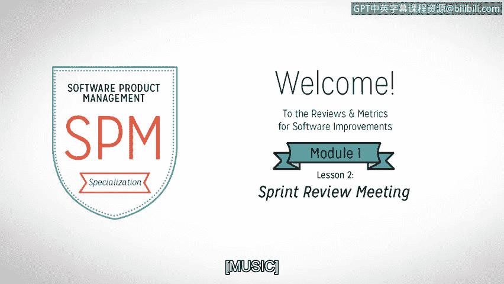
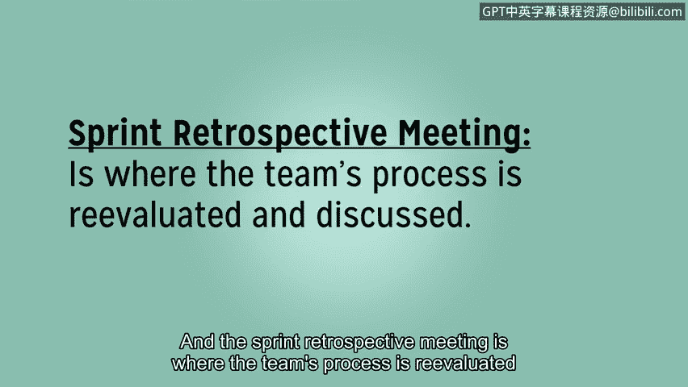
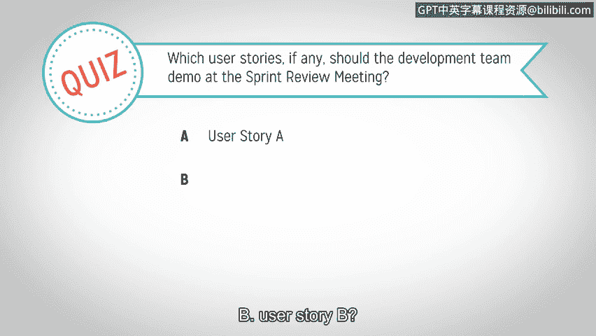
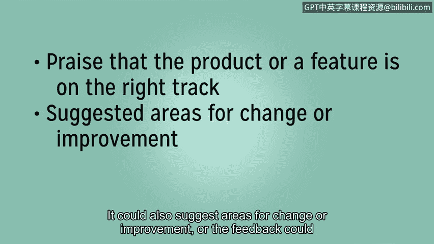
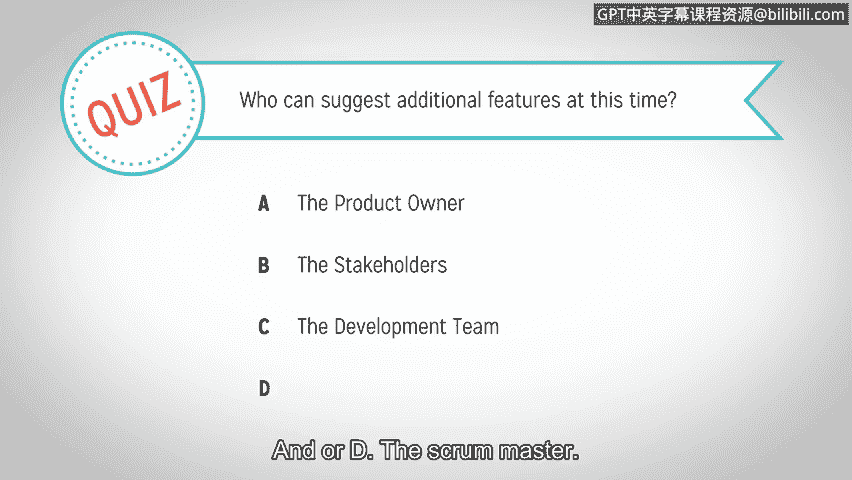

# 软件产品管理课程5：《软件改进的评审与度量》｜章节3.01：Sprint评审会议

## 概述
在本节课中，我们将要学习敏捷开发中的一个关键事件：Sprint评审会议。我们将了解其目的、参与者、流程以及如何有效地利用它来确保交付正确的产品。

---

## 敏捷术语回顾
在深入细节之前，我们先回顾一下本课中将使用的敏捷术语。

*   **Sprint评审会议** 是一个常见的Scrum事件。
*   **Scrum主管** 是负责促进Scrum实践的角色。
*   **产品负责人** 是负责产品待办事项列表的角色。
*   **Sprint** 指的是迭代周期。

在一个Sprint结束时，会发生两个不同的Scrum事件：Sprint评审会议和Sprint回顾会议。简单来说，Sprint评审会议是展示产品的地方，而Sprint回顾会议是团队重新评估和讨论其流程的地方。

> 你将在本课程的最后一个模块中学习Sprint回顾会议。Sprint评审会议在Sprint回顾会议之前举行。

---

## Sprint评审会议详情
现在让我们深入了解细节。我们在“软件过程与敏捷实践”课程中关于Scrum的课程里介绍过Scrum事件。Scrum事件贯穿整个开发过程。Sprint、每日站会、Sprint评审会议和Sprint回顾会议都是Scrum事件的例子。

除了Sprint本身，其他Scrum事件都是获取反馈和评估进展的正式机会。所有Scrum事件都是**有时间盒限制的**，这意味着它们不能超过预定的时间。

为Sprint评审会议建议分配的时间是：**Sprint的每一周对应一小时**。因此，如果你有两周的Sprint，你应该将Sprint评审会议的时间盒限制在两小时。如果你的Sprint长达一个月，你的Sprint评审会议应该分配四小时。

**示例问题**：
你正在为你的开发团队安排Sprint评审会议。你的团队刚刚完成了一个为期三周的Sprint，他们渴望展示他们的进展。这个会议最多应该持续多长时间？
A. 一小时
B. 每周结束时一小时
C. 3小时
D. 需要多长时间就多长时间

**解答**：
你应该将Sprint评审会议的时间盒限制为Sprint的每一周对应一小时。由于你的团队采用三周长的Sprint，你应该为这次会议安排三小时。你的会议不应超过三小时，因此C是正确答案。

---

## 会议参与者
现在我们来谈谈谁会被邀请参加Sprint评审会议。答案很简单：**任何对产品感兴趣的人都会被邀请**。或者用本专业的术语来说，**所有利益相关者**都被邀请参加会议。

通常，会议将包括Scrum主管、产品负责人、Scrum团队、管理层、一些客户和用户，可能还有其他项目的开发人员。会议旨在非正式进行。这意味着没有幻灯片演示，且准备工作最少。

由于会议的核心是展示产品，唯一需要的准备就是将产品开发成可工作的软件，而这正是开发团队在Sprint期间应该做的事情。这些会议的准备工作很少，因为Sprint评审会议不应该分散开发团队的注意力。

---

## 会议中的角色
我们来谈谈Sprint评审会议中的一些角色。如前所述，Scrum主管负责**促进会议**。这意味着他们要确保会议保持在时间盒内。Scrum主管要确保对话不偏离主题，人们提出相关意见，并且适当地提问和提供反馈。

虽然Scrum主管是促进会议的人，但**开发团队**通常会主持会议。开发团队中的每个人都应该在会议中有所贡献，因为他们都参与其中。

**产品负责人**在场是为了批准功能，并确保Scrum团队遵循整体的产品愿景。

**其他利益相关者**将在会议结束时有机会提出反馈和改进建议。

**示例问题**：
你是Sprint评审会议上的Scrum主管。当开发团队正在演示产品时，一位利益相关者提出了一个新功能的建议。开发团队、产品负责人和这位利益相关者开始讨论这个新功能。作为Scrum主管，你应该怎么做？
A. 加入讨论
B. 将该功能添加到待办事项列表中
C. 让他们完成讨论
D. 要求他们将功能建议留到会议结束时再提

**解答**：
作为Scrum主管，你负责促进会议。这意味着要保持会议按计划进行。你应该将功能建议留到会议结束时再提。这允许开发团队完整地演示他们的产品而不受干扰。如果对话开始偏离主题，你应该引导他们回到正轨，否则你就有超出时间盒的风险。因此，D是正确答案。

---

## 会议流程
我们来谈谈会议中会发生什么。

Scrum主管应该首先介绍会议的指导原则。这些原则可能包括人们何时可以发言或提出建议等。

之后，Scrum团队应该**回顾Sprint目标**。重申Sprint目标后，Sprint评审会议中会发生三个主要事件：
1.  产品演示
2.  产品负责人批准
3.  利益相关者反馈

以下是每个环节的详细说明：

**1. 产品演示**
首先，Scrum团队演示产品。演示应尽可能真实，使用合适的平台。例如，如果团队正在创建移动应用程序，他们应该使用移动设备进行演示。

演示也应该是**真实的**。这意味着功能不应仅为演示而硬编码。它应该是已完成功能的现场演示。只有当功能满足团队的“完成定义”时，才应进行演示。未完成的功能应留待未来完成后的Sprint评审会议。

> 例如，产品演示只包括那些已编码、已测试、已文档化、可用且准备发布的功能。

**示例问题**：
在当前Sprint中，开发团队计划构建四个功能。我们称它们为用户故事A、B、C和D。用户故事A和B满足了团队的“完成定义”。用户故事C已完成且能工作，但尚未经过充分测试。用户故事D离完成还很远，但开发人员可以对其进行硬编码，使其在演示中看起来能工作。开发团队应该在Sprint评审会议上演示哪些用户故事？
A. 用户故事A
B. 用户故事B
C. 用户故事C
D. 用户故事D

**解答**：
你的开发团队应该只演示那些满足Scrum团队“完成定义”的用户故事。这通常意味着它们已编码、可测试且可用。只有用户故事A和B符合这个标准。用户故事C在演示前仍需测试。这一点很重要，以确保产品功能符合预期。你绝不应为演示而硬编码功能，因此答案A和B是正确的。

**2. 产品负责人批准**
产品演示之后，产品负责人从产品待办事项列表中**批准已完成的功能**。一旦产品负责人批准了一个功能，它就会从产品待办事项列表中移除。团队可以选择在会议上完成此操作，或者产品负责人可以在花额外时间评估产品后再批准该功能。

**3. 利益相关者反馈**
批准之后，Scrum主管向利益相关者开放发言权。这是利益相关者提问、建议功能和提供反馈的机会。

通常，反馈采取以下三种形式之一：
*   可以是**赞扬**，表示产品或功能方向正确。
*   也可以**建议需要更改或改进的领域**。
*   或者，反馈可能**指出引发新问题或需要重新审视假设的领域**。

由于待办事项列表由产品负责人维护和确定优先级，利益相关者可以自由提出他们想要的任意多功能建议。由产品负责人决定是否以及何时开发这些功能。这也是产品负责人可以为待办事项列表建议功能的时候。

我们之前提到过，不应在Sprint中途将建议添加到Sprint待办事项列表中。现在是将他们的建议添加进来的适当时机。

**示例问题**：
在Sprint评审会议上，你已经进入了第三个阶段，即开放会议以征求建议和反馈。此时谁可以建议额外的功能？
A. 产品负责人
B. 利益相关者
C. 开发团队
D. Scrum主管

**解答**：
在会议的这个阶段，**任何人都可以**建议将功能添加到待办事项列表中。产品负责人对待办事项列表进行优先级排序，并选择何时以及是否构建功能。让任何人建议功能都没有坏处，因此答案A、B、C和D都是正确答案。

---

## 总结
本节课中，我们一起学习了Sprint评审会议。Sprint评审会议是展示Scrum团队辛勤工作、提高透明度并获得宝贵反馈的绝佳机会。它们也为Scrum团队提供了努力的目标，并鼓励他们生产可工作的软件。

在下一课中，我们将继续讨论交付正确产品的方法。我们将介绍用户研究，以及如何在开发软件产品时使用它们。