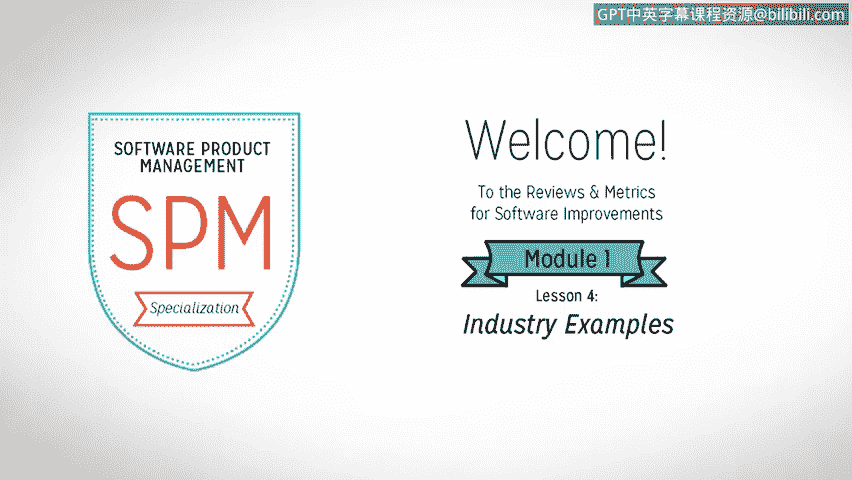
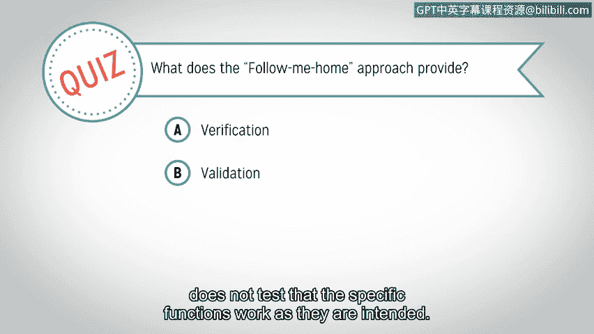
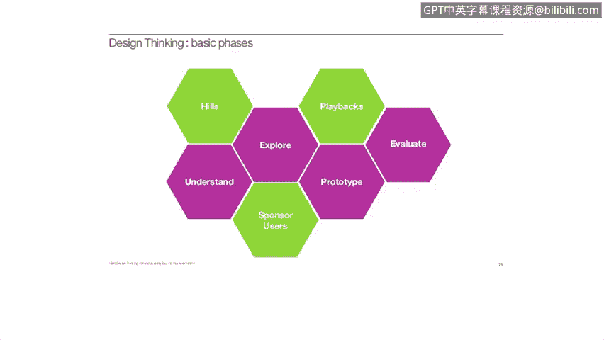

# 艾伯塔大学软件产品管理课程5：《软件改进的评审与度量》｜reviews-and-metrics-for-software-improvements｜ - P34：5_01_5-1-4-industry-examples.en_subtitled - GPT中英字幕课程资源 - BV1j8411y7q1

In this lesson， we'll talk about industry examples of how major companies produce the right product。

After that， we'll learn about additional areas of interest for an effective product manager。

It would make sense to start with a company that is known for continuously delivering the right product。

 Apple。Apple is known for its elegant products。 How do they consistently deliver the right product？

Once an idea is formed， Apple starts with their prototyping。

Apple's prototyping is commonly known as Pixel Perfect prototyping， or 10 to 3 to one prototyping。

Their eventual near final prototypes are pixel perfect because they are designed to the point of each individual pixel。

This means that they don't just design the interface， they design it to the highest level of detail。

 the pixel。As you can imagine， this is quite expensive to do， and it's not very agile。

But it seems to work。The 10 to3 to one prototyping is known as such because of the way the designers develop prototypes。

The designers work without restriction to come up with 10 different prototypes。

This is very similar to leanan development， where several prototypes are explored before making a decision。

They will then choose the top three designs and further explore those options。Finally。

 they will choose the top contender and design that prototype to the Pix Per level。

Apple also conducts regular reviews； They have a weekly executive team review in which they go over the production process。

They also have peer design meetings。This is a meeting between the design team and engineers that focuses on improving the design。

Apple's design process is extensive and subsequently very expensive。But as you've seen in the market。

 it works。Apple products have dominated the market for many years。

 so the expense of elaborate design work seems to be worth it。

Why does Apple's method of prototyping have the name Pixel perfect？A。

 because the pixels in the Apple product are always perfect。B。

 because the prototyping makes sure all pixels in the product are perfect。C。

 because the prototype is designed to the level of individual pixels or D， because it sounded cool。

Apple calls one method of their prototyping pixel perfect because the prototypes are designed to the highest level of detail。

 the pixel。Therefore， C is the correct answer。Let's now talk about another big name in software products and services。

 Google。Google created their design sprint process。

This process is also used at other companies such as Airbnb and Blue bottle coffee。

This process is rapid and iterative， condensing what used to take weeks or months into one week。

 sometimes even shorter。Google Glass was prototyped using this process in just under two hours。

This is similar to the lean principle of deliver as fast as possible。

There are five stages in the design sprint。They are understand。Diveerge， decide。

Prototype invalid validate。In the understand stage。

 engineers and designers evaluate the problem at hand and identify who they are designing for。

In the diveer stage， participants are encouraged to come up with as many solutions as possible for the problem。

Regardless of how unrealistic or farfetched they may be。Then in the decide stage。

 participants vote and discuss which idea or ideas to pursue in more detail。

Then it's on to the prototype stage。In this stage， participants rapidly sketch and build out prototypes。

These prototypes focus on the user interface and the user experience。😊，Finally， the validate stage。

In this stage， the products are given to users， and the designers and engineers are encouraged to demonstrate。

They then receive feedback from the users。Each stage of this process is intended to take just one day each。

What are the five stages of the design sprint？A， understand， diverge， decide， prototype。

 and validate。B， evaluate， brainstorm， vote， create， test。C。Understand brainstorm， decide， prototype。

 test， or D evaluate braininstorm， decide prototype test。

The five stages of the design sprint are understand， diverge， decide， prototype， and validate。

Therefore， a is the correct answer。So now that we have talked about how some major companies design the right product。

 let's talk about a way that another major company into it verifies their product is in fact。

 the right product。Intuit uses an approach called Fo Me Home。

Intuit is a company that makes accounting software。Scott Cook， the founder。

 started the Fo me home practice in the early years of his company。

Cook would hang out at the local office supplies store and wait for someone to buy his software。😊。

He would then ask the customer if he could follow them home and watch as they install and use the software。

The practice sounds a little creepy， but it was effective。

 It allowed into it to build products that truly fit in the user's environment and completely met their needs。

Intuit continues to use this practice now， in a more controlled fashion。On average。

 they pay about 20 visits per year。These visits tend to be about an hour。During the visit。

 they observe a customer using the software。They also take note of the environment the customer is working in and how work gets done in the office and how the software fits into the business。

What does the follow Me Home approach provide， A， verification or B validation。

The follow Me Home approach provides validation for the product。

It tests the satisfaction of the user and does not test that the specific functions work as they are intended。

Therefore， B is the correct answer。IBM has implemented a practice called Design Think that combines prototyping。

 user observation， and agile development。Design thinking is a concept that was developed at Stanford University and has since been adapted by IBM to suit their needs。

Design thinking is focused on identifying people's needs and coming up with solutions to those needs。

There are four main stages in traditional design thinking。Understand， explore， prototype。

 and evaluate。IBM has adapted this to create three additional stages。Sponsor users。

 hills and playbacks。 This starts with the end user。😊。

You need to identify the reasons that the needs of the user are not being met。

To understand the needs of the user， you need to find out who the actual users are。

And discover how they think， what they see。How they use the product and what they use the product for。

They then search for a candidate that would be interested in the product。

They narrow this down to one candidate that possesses many of the characteristics and faces many of the same problems as the typical users。

 This is the sponsored user。They are used to provide insights as the product grows。

The team works with the sponsored user to gain insights and information。

They use this to identify a problem with the product。 This challenge is the hill statement。

They then take this problem to the larger team to come up with a solution。

The team then explores various solutions to the challenge。Bad or unrealistic ideas are weeded out。

Once the solutions have been narrowed down， they begin with sketches to these solutions。

They then move on to prototype the ideas more formally。

It may take a few iterations to determine the best idea to pursue。These are called the playbacks。

Eventually， a working model is then created and evaluated with end users。

The idea is iteratively refined with feedback from the sponsored user。Once refined。

 the product is launched but continuously tested and refined based on new user needs。

