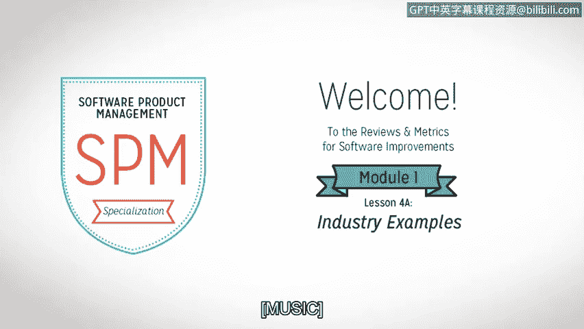
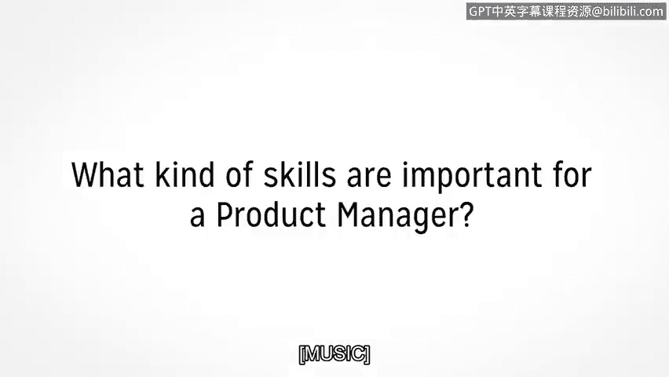
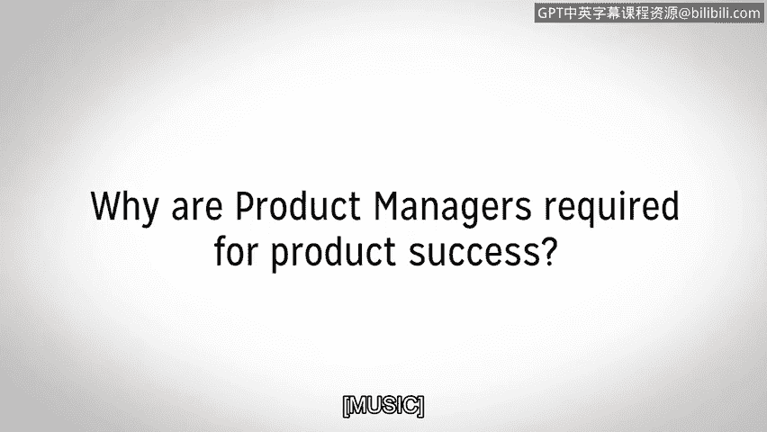
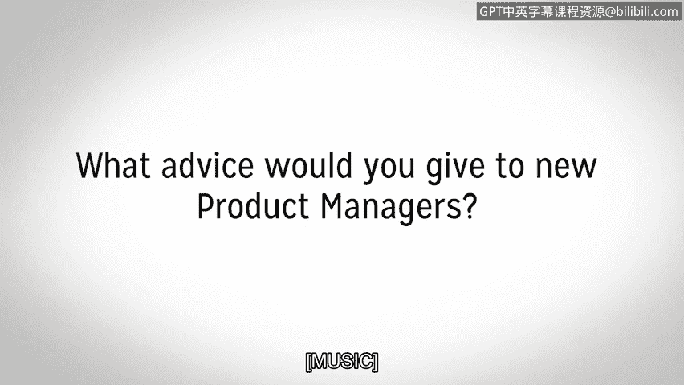

# 艾伯塔大学软件产品管理课程5：《软件改进的评审与度量》｜reviews-and-metrics-for-software-improvements｜ - P35：6_02_5-1-4a-industry-examples-interview.en_subtitled - GPT中英字幕课程资源 - BV1j8411y7q1

🎼。

🎼不不不。It is very important that a product manager have in depth knowledge of the software development lifecycl。

Now that we've described how industry heavyweights deliver the right product。

 let's have a look at how product managers use product strategy， lifecycl management。

 and market intelligence to identify and achieve the right product。

My name is Clon Costa， I am a producer which is the equivalent of a product manager for the video game industry。

As a product manager， I need to take care of the three pillars for the product。

 one being the strategy for the product， so I need to understand really about what the vision should be for the product and make sure that the team understands that I also need to take care of the development of the product itself and also how do were going to make the product reach the consumer so also the distribution of the product。

🎼Software product managers need to be able to communicate really well。

 they need to also be able to understand really well the trends in the market they need to understand also the strengths of the competitor so you need to be really good at understanding what's out there and you also need to be very strong at understanding how to create softer so the better you understand how to create software。

 the better you can help to get to that vision that you had before for the product and finally but not last and like you need to understand the business as well the business side of the product what kind of business models you're going to have how you're going to reach the consumers at the end that you're going have like digital distribution is going to be retail so all that combined makes a good software product manager。

🎼嗯。

🎼Market intelligence is the ability to understand what's out there who are your consumers。

 what is your audience， do you have retailers in between the consumers because they may be your clients as well what kind of trends you have in the market right now in terms of technology or in terms of like distribution or business models etc Also it's the ability for you to understand the needs what are what kind of a needs is there a gap in the market right now that no one is actually catering to so can you actually reach that gap and be stronger than everybody else that's what I call market intelligence。

I think it takes a lot of research like you have to invest yourself also in understanding the market so you need to read a lot。

 you need to in the case of like software development you need to play the other softwares as well use the other softwares as well so that you can understand what are the strengths of the competitors you also need to read magazines or blogs or sites about specifically about your area so in my case video games and like I read a lot of video game articles and video game blogs and also you need to。

Understand how to reach the consumers as well， you have social media nowadays you can reach directly to the consumers and ask what they're looking for in a specific product。

 why do you think that this competitor is good at or what they're not good at that you can actually go and fill the gap for the market。

🎼You have to use a lot of the software that is out there in the market right so you need to if your own software。

 you need to understand it really well， you need to have lots of attention to detail and understand really well what your software actually delivers to the market。

 but you also need to do the same with all the competitors out there at the same time。

 you also need to speak。 You need to come up with a way to speak straight to the consumers。

 it may be a focused as he may be using social media。

 but you need to understand also if there is a gap。

 if there is a different need that came up or maybe a weakness of the leader in the market that actually he doesn't do really well and that you can actually fulfill you and do better than that。

So for demographics usually what we do we think about archetypes and personas so you're going to try to understand in the specific case of video game development I'm like we have a really broad audience and we need to understand the segments that we have and then we create personas for each of those segments so for example this is gonna be the 20 bo the 21 year old college student that I don't know it's a student medicine for example。

 but he wants to play video games and he wants to do it because it's escaping for him the other one may be an entertainer or a mom that has some free time so you need to create those personas and once you have those personas now you're going to see how your features for your software。

 they do align with those personas that you're actually reaching the needs for those personas。

So product strategy is ability to understand first， what do you need to build？

🎼What does your software has to have in order to beat the competitors in the market that's one of the things you need to do for product strategy。

 the other thing you need to understand you need to also work on the business models for your product。

 how you're going sell your softer， what is it going to be a subscription。

 is it going to be like a flat fee， is it going to be some sort of like a freeware that after 30 days then you sell the other part of the software。

 there are many different business models and it really depends on your market。

 it depends on your competitors， what you're doing as well so you need to understand what you need to build how you're going to sell it and how you're going actually reach to the consumers how youre going to distribute it as well。

The product manager needs to create the vision， so he needs to be the bridge between the consumers and the development team。

 so he needs to be that bridge and he needs to create that vision that in a very succinct way in a very simple way tells the team what they need to build and why this is important and why this is good enough to actually beat all the competitors you have in the market。

Your vision for the product can have what we call unique selling points。🎼If you do have。

 let's say five unique exc points， hopefully your product is going to have strong features that relate to those pillars as well you can now once you have a prototype of your software or maybe if you already have a beta version or alpha version of your software you can create focus that so you can reach to specific segments of your users and actually test how they're receiving your software do they like these new feature is that compelling enough is it better than what's out there in the market and that's one way to do it so you can get that feedback and if they are friction points for example you can reduce the friction points and change the feature and make it better and then you take it to the market again if you keep on doing that by the end of the cycle。

 the dev cycle you should have a much stronger product to be released。

🎼I think that the first step to differentiate your product from the other ones in the market is understanding your own strengths and weaknesses。

 so in our case our company has its strengths in a few areas that other competitors don't and we try to emphasize that so we try to make sure that our products they come with a signature so that our consumers know this is a product from our company。

So basically understand your strengths and weakness first and understand also how they play in regards of the needs of the market because if you're really strong in one area that the market doesn't actually need so it's not helping you but if there is a gap here if there is a demand in the market and you're strong at it then that's where you can actually make a difference。

🎼。🎼So monetization models for a product， for a soft product。

 there are many different ones now and the market is changing quite rapidly you can go from a traditional retail。

 you can have a box that you sell at the store， you can have digital distribution where the user only downloads your software you can have a subscription based like many other softwareers are doing so now and you can have a mix as well as you have like some sort of a free to play version of your software that the consumer can download it for free but if you want a advanced features then it needs to either subscribe or pay a full price or pay a different type of price for parts of your product so there are many different business models right now in the table it really depends on the market that you're trying to。

To act on， it really depends on the consumers of your market， of your specific market。

At a startup a product manager has more flexibility， he has to wear many different hats as well。

 he doesn't have de for having usually a lot of money。

🎼But he does have a small team that can be very nimble and very iterative so those are things that I see as positive for your startup if you're a product manager but you need to be very persistent and you need to be resilient as well because things that aren't gonna to be easy because you have very small team and usually small resources as well at a big company you have the advantage of having more resources available so you can do better research or broader research。

 different types of surveys you can also specifically you can can travel to a specific place in the world that you have consumers and actually speak with them if you need to be so you have better resources but at the same time you may have to go through more lengthy processes to get things done you have to sometimes combine and coordinate many different teams within the organization so it can be more difficult for a product manager because it needs to convince way much more people in order to get something done。

Mhmm。🎼A common life cycle for a soft product would be you would have a preproduction phase where you would understand what your product needs to be。

 maybe you call it ideation phase at different industries so you're gonna understand what you need to build and why that product is better than what's out there in the market so that's where you have your vision set that's where you have your team aligned around a vision that is strong enough to beat everybody else in the market you also need to make sure that in the preproduction phase you have enough funding to go through and you're going to try to iterate and create prototypes as well to validate as quickly as possible if the future that you have are actually as strong as you think that they are going be After the preproduction phase you go to the production phase that's when you know already you know what you need to build and now it's about building it it's about scaling it up and making sure that you can make everything。

Under the whatever constraint you have in terms of budget or time so you're going to work on the production phase and necessarily develop a product after you develop the product you're going to reach what we call finally phase The final phase it's where we actually polish the product as much as we can so we're going to try to take all the bugs out we may even have a beta version of the software that we actually release to a thousands of consumers so that they can play it。

 they can use our software and they can come back and tell us what's working really well and what's not working in the software what they like and what they don't like so that we can fix it even before the release of the software。

After releasing the softer， while we jump to the release phase。

 after the final phase we go to the release phase where you're going to have to distribute your software。

 you're going to have to make the softwareer actually reach your consumers。

 make sure if you have a digital distribution and you have retailers。

 make sure that everything is working that the consumers know about the softwareer and that they can have a way to actually buy it。

After the release phase there is a phase what we call live service in our specific case we have a service that we run。

 which means that we have to create a roadmap of everything else that we're going to do for the software after the release of the software。

 it may be around patches or bugs that we're fixing on the software。

 it can be around like new expansions for the software with new features because we're receiving that feedback from the consumers and also from the game video game journalists as well。

And once we get that feedback， we prioritize everything we need to do with the team that we have and then we create a roadmap and the product manager leads that roadmap development。

🎼After the product is released， you need to understand the first thing you need to understand is how your product was received by your consumers right so you have to quickly analyze what went really well。

 what went really wrong from the perspective of the consumer Some of the things that went wrong。

 you may be able to patch it as a softwareer and you may be able to fix it it may be a bug or it may be a feature that you need to add quickly so you can create an extension and update for your product as well if it's necessary Another thing you need to do depending on if you have a product that becomes a service as well。

 so if it is a service， you need to have that constant communication with the consumers about what's going well and what they don't like so that they can help to create a better roadmap for your product over time。

🎼There are many different ways you measure the success of a softer product you may have it really depends on your industry and like you may have like the number of units sold。

 you may have your revenue， you may have the profit margin that you have it may be the quality of your product which can be measured depending on the industry you may have like some sort of a score that actually measure and compares your software against other ones but usually it always go back to the consumer satisfaction right I mean like you need to understand how how the consumers received your software。

 a good product manager needs to understand really well analytics how are you going to use your telemetry for your software to actually get like important data about things that need to be changed so usually a good product manager is going to try to create first the key performance indicators what we call KpiI and once you have your KPIs and it really depends on the industry that you're working on then you can start measuring if your software is being successful or not internally let's say you may have KpiIs like。

🎼ForThe development team， you may have like how many crashes per hour or how many hours your servers are up or down the other way around。

 you may have some other metrics around like how many people are actually actually accessing the server at the same time。

 So what is the Piximaneous user that you have right now there are many different metrics that you can use to help the development team to understand if their service if their product is working really well externally there are some other factors that you measure。

 usually we have a funnel that we call AO So a for acquisition over for onboarding E for engagement and M for monetization for acquisition。

 we have metrics like how many people are actually downloading your software or actually bought your software。

 how many people are playing every day， what is the number of daily unique users you have in terms of engagement you have how many sessions per day your users are playing your software using your software for how long do they play your software use。

You're softer。🎼We also have other metrics in terms of engagements like are they likely to recommend you softer to another friend that's another metric that we can have we call it N or net promotemor score in terms of monetization。

 we have metrics around how much money theyre spending overall on on a daily basis or lifetime what is the value of that user lifetime as well so if you spent like $60 in the product in the beginning and over the lifetime or like he spend another 20 so he's worth $80 for example。

 what is the average revenue that you have per spender。

 what is the average revenue that you have per user as well。

 what is the percentage of spenders that you have， there are many different KPs to measure monetization and I skipped one which was onboarding which is like you may have specifically for a few softwareer you may have to teach users how you use your softwareer so that's what we call onboarding and for onboarding you may have also metrics like did they go through the whole tutorial process did they stop before or not。

Then in terms of analytics， you can actually use that information to see how successful those users are if they went through the full funnel of onboarding or if they didn't let's say they skip the tutorial completely and are they having more issues are they reaching into the customer service more often because they don't understand how to use the software and you may notice that the ones that went through the tutorial they actually grasp the key fundamentals of the software and therefore they need less assistance。

I think a successful product。🎼Needs a successful product manager behind It means that you're going to need someone that is going be that important bridge between all the consumers。

 all the millions of consumers that you have and the development team it needs to be someone that not only is going to do that bridge。

 but also it's going to understand from a business perspective。

 what kind of business model youre going to have how you're going to distribute you softer。

 how they're going to reach all the consumers that you have so you kind of need to work really well on those three pillars let's say the business model side of things you also need to understand really well about the market and you need to understand really well about the development process as well if a good product manager can work really well on all those three pillars。

 it's very likely that he's going to be successful。

🎼I think that new product managers is the first thing they need to do is you have passion for software right passion for the product that you're trying to work on like if you love what you do。

 the chances of you being successful are much higher that's the first one The second one is being very curious like you need to be very curious you need to try to understand what's out there in the market。

 you need to play or use the software from the competitors as much as you can you need to have that curiosity inside you and also you need to ask the questions why I'm like why are they doing that why can't we do this way or why can't we do something better that way I think that's one thing The other one is of course I'm you have to study a lot I like regardless of your market。

 you need to study a lot your market， you need to understand really well how your market works and finally and I think it's super strong super important also for the product manager to know how to relate with people。

 you don't make softer alone， you know make the product alone， you have a team and you need。

know how to communicate really well with the team and with different teams within the team as well。

 how can you make sure that everybody's aligned under the same vision， under the same goal？

In the next module， you are going to learn how to make sure that your product is done right。

Bradley will take you through some monitoring techniques and metrics that you can use to ensure that your product is done。

 right， enjoy。😊。