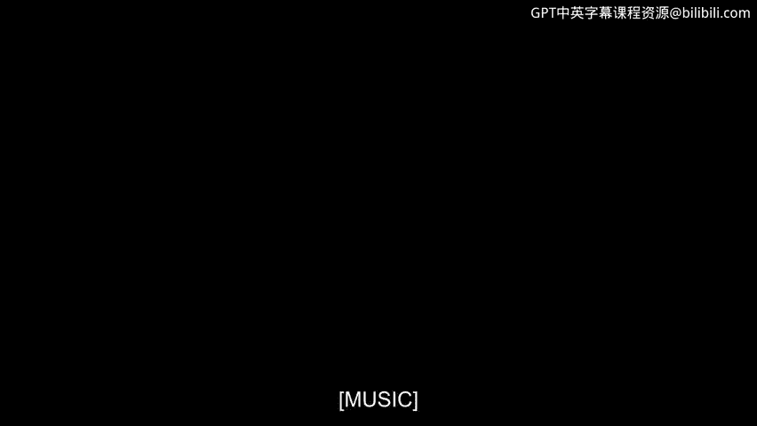
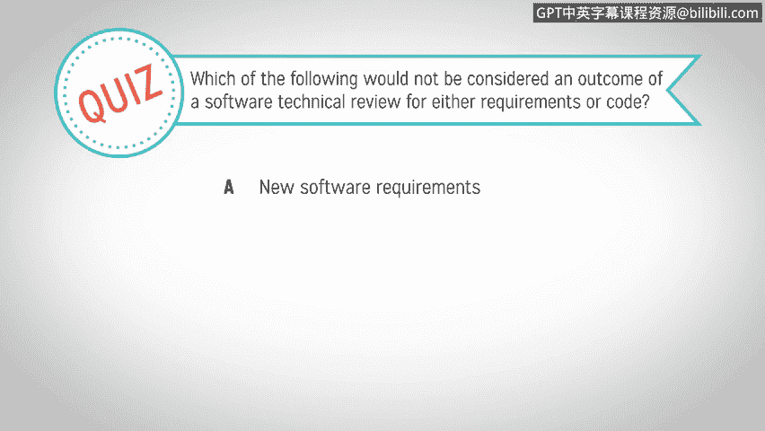

# 软件产品管理：5.2.1：评审技术 🧐

在本节中，我们将学习如何确保软件产品被正确地构建。我们将重点介绍几种用于检查软件开发过程中产出的工作产品的评审技术。这些技术能帮助团队更早地发现缺陷，从而避免在后期修复时付出更高的成本。

回想一下冲刺评审会议。在那些会议中，开发团队与客户一起审查上一个冲刺周期完成的工作，并确保项目进展符合预期。本节我们将聚焦于开发团队内部进行的评审，具体讨论不同类型的同行评审。同行指的是在同一级别工作的人员，例如两位开发者互为同行。

我们将介绍的同行评审包括：软件技术评审、审查和走查。你将看到，软件同行评审的形式可以从非常正式到非常不正式，其范围可以从深入的技术代码分析延伸到高层的需求设计。

## 软件走查 🚶‍♂️

最不正式的同行评审是软件走查。

软件走查简单来说，就是一位软件开发者向他人展示代码如何工作。这是一种“展示与讲述”的形式，开发者向一小部分听众介绍自己的代码。在整个走查过程中，听众可以随时提问并指出潜在问题。

走查之所以是非正式的，是因为它旨在为开发者提供一种快速、简便的方法来帮助他们提高软件质量。

以下是软件走查的一个例子：一位开发者刚刚构建了一个软件模块，该模块通过连接公司的客户数据库并提取客户的支付信息，来授权客户的付款。构建完此功能后，该开发者邀请了几位同行，询问是否可以快速进行一次代码走查。大家聚集在这位开发者的电脑周围，开发者带领他们浏览代码，并跳过了许多次要细节。在代码评审过程中，开发者的同行会提出诸如“用于访问数据库的库是否可靠”、“当前代码是否是资源效率最高的选择”以及“代码是否足够安全可以发布给公众”等问题。同行们还会帮助确保代码的可读性并符合团队的编码标准。此外，通过这个过程，开发者的同行也会更加熟悉这段代码。当他们处理其他项目时，可能会整合从这次走查中获得的知识。正因为这个特点，代码走查也常被用作培训新团队成员的一种手段。

总而言之，软件代码走查是一种有价值的评审技术。它允许个体开发者借助同行的力量，获得建议、改进意见并熟悉代码，而无需花费太多额外的精力。

**在软件走查中，软件开发者需要产出以下哪项工作产品？**
A. 代码评审总结
B. 需求文档
C. 会议纪要
D. 无

**答案：D. 无。** 软件走查旨在保持随意性，因此不要求产出任何工作产品。

## 软件技术评审 🔧

上一节我们了解了非正式的走查，现在让我们看看更正式的评审形式。软件技术评审与走查不同。

软件技术评审更为正式，其目的是处理产品的技术层面。评审的正式程度取决于实施它的组织。例如，一家军事防御承包商的评审过程会比一家开发手机游戏的公司严格得多。本质上，软件技术评审的全部目的是在技术层面改进软件产品。它可以用于创建更健壮的设计、从客户那里形成明确的需求，或对代码进行一系列技术改进。

软件技术评审以讨论为导向，包含三个主要角色：
*   **决策者**：其工作被评审的人。负责设定评审目标并判断这些目标是否已达成。
*   **评审负责人**：确保评审有序进行并保持在正轨上。
*   **记录员**：负责记录所有已识别的问题。这并不意味着他们是会议记录员，记录员是在会议上记录会议发现的人。

在评审开始前，所有参与者都需要进行准备。决策者创建一份希望在会议中达成的目标清单。评审负责人确保每个人都能访问待评审的软件产品。其他所有参与者则负责预先评审分发给他们的材料。

在实际的评审会议中，评审负责人促进所有相关方之间的对话。如果这是一个需求获取会议，评审负责人会确保客户及其产品团队正确地传达需求，并引导会议朝着决策者的目标前进。在需求获取会议的情况下，目标很可能是获得一份用户故事列表，开发团队可以据此规划工作。

在软件技术评审中，一个人可能担任多个角色。例如，评审的贡献者可能同时担任评审负责人。也可能有人既是决策者又是记录员。这完全取决于谁自愿承担什么角色，以及什么对当前情况最合理。

在软件技术评审结束时，应该达成某个特定目标。例如，可能是消除歧义或对当前产品进行改进。技术评审的结果是一套针对软件产品改进的建议。

**对于需求或代码的软件技术评审，以下哪项不被视为其可能的结果？**
A. 新的软件需求
B. 改进的软件生产过程
C. 提高的代码效率
D. 为高效员工加薪

**答案：D. 为高效员工加薪。** 虽然软件技术评审可能会提高对员工效率的认识，但其目标并非关注个别团队成员，而是改进产品整体。

## 总结 📝

在本节中，我们一起学习了两种关键的软件同行评审技术。我们首先介绍了非正式的**软件走查**，这是一种快速、协作的代码展示与讨论方式，旨在早期发现问题并促进知识共享。接着，我们探讨了更正式的**软件技术评审**，它通过明确的角色（决策者、评审负责人、记录员）和结构化的流程，专注于在技术层面系统地改进软件产品或需求。理解这两种技术的形式和适用场景，将帮助你在软件产品管理中选择合适的工具，以确保工作产品的质量并推动持续改进。