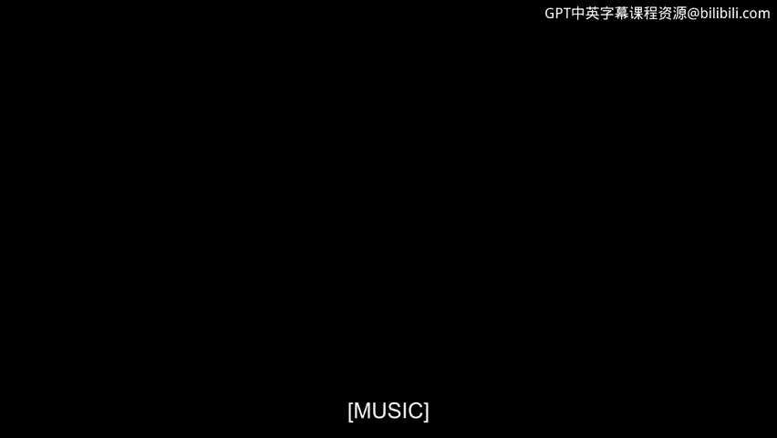
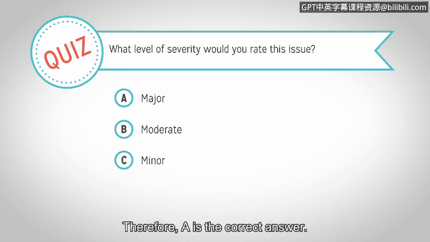

# 软件产品管理课程5：《软件改进的评审与度量》：8_02_5-2-1a：评审技术

在本节课中，我们将要学习软件同行评审的第三种类型——软件审查，并深入了解两种具体的审查技术：需求技术评审和需求审查。我们将探讨它们的结构、角色、流程以及如何应用它们来提升软件产品的质量。

---

## 软件审查：最正式的同行评审

上一节我们介绍了软件走查和技术评审，本节中我们来看看最正式的同行评审类型——软件审查。

软件审查，也称为正式技术评审。请注意不要将其与软件技术评审混淆。软件审查比前两种评审类型更为正式。与软件技术评审类似，软件审查也包含多个角色并遵循严格的结构。

软件审查的主要目的是发现并修复工作产品中的缺陷，例如一段代码模块的需求文档。为了实现这一目标，软件审查会利用以下角色：作者、主持人、朗读者、审查员和记录员。与软件技术评审一样，多个角色可以分配给同一个人。

以下是各角色的职责：
*   **作者**：创建了被审查软件产品的人。
*   **主持人**：类似于软件技术评审中的评审负责人，负责监督审查过程并确保一切顺利进行。
*   **朗读者**：负责向审查员朗读文档，审查员随后指出文档中的缺陷。
*   **记录员**：负责记录笔记。

## 软件审查的多个阶段

软件审查由多个阶段组成，其中一些阶段可以重复，直到产品达到适当的标准。

以下是软件审查的主要阶段：
1.  **规划阶段**：在此阶段，主持人熟悉被审查的产品以及作者关注的主要领域。
2.  **概述会议**：所有角色人员聚集在一起，由主持人对产品进行简要介绍。通常在此阶段结束时，审查员会收到待审查的产品，从而启动审查的准备阶段。
3.  **准备阶段**：审查员审查产品以寻找缺陷并做笔记。完成此阶段可能需要几分钟到几天，具体取决于被审查的工作产品。
4.  **审查会议**：在此会议上，朗读者分小块朗读文档。审查员随后对他们发现的每个块中的缺陷发表评论，记录员确保记录所有内容。作者可以提问和寻求澄清，但由于审查更为严格，不鼓励讨论。
5.  **返工阶段**：审查会议后，作者根据审查员的反馈进行必要的修改。
6.  **跟进阶段**：完成修改后，进行跟进以确保更改已完成、恰当，并解决了审查会议中发现的缺陷。

我之前提到，一些审查阶段可以重复。通常重复的阶段是返工和跟进阶段。这是因为有时在返工阶段完成的工作不足以解决审查会议中提出的缺陷。当在跟进阶段指出这一点时，作者必须返回并完成工作。

## 严格的完成标准

软件审查还实施了严格的程序来确定每个阶段何时完成以及何时准备好进入下一阶段。例如，为了开始审查过程，可能需要一个待办事项清单。

这个清单可能包括：
*   软件走查已完成。
*   代码已通过所有测试用例。
*   每个函数都包含足够的文档。

这样做是为了帮助主持人和审查员在讨论之前正确审查工作产品。

## 三种评审类型的比较

在我本节课讨论的三种不同类型的同行评审中，哪种结构最严格？A. 软件走查。B. 软件技术评审。C. 软件审查。

答案是 **C，软件审查**。软件审查是最正式的同行评审类型，其次是软件技术评审，然后是走查。

---

## 需求技术评审：一种流行的审查技术

现在，让我们来讨论一种非常流行的软件审查技术：需求技术评审。

需求技术评审是一个两阶段过程。第一阶段是评审，第二阶段是讨论会议。您可以与多个审查员或多次进行此过程。

### 第一阶段：评审

在评审阶段，评审员检查作者编写的一组需求。作者可能需要向每位评审员提供术语表和其他相关信息源。

每位评审员检查需求文档，以定位尽可能多的缺陷。这可能包括错误或遗漏，这些错误或遗漏会阻止产品执行其一项或多项任务。

每位评审员还应识别需求标准方面的高风险领域。例如，需求似乎不完整、过于僵化或过于浅显而无法处理所有可能发生的情况。

每位评审员还应突出显示任何疑虑。例如，他们可能突出显示一种情况，即需求正确且完整，但在复杂性或可重用性方面可以改进。

然后，每位评审员应将其发现分类为主要、中等或次要的严重性级别。

以下是严重性级别的定义：
*   **主要发现**：意味着问题的修复方案不明显，需要非常仔细的进一步探索。
*   **中等发现**：意味着问题的修复方案是直接的，但需要进一步审查。
*   **次要发现**：表示修复要么不必要，要么显而易见，无需进一步审查。

### 严重性级别判断练习

假设您正在为另一个团队的需求执行评审阶段。您发现一个问题：他们的一项需求在其预算、时间线和资源范围内不可行。您认为他们将不得不重新考虑整个产品规划。

您会将此问题的严重性级别评为：A. 主要。B. 中等。C. 次要。

这种类型的问题将是**主要**严重性级别，因为没有明显的解决方案，并且该团队必须仔细审查他们的产品。因此，**A** 是正确答案。

### 第二阶段：讨论会议

一旦评审阶段完成，您就进入流程的第二阶段：讨论会议。在此会议中，应有评审员、作者、主持人和记录员。

主持人负责确保会议不偏离主题，并以建设性的方式提出批评。他们确保评审不会让作者感觉受到攻击。Scrum Master 可以主持此会议，类似于他们主持其他会议的方式。

会议也应有记录员。此人可以与项目无关，他们只负责记录会议笔记。作者将参考这些笔记来修复已识别的问题。

为此会议设定时间盒是一个好主意，以便其保持在正轨上，并且不会占用评审员或作者太多时间。

在此会议中，将讨论收集到的发现并可能重新分类。尽可能减少对次要问题的讨论是一个好主意。不期望作者回应提出的每个问题或评论，但记录员应记下所有问题。作者在场主要是为了更好地理解发现并在需要时寻求澄清。这将有助于将会议控制在既定的时间盒内。

### 后续的修复过程

遵循需求技术评审流程之后是修复过程。在修复过程中，需求作者将根据评审反馈对需求进行调整。他们不需要解决所有建议的更改。提出的一些问题可能无效或已经解决。

我发现这个需求技术评审过程对于确保您的团队拥有高质量的需求非常有帮助。这对于确保产品做对非常有帮助。通过进行评审，您还可以学到很多关于开发和创建良好需求的知识。

---

## 需求审查：确保清晰、一致和完整

在结束之前，让我们谈谈需求审查。

需求审查是一个正式过程，在此过程中审查用户故事列表的**模糊性**、**一致性**和**完整性**。模糊性是软件需求的一个大问题，通常让第三方审查您的需求以确保一切清晰是很有用的。

当识别出需求的所有问题后，由作者负责修复它们。通常作者是产品负责人或软件产品经理，也可能包括开发团队的成员。有时作者是客户。在所有这些情况下，在审查会议中提出的缺陷随后得到解决，并在跟进中再次呈现。

需求审查是确保您的需求清晰、一致和完整的有用方法。审查过程使任务直接且易于理解，这可能解释了它在行业中的流行。

---

## 总结

在本节课中，我们一起学习了最正式的同行评审——软件审查，了解了其严格的阶段和角色。我们还深入探讨了两种具体的审查技术：需求技术评审（包括其两阶段流程和严重性分类）以及需求审查（专注于消除模糊性、确保一致性和完整性）。

无论上下文如何，软件同行评审都是有用的。无论是非正式的走查、技术评审还是正式的审查，评审在几乎所有软件项目中都有一席之地。

既然我已经介绍了一些如何评审软件的技术，接下来让我们谈谈软件评审过程中一些常见的问题。这就是我将在下一课中要讲的内容。