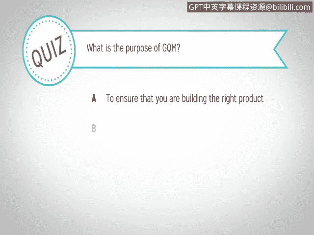
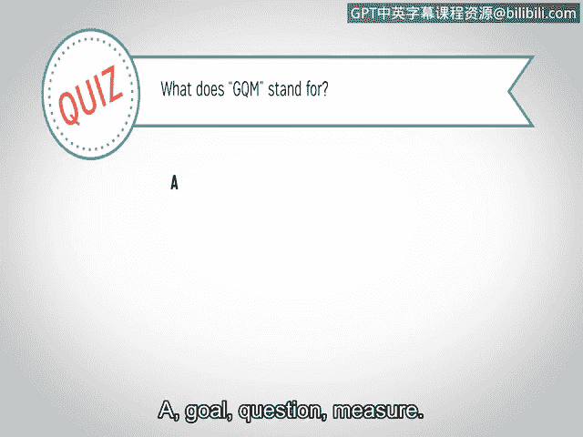

# 艾伯塔大学软件产品管理课程5：《软件改进的评审与度量》｜reviews-and-metrics-for-software-improvements｜ - P39：10_01_5-2-3-goal-question-metric-gqm.en_subtitled - GPT中英字幕课程资源 - BV1j8411y7q1

Welcome back in the last lesson I spoke about some of the issues that surround monitoring software projects。

These issues had a lot to do with the effectiveness of metrics and how metrics can be misused。

In this lesson， I'm going to talk about a way of formulating metrics so that you can make sure that they are measuring aspects of your project that are valuable to you and your team。

That method is called goal question metric。Gold questiontion metric or GQM is a method of choosing metrics for your software projects created by Victor Vasili in the University of Maryland in 1994。

The basic idea behind GQM， according to Basili himself。

 is that for an organization to measure in a purposeful way。

 it must first specify the goals for itself and its projects。

Then it must trace those goals to the data that are intended to define those goals operationally。

 and finally， provide a framework for interpreting the data with respect to the stated goals。

Basically， in order to make sure that you're using the right metrics for your project。

 you have to know the concept that you want to measure first， also known as your goal。

Once you know that， you have to figure out what defines that goal， also known as your question。

Then you have to find a way to calculate that definition in a way that you can interpret to inform your progress towards the goal。

 this is known as your metric。To start at the beginning， how do you set a goal？Well。

 according to Basili， goals are applied to objects， these objects are products， processes。

 and resources。Essentially， you could choose your goal to improve one of these three things。

You could choose to improve your product， like your code or your documentation。

You could choose to improve your processes， such as your testing or elicitation processes。

You could choose to improve your resources， such as your office space。

 the computers on which your development team works， or the developer's effort and salaries。

The whole idea is that you can measure anything， but breaking your project goals down into these three categories helps you to think about how to measure them。

What is the purpose of GQM？A， to ensure that you're building the right product。B。

 to ensure that you use metrics effectively。

C， to make sure that metrics use the correct data。Or D。

 to make sure that you ask the client the right questions。

The answer is B to ensure that you use metrics effectively。

GQM is a framework for using metrics that focuses on making sure that you use the best metrics for answering the questions you want to ask about your project。

The next thing to consider after each goal are the questions you want to ask about the goals。

Basically， what questions do you need to ask that will tell you whether each goal is being met？

This depends on the individual goal， but the general idea is that your questions should be specific enough so that the answer to the question addresses the goal。

And how do you find that answer？That's where the metric part comes in。

A metric is a quantitative way in which data can be collected to address the questions you're asking。

This is something that we already covered， though， this metric is exactly the same as other metrics we've discussed in previous lessons。

The only thing that's special about metrics as they exist in the GQM is that theyre made more meaningful by the planning process that precedes them。

Metrics in the GQM are made more valuable because the questions that metrics are designed to answer have been thought out ahead of time。

Metrics can either be subjective or objective。If they're objective。

 they're based on data that does not rely on anyone's individual viewpoint or interpretation。

For example， this could be number of product downloads。Sales numbers， processing time。

 or user stories completed。Subjective metrics are those that depend on interpretation。

 such as product ratings by users， developer morale or code quality。

If you think of metrics like software， this is a lot like what we talked about in the clientient needss and softwareft requirements course about gathering requirements versus eliciting them。

You don't want to just start with gathering metrics with reckless abandon。

Just like it's important to elicit requirements from your client。

 it's also important to specify the goals of the metric ahead of time。Of course。

 once you have user stories， you don't dive straight into building them either。

 that's because you create developer tasks first。Small。

 actionable items that can be done in a few hours。Questions in the GQM are the same thing。

 you create small items that when added together， address the entire goal。

Only when you have planned your work ahead of time with a release and an iteration plan。

 do you move forward to developing code？So only when you have defined the goals of your metrics with specific questions ahead of time。

 do you move forward to actually implementing the metrics and collecting data？

What does GQM stand for？A goal question measure。

B gains question measure。C， goal， question metric。Or D gains question metric。The answer is C。

 goal question metric。Let's look at an example of GQM。

Say you're developing a software product and you want to know whether your product is done right。

Product quality then is your goal。Here are a few questions that could help you address this goal。

How much of my product's code is covered by unit tests？How many defects are in my product？

Once you've asked your questions， the next step is to identify your metrics。

So if we were to take the question of how many defects are in my product？

We could approach this in a few ways。One metric could be the number of times a user story is rejected during acceptance testing before it's finally accepted。

This could be represented as a percentage of rejections to acceptances across the whole project。

You could say that a high ratio of rejections to acceptances is an indicator that something in your process should change so that you can reduce the defects。

To know what a high ratio is， you might consider comparing this number across projects that worked well versus those that didn't。

Another metric that addresses this question is the number of bugs that are placed at your product backlog at any given time。

If you're seeing an influx of bugs in your backlog。

 this might indicate that you need to review your techniques to catch defects earlier。Of course。

 you could get much more complicated than that。The idea here is just to give you an idea of how metrics can be applied within the GQM paradigm。

