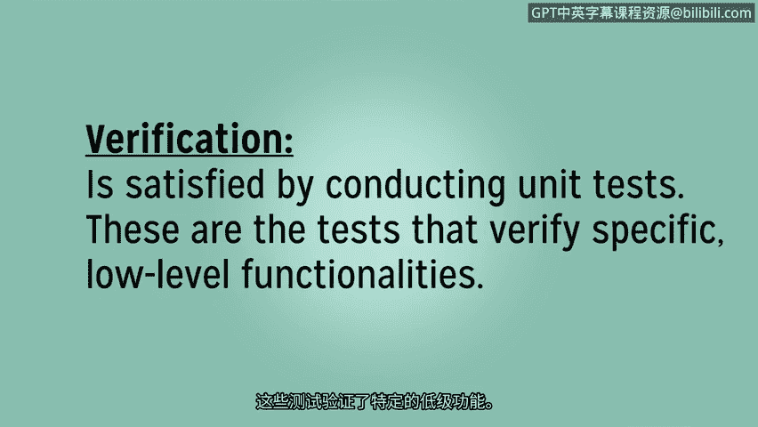
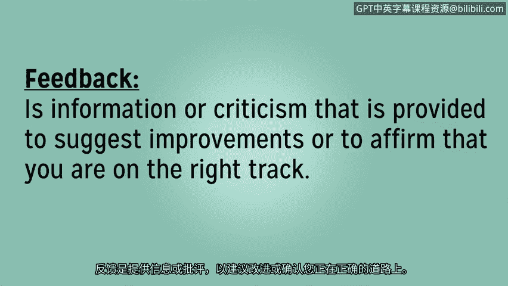

# 艾伯塔大学软件产品管理课程5：《软件改进的评审与度量》｜reviews-and-metrics-for-software-improvements｜ - P3：2_第5.1.1节 监控简介.zh - GPT中英字幕课程资源 - BV1j8411y7q1

🎼。😊，Welcome back。 This is the reviews and metrics for softwareftware Iments course。

 We've got a lot of exciting practices for you in this course。😊。

We are going to show you how to define and deliver the right product， done right and manage straight。

This module will cover elements for determining the right product and how to ensure you are delivering the right product。

We are going to start by learning about Sprint review meetings。

This type of review validates that you are creating the right product for your client。After that。

 we will take a look at user studies。User studies are a great way to validate that you are creating the right product for your product's users。

😊，We will talk about how some of the big names in the business ensure that they are delivering the right product for their users。

Then we will finish this module with an interview outlining the importance of product strategy。

 life cycle management， and market intelligence in product management。😊。

Let's see what you can recall from the previous courses。

Which term did we use to describe when a software product meets all the specified requirements？

A verification。B validation， C， specification， or D complete。Back in the introductory course。

 we defined verification to be when software product meets all the specified requirements。

 therefore answer A is the correct answer。We are going to be talking about verification and validation a lot in this module。

 and it's important that you distinguish between the two。

Two buzzwords that will be common in this course are verification and validation。

We've talked about these terms in various places throughout the specialization。

But let's define them again， since they will be essential to this course。

As we covered in the last quiz， when a product is verified。

 the specified requirements work as they are intended to。

Verification is satisfied by conducting unit tests。

These are the tests that verify specific low level functionalities。

In test driven development， they are written before the source code for a feature。

When a product is validated， the release software product satisfies the client and or the users。

You gain validation from your client by providing frequent demos and having open communication。

Client validation directly aligns with the principle from the Agile manifesto。

 Our highest priority is to satisfy the customer through early and continuous delivery of valuable software。

There are many ways that you can gain validation from your users， for example。

 you can conduct user studies， surveys or focus groups。

Like we said in the course on client needs and software requirements。

 a great product has validation from all stakeholders。😊，In short。

 verification ensures that you are building the product right。

 whereas validation ensures that you are building the right product。

This module is focused on how to deliver the right product。

 so validation is a key term for this module。

You are testing your software product by having various users use the product。

You are trying to determine if they like the user interface and user experience。

What is this an example of？A verification or B validation。Although you are testing the product。

 you are not testing the product to ensure that all the specified requirements work correctly。

You are testing whether the user is satisfied with the product。Therefore。

 this is an example of validation， so answer B is the correct answer。

Let's now introduce some new terms to this course。Two major terms are monitoring and metrics。

In software development， monitoring consists of tracking， reviewing。

 and evaluating the product and the process throughout development。

Monitoring is essential for ensuring that you are delivering the right product。

 done right and managed right。Agile is all about increasing transparency。

Everyone knows the status of a project at any given time。

This is made possible through various monitoring techniques。

Metrics are a method of measuring something。You can use metrics in development to measure various aspects of the product。

 the process， and the project。Metrics are an effective way of monitoring that gets quantifiable results。

But as you'll learn throughout this course， not everything that can be counted counts and not everything that counts can be counted。

Monitoring and metrics help to provide feedback。😊，Feedback is information or criticism that is provided to suggest improvements or to affirm that you are on the right track。

In software development， feedback may take the form of calculations， results from user studies。

 suggestions made by the team， or client reactions。

Feedback can be both qualitative or quantitative information。

Feedback is a great way to identify ways to improve your product。

Agile is committed to constantly improving as often as possible。

This could mean improving things such as the product， communication， the process。

 or the practices used。Feedback could also be used in other ways， for example。

 in the leanan methodology when you are considering alternatives。

You can use feedback to decide which option is the right one。Now。

 I'd say we're ready to begin this course。In the next lesson。

 we're going to talk about the first type of review， the sprint review。

This is where you gain validation from your client about the product。

