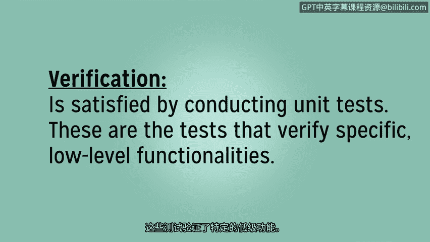
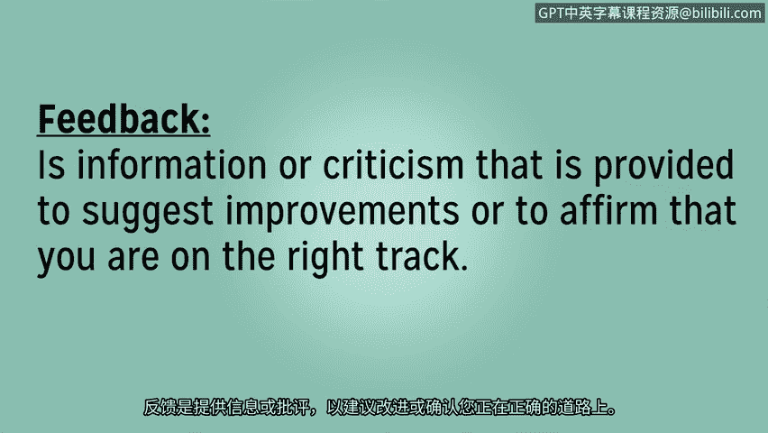

# 软件产品管理课程5：《软件改进的评审与度量》｜ 5.1.1：监控简介

在本节课中，我们将学习软件产品管理中的核心概念：监控、度量与反馈。这些是确保我们“交付正确的产品”并“正确地交付产品”的关键实践。

---

我们首先回顾一下之前课程中学到的重要术语。在之前的课程中，我们定义了“验证”和“确认”这两个概念。

*   **验证** 指的是软件产品满足所有**规定的要求**。它通过执行单元测试来实现，确保具体的底层功能按预期工作。在测试驱动开发中，这些测试甚至在一个功能源代码编写之前就已写好。
    *   **公式/定义**：`验证 = 产品符合规格说明`
*   **确认** 指的是发布的软件产品让**客户和/或用户**感到满意。你可以通过频繁演示和开放沟通从客户那里获得确认，也可以通过用户研究、调查或焦点小组从用户那里获得确认。
    *   **公式/定义**：`确认 = 产品满足用户/客户需求`

简而言之，**验证确保你“正确地构建产品”，而确认确保你“构建了正确的产品”**。本模块的重点是如何交付正确的产品，因此“确认”是本模块的一个关键术语。

现在，让我们为本课程引入一些新的术语。

**监控** 在软件开发中，指在整个开发过程中对**产品和过程**进行跟踪、评审和评估。监控对于确保你“交付正确的产品、正确地交付、并正确地管理”至关重要。敏捷开发强调增加透明度，而各种监控技术使得项目状态在任何时候都能被所有人知晓。

**度量** 是一种测量事物的方法。在开发中，你可以使用度量来测量产品、过程和项目的各个方面。度量是一种能产生可量化结果的、有效的监控方式。但请注意，并非所有可计数的东西都有价值，也并非所有有价值的东西都可被计数。

监控和度量有助于提供**反馈**。

**反馈** 是为提出改进建议或确认你走在正确轨道上而提供的信息或批评。在软件开发中，反馈可能表现为计算结果、用户研究结果、团队提出的建议或客户的反应。反馈可以是定性信息，也可以是定量信息。它是识别产品改进方向的绝佳方式。敏捷致力于尽可能频繁地持续改进，这可能意味着改进产品、沟通、流程或所用实践。反馈也可用于其他场景，例如在精益方法中评估备选方案时，你可以利用反馈来决定哪个选项是正确的。

---

在下一节中，我们将讨论第一种评审类型：Sprint评审会议。这是你从客户那里获得关于产品的确认的关键环节。

---

**本节课总结**

本节课我们一起回顾了“验证”与“确认”的区别，并引入了“监控”、“度量”和“反馈”这三个核心概念。我们明确了监控和度量是确保项目透明和方向正确的重要工具，而反馈则是驱动持续改进的关键输入。接下来，我们将深入探讨具体的评审实践。