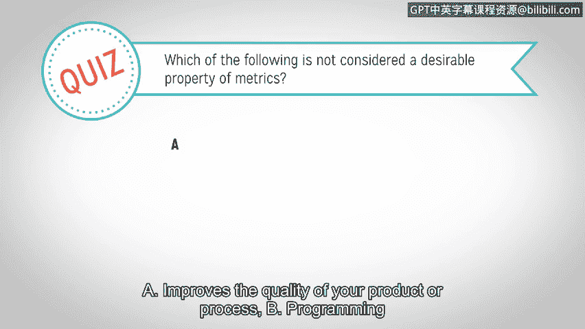

# 艾伯塔大学软件产品管理课程5：《软件改进的评审与度量》｜reviews-and-metrics-for-software-improvements｜ - P40：11_01_5-2-4-desirable-properties-of-metrics.en_subtitled - GPT中英字幕课程资源 - BV1j8411y7q1

Welcome back。

In the last lesson， I introduced the paradigm of goal question metric or GQM and how it can be used to increase the value of your metrics。

GQM does this by giving you a framework in which you can plan your metrics ahead of time through defining goals and questions that address those goals。

In this lesson， I'm going to define some key terms to help you understand software measurement。

I'll talk about some desirable properties of software metrics and give examples of a bad and a good metric with respect to those properties。

Let's start with key terms。In order to understand software metrics as a whole。

 you must first understand three key terms。Measures， metrics and indicators。

A measure is a standard or unit of measurement。Basically， it's just one instance of a measurement。So。

 for example， inches is a measure because an inch is a standard unit of measure。

This means that if you compared one inch to another inch， it would be exactly the same。

This may seem trivial and simplistic， but it's very important to get right。

Consistency and measurement is an important part in having meaningful metrics。

The next key term is metric。A metric is the combination of two or more measures that give a meaningful result。

An example might be kilometers per hour。Kloomes is your first measure， and hours is your second。

When combined， they create something meaningful。However， not all metrics are meaningful。

You could measure the number of keystrokes your developers make per hour。

 but that doesn't necessarily tell you anything meaningful about your project。Finally。

 there are indicators。Indicators are just measures that draw the attention of the person who is making the measurements。

A good example would be when taking someone's oral temperature。

An indicator that a person is in good health is that their oral temperature is measured between 36。

5 to 37 degrees Celsius。If you measure someone's oral temperature and their temperature reads 38 degrees。

 this is an indicator that they have a fever。Without these values as indicators。

 you wouldn't be able to tell if someone had a fever based on temperature alone。

Indicators make it easier to know when your measures or metrics are telling you something of which you should be aware。

Is 39 degrees Celsius per hour， a measure， a metric， or an indicator。A measure。B， metric。

Or C indicator。The answer is B， it's a metric， 39 degrees Celsius and hour are both measures。

 but when combined， they create a metric。Now you know what the difference is between a measure。

 a metric， and an indicator。It's a common task to collect data and analyze that data to gain insights into your product。

Like I said in the last lesson on GQM， you don't want to use metrics without a clear goal behind the metric。

Just as importantly， you want to use a metric that you know will give you a result that you can trust。

That's why it's important to know the desirable qualities of metrics。

Let's go back to that example of measuring the keystrokes your developers make per hour。

What makes that metric such a bad metric to use on a software project？Well， first of all。

 what do keystrokes have to do with the creation of software？

One might argue that tracking a developer' keystrokes allows them to track how much code they're writing on any given day。

However， just like the lines of code metric could vary greatly between programming languages and developers。

 so could this keystroke method。That in its own is a problem。

Consider how you'd record the keystrokes。If you used a keystroke logging program on the computer。

 for example， how would you know that the strokes being logged are actually code being written？

Your developers could be doing other things， such as typing into online chat forums or writing that novel they've been trying to complete for the past two years。

Okay， I'm sure you get it。 It's important to choose the right metric。

 and part of that means choosing a metric that actually answers the questions you want to ask。

What are some desirable properties and metrics then？Metric should be simple and easily computable。

Intuitively persuasive。Objective。Consistent in their use of units and dimensions。

Programming language In and provide an effective mechanism for improving software quality。

A metric should be simple and easily computable for one main reason。

That reason is that the more complex a metric is， the more likely it is for the person using the metric to make a mistake。

If the metric you are using is overly complex， a simple mistake that would have been easily to identify in a simple formula could become a nightmare to track down when you realize that something is wrong。

Matrics should also be intuitively persuasive。If you calculated the metric。

 took it to someone on your team， and asked them to tell you what it means。

 it should make sense to them。This isn't to say that you should only use simple metrics。

 but it should make intuitive sense to use。The keystroke per hour metric is a great example of this。

 you could calculate it and make a case to whomever you want， but when it comes down to it。

 it just doesn't make much intuitive sense to track your developer' keystrokes。

Metrics should also be objective。This means that they don't depend on anyone's opinion and are based on empirical data。

This is crucial to any science， and the science of monitoring your projects is no different。

An example of this would be like using your developer' estimates for how productive they are in order to track developer productivity。

It would be difficult to get an accurate objective measure from this because your source of data is inherently biased。

One of your developers may have just come back from the gym and feel great。

 so their estimate would be higher than normal。 Another developer may have just gone through a tough emotional time。

 and they underestimate their productivity。😊，Worse still。

 developers might even lie about their productivity in order to appear as they're getting more work done。

A better way to track developer productivity would be to measure how much work they were able to get done over a given period of time。

The work they get done may be something like story pointss。

What's important here is that the metric you use isn't something anyone could dispute。

 they're just numbers。Metrics should also be consistent in their use of units and dimensions。

If you use story pointss as your metric for project velocity。

 then you need to be consistent in your definition of what a story point is。

You won't get much information out of your velocity metric if you double your storyPo estimates on some user stories halfway through your project。

It's important to keep a steady， consistent definition of what you're measuring。Otherwise。

 you could be dealing with a metric that is difficult to interpret at best or completely unusable at worst。

On top of that， you want to make sure that the units you're comparing are consistent。

You wouldn't add story points to hourss in a metric， for example。

Which of the following is a desirable property of metrics？A， based on subjective data。B。

 applicable to human resources issues。C， give the same number for any data or D intuitive。

The correct answer is D， a metric should be intuitive。If it's not intuitive。

 the metric you're using probably isn't going to help you improve much。Next。

 you want any metric you use to be programming language independent。As I said earlier。

 and in a previous lesson， the lines of code metric is a great counter example to this。

While it may seem to be an intuitive measure of how much work is being completed on a software project。

 the metric is actually quite misleading。Also， within each language。

 the amount of code that is required to implement a function could vary from programmer to programmer based on coding style alone。

However， what's more important is that different programming languages vary widely in the amount of lines of code they require to implement a certain functionality。

This goes back to the last point of needing a metric that is consistent in its measured units and dimensions。

In order to be consistent， your metric should be able to give you a reliable measure that can be compared across programming languages。

Lastly， a metric should give you the ability to improve your quality of your software project or process。

You're not just tracking numbers for the sake of tracking numbers。

 There isn't much point in tracking them in the first place。

What you need to do is track numbers for the sake of improving the project。

If you made improvements to your project， would your metric be able to show you those improvements？

Take， for example， the metric of developers keystrokes per hour。

If you had tried to improve your project by getting your developers to make more keystrokes。

 what do you think would happen？Well， what might end up happening is your developers could procrastinate more by responding to more internet forum posts or perhaps becoming even more productive at writing their novel。

What's worse is that if your developers were actually being more productive programmers。

 the number of keystrs they make might actually decrease since code requires far less characters than writing something in a natural language。

It would be far better to use a metric that would show you their progress if progress was being made。

Importantly， a good metric would also be able to show you if the quality of what you were measuring was decreasing。

An example of a good metric will be the number of defects found in your product per week。

In order to calculate this， all you would have to do is track the number of new defects reported in the form of bug reports or loggged issues and tabulate them at the end of every week。

Calculating this metric is simple and easy to do。Defects are clearly a bad thing in any software project。

 and decreasing the number of defects in your product would be something that people would agree is desirable。

The metric is also fairly intuitive。Assuming your developers were equally as skilled at writing one programming language as another。

 the number of defects found per week would remain fairly consistent across programming languages。

 and the definition of defect wouldn't change。That covers consistency across programming languages and units。

Defects are also not based on anyone's opinion if a new defect is logged， a new defect is logged。

There's no way to fake it unless the developers are flat out ignoring issues。Finally。

 if you track this metric over time and implement processes that allow you to increase the number of defects you're fixing or increase your code quality。

 the number of defects you observe per week should decrease over time。By tracking this metric。

 your code quality wouldn't improve。Which of the following is not considered a desirable property of metrics？

A improves the quality of your product or process。

B， programming language independent。C， consistent in their use of dimensions。

Or D reduces the number of hours required to complete the project。The answer is D。

 while it would be awesome if your metric helped you to reduce the number of hours required to complete the project。

 that's not a desirable property of all metrics in general。

Improving the quality of products or processes is a goal of metrics。

 but that isn't a desirable property of metrics。Another great thing about tracking the number of defects found per week is that it doesn't have to be applied only to the whole product。

You could break this metric down to analyze different parts of the product。By doing this。

 you can identify any problem areas in your project and focus on them。

Another thing to mention is that metrics aren't always absolute。

Sometimes you will end up with metrics that are only useful for your project because the values upon which they're based are relative。

Vellocity based on story pointss is a good example of this。

The definition of a story point will vary from project to project。

It's okay to use metrics that are based on relative values。

 It's just important to recognize when your measures are relative so that you don't make the mistake of trying to compare two metrics that are based on slightly different measures。

That concludes this lesson on desirable properties of metrics。

The big takeaway here is to practice conscious use of metrics。

Make sure that the metrics you' are using are appropriate and meaningful， and you won't go wrong。

In the next lesson， I'm going to cover some metrics that are used to assess products and processes。

 You'll learn some solid real world metrics， so don't miss it。

