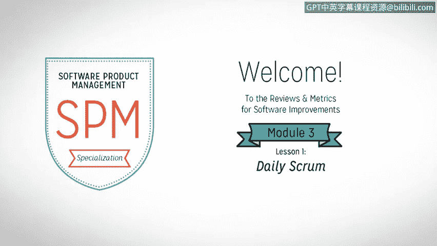
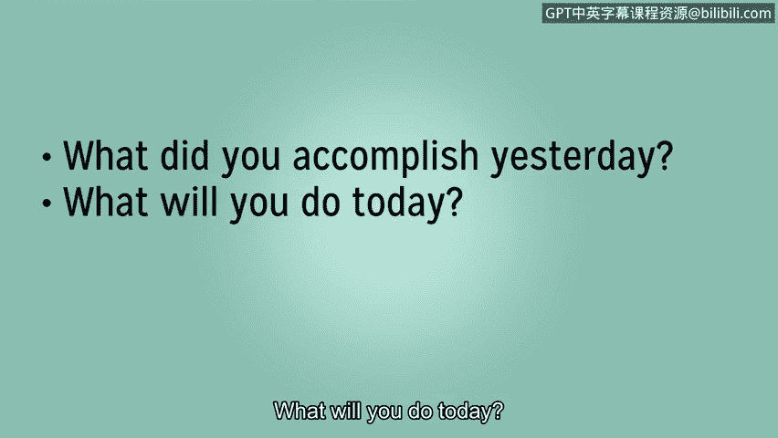
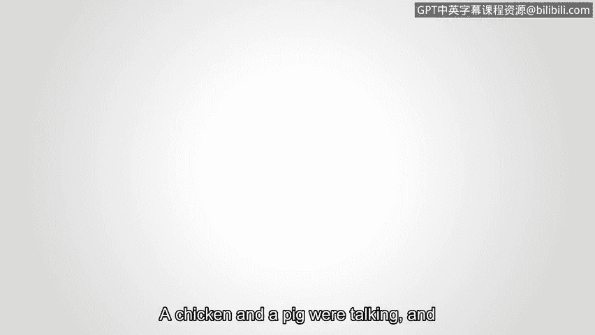
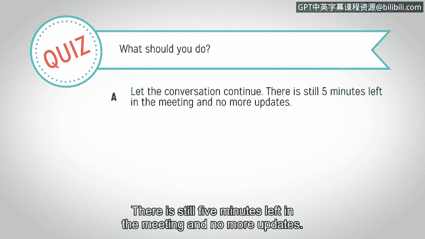

# 艾伯塔大学软件产品管理课程5：《软件改进的评审与度量》｜reviews-and-metrics-for-software-improvements｜ - P43：14_01_5-3-1-daily-scrum.en_subtitled - GPT中英字幕课程资源 - BV1j8411y7q1

🎼。

In this module， we are going to talk about methods for ensuring that your product is managed right。

This includes keeping your project on schedule and verifying that development is effective and occurring at a sustainable pace。

This module will cover the daily Scrum and how it is used to manage your project。

We will cover velocity and burn downs for both releases and iterations。

And we will examine how burndowns are used to manage and track development progress。

If you have read about scrum， you have probably heard of the Daily scrum。

The Daily Scrum is a meeting that occurs each workday with the development team。

This is a short meeting that is intended to get the day started on the right track。

In the Daily Scrum， all developers， the Scrum master。

 and other optional stakeholders stand in a circle and answer three questions。

What did you accomplish yesterday， what will you do today？

And are there any impediments in your way。This meeting is strictly time box at 15 minutes。

You may be thinking， how are we going to get the updates from all these people in that timeframe？

Well， there is an old joke that sums up the answer to this question。

A chicken and a pig were talking。 And the chicken suggests， hey， pig， let's start a restaurant。

The pig agrees。 good idea， chicken。 but what should we call it。The chicken suggests。

 how about we call it bacon and eggs？The pig replies，No thanks。

 I'd be committed and you would only be involved。In the daily scrum。

 it is suggested that only the pigs that is the people who are substantially committed to the project should speak。

Chickens may attend， but not contribute。The pigs， those who are committed。

 would be the developers and the product owner if they have an update for the team。

Chickens may include developers from other teams， business executives who want a status update。

 or the product owner if they have no major updates。

A chicken may want to attend a daily scrum to get an update on what the team is doing or where they are in the sprint。

Scrrum rules state that the product owner may optionally attend the daily Scrum。

You are at the Daily Scrum。 It is your turn to speak next。

Which of the following should you include in your update？A， yesterday。

 you completed the design for the database structure。B， yesterday。

 you watched a really cool movie after work。😊，See， today you are going to start designing the user interface。

D， the supply room is out of paper so you can not draw up mockups for the user interface and or E。

 I have a suggested feature improvement for the product。In the daily scrum。

 you only want to answer the questions。 what did you do yesterday， what will you do today。

 and what impediments are in your way。Updating the team on the work you completed yesterday answers these questions。

You also want to update the team on what you commit to doing today。

If there is an impediment that is preventing you from doing your work。

 such as the supply room being out of paper， then that should be brought forward at the daily Scrum。

Therefore， answers A， C， and D are the correct answers。

Updating the team on something you did after work should not be included in the daily Scrum。

 so answer B is incorrect。The daily Scrum is not the place to suggest future improvements。

 so answer E is also incorrect。The daily scrum is common in many methodologies， not just scrum。

In extreme programming， it is referred to as the Daily standup。

It is also commonly known as the Daily huddle or morning roll call。

The Daily Scrum is not intended to be a status meeting for product managers or product owners to determine progress。

For status updates， we use progress tracking practices such as the Canban board or durationeration burndowns。

The daily scrum should be a synchronization meeting conducted by the development team for the development team。

In the daily scrum， the scrum team is making commitments to one another。

If a developer commits to completing a feature on the same day as the daily Scrum。

 the team should expect that developer to report in tomorrow's meeting that the feature is either complete or that there was some impediment that prevented completion。

A daily scrum should be rapid and enthusiastic。And should not be a dreaded meeting that developers feel burdened to attend。

It should get them excited and ready to start their day。You are at the Daily Scrum meeting。

 One of the developers Danny said at yesterday's meeting that he was going to complete the source code for the login feature。

At today's meeting， he said that he worked on it yesterday and intends to complete it today。

 He says he has no impediments。Is the scrummma， What should you do。A， get mad at him。

 He committed to completing the feature yesterday。B politely asked Danny why he couldn't complete the feature。

 And if there is anything the team can do to help him， see nothing。

 he said he would get it done to day or D assign some one else to complete the feature。

A daily scrum is supposed to be an open channel of communication and not a place to attack。

It seems odd that he couldn't complete the feature， but has no impediments。

 So it would be best to ask him if there is anything that the team can do to help。

This is a team effort after all。Maybe suggest that someone pair programs with him。Therefore。

 B is the correct answer。Let's walk through what happens in a daily Scrum in more detail。

The meeting begins with everyone standing in an unobstructed circle。

There should be no laptops or phones in the circle。Each pig answers the three questions。

 what they did yesterday， what they will do today， and if there are any impediments in their way。

A typical update from a developer might sound like， Hi， team。 yesterday。

 I had a productive date and completed all the unit tests for the user profile page。Today。

 I'm going to start writing the source code for that feature。

My only impediment right now is that I am not that familiar with this programming language。

 I there anyone who would like to pair program this feature with me today？

This meeting usually takes place in front of the task board or Kban board so that the team can move their tasks if needed。

This meeting should happen at the same place， at the same time each day。

If the conversation starts to stray from the three questions。

 it is the duty of the Scrum master to cut the conversation short。

And add that topic to a list to be discussed after the meeting with anyone involved。

This helps to keep the meeting in the 15 minute time box。

This list of topics to discuss after the meeting is commonly known as a parking lot or sidebar。

 or you would say let's discuss this offline。The scrub master also records any impediments that are not directly solved in the meeting。

They are responsible for seeing that these are fixed or assigning someone to do so。

When the meeting is over， there should be some sort of action to signal the end of the meeting。

This prevents people from awkwardly standing around， wondering if the meeting is over。

This could be a team cheer or a familiar phrase from the Scrum master。

You are the Scrum master at the Daily Scrum meeting。This meeting has been going very smoothly。

 The last developer is giving their update， and the meeting has only been 10 minutes。

Her update sparks an off topic conversation among the developers。What should you do？A。

 let the conversation continue。 there is still five minutes left in the meeting and no more updates。

B， let the conversation continue。 This was something we needed to talk about。 anyways。

 It doesn't matter if we go over the 15 minute time box。C， cut the conversation short。

 end the meeting and have everyone go back to work or D， cut the conversation short。

 add it to the list of discussion items and suggest that anyone who wants to continue this discussion can talk about it after the meeting。

Conversation should be cut short， regardless of how long is left in the meeting。

You don't want to encourage the habit of off topic conversations because it may not always be the case that there is extra time。

You do not want to have anyone in the meeting for longer than they need to be。

Perhaps the conversation does not concern them。If that's the case。

 you are taking away work time from them。However， you don't want to discourage communication。

Cutting the conversation short and never revisiting the topic is not an example of open communication。

The best practice is to cut the conversation short and invite anyone who is interested to talk about it after the daily Scrum。

Therefore， D is the correct answer。