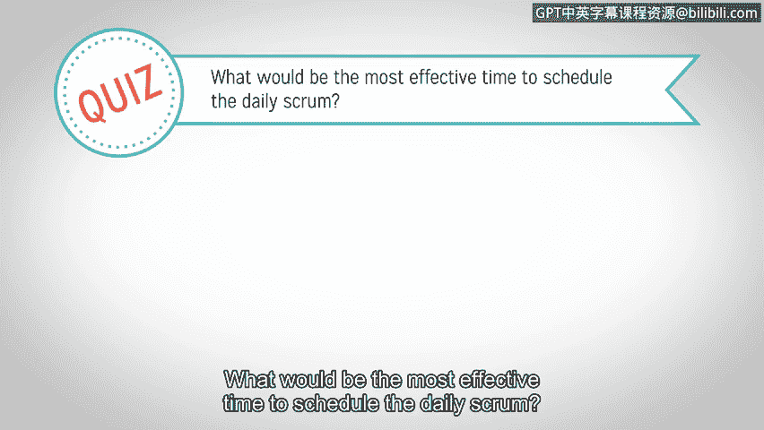

# 软件产品管理课程5：《软件改进的评审与度量》：5-3-1a：每日站会的常见挑战与解决方案

## 概述
在本节课程中，我们将探讨每日站会可能遇到的常见问题，并提供一系列实用的解决方案。每日站会是Scrum框架中的核心实践，旨在促进团队同步和协作。然而，如果实施不当，它可能会变得低效甚至适得其反。我们将逐一分析这些问题，并学习如何让每日站会重新变得高效。

## 每日站会为何失效？
如果你的每日站会效果不佳，可能存在以下情况：会议经常超时；团队成员不愿分享进展；或者会议氛围沉闷、缺乏热情。接下来，我们将详细讨论每日站会中常见的问题以及相应的解决方法。

## 问题一：无人愿意或不知如何开始发言
你可能会遇到一个问题：没有人愿意开始每日站会，或者不清楚发言顺序。团队总是依赖Scrum Master来发起会议。

Scrum Master可以宣布会议开始，但不应该总是由他来负责启动会议。Scrum Master应尽可能避免主导会议进程，因为这容易让会议看起来像状态汇报会，而非团队同步会。

以下是解决此问题的一些技巧：

*   **最后到者先发言规则**：这意味着最后一个加入会议的人必须首先发言。虽然这可能鼓励守时，但最后到达的人通常也是最没有准备好发言的人，因此这个技巧可能效果有限。
*   **传递令牌法**：许多团队使用一个令牌进行传递。这个令牌可以是一个球、一个毛绒玩具或一件办公用品。传递令牌通常能让会议更有趣，鼓励参与者集中注意力，并消除“下一个谁发言”的问题。当一个人完成更新后，他将令牌扔给圆圈中的另一个人。如果团队成员想带着早晨的咖啡参加站会，或者团队规模较大时，这个方法可能不太适用。
*   **轮流发言法**：采用轮流发言技巧，即一个人自愿开始会议，然后按顺序轮流，直到每个人都完成更新。

**场景练习**：你的Scrum团队总是迟到参加每日站会。当大家终于到齐后，又没有人愿意开始会议。你应该实施哪种技巧来使每日站会更有效？
A. 最后到者先发言
B. 传递令牌
C. 轮流发言

实施“最后到者先发言”技巧将鼓励团队更加守时，同时也会迫使某人开始会议。因此，**A是正确答案**。

## 问题二：会议经常超时
每日站会一个非常普遍的问题是经常超过15分钟的时间盒限制。

我们已经讨论过，可以通过确保只有核心成员（“猪”）发言来缩短每日站会的时间。我们也建议将任何离题的讨论添加到会后讨论主题列表中。

如果你仍然超时，以下是一些可以尝试的额外技巧：

以下是你可以尝试的一些额外技巧：

*   **站立开会**：确保你的团队在整个会议期间保持站立。如果你的每日站会是在会议桌旁舒适的椅子上进行的，这会鼓励人们逗留并拖长会议。通过让他们站立，他们会感到不适，从而希望更快结束会议。
*   **使用小型计时器**：将会议的15分钟时间盒分配给每个人。当时间快用完时，正在发言的人会知道需要快速结束。
*   **使用有“分量”的令牌**：你也可以创造性地使用前面提到的“传递令牌”技巧。但不要使用普通的令牌，而是使用一个沉重的健身球。这会鼓励他们想尽快传递它。如果这仍然不起作用，可以让他们双臂向前伸直托着球。在这种情况下，他们绝对会想尽快摆脱这个球。

## 问题三：无人沟通障碍
你可能遇到的另一个问题是没有人沟通障碍。可能是你的团队没有遇到阻碍，但这并不常见。如果没有人提出障碍，但你们却经常错过截止日期，这就应该引起警惕。

解决这个问题的一种方法是，在你自己的更新中包含一些小障碍，让团队知道他们被鼓励提出任何障碍，无论多小。你也可以用一些问题来提示他们，例如：“我或团队可以做些什么让你今天的工作更轻松吗？”

## 问题四：并非所有成员都在上午出席
并非所有团队成员都在上午出席，这在实行弹性工作制的办公室中很常见。

在这种情况下，你应该将会议安排在所有人都会在场的时间。需要注意的是，如果你将会议安排在上午较晚的时候，通常富有成效的工作就无法在会议前完成。会议较晚通常意味着开工较晚，并损失了有效工作时间。

在一天开始时开会是最有效的。但如果不可能，可以将会议安排在午饭后或当天晚些时候的另一个时间，这样会议就不会与一天的开始相关联。

## 问题五：会议感觉像状态汇报会
我们将探讨的最后一个问题是，会议感觉像状态汇报会。如果团队是在向Scrum Master或产品负责人汇报，而不是向开发团队的其他成员同步，那么这代表的是状态汇报会，而非同步会议。

为了解决这个问题，可以提醒进行更新的人与开发团队分享。你可以建议进行更新的人避免与他们的主管进行眼神交流。这鼓励他们看向开发团队的其余成员。

**场景练习**：你的办公室实行弹性工作制，这意味着员工可以在一天中的任何时间工作，只要满足要求的工时即可。你的两名开发人员通常在早上送孩子上学后，于10点到达。一名开发人员喜欢提早开始一天的工作，每天早晨7点准时到办公室。你的最后一名开发人员喜欢中午左右来，并工作到很晚。安排每日站会最有效的时间是什么时候？

A. 上午10点，然后向最后一名开发人员更新会议内容。
B. 午饭后，当所有开发人员都在场时。
C. 根本不进行每日站会，因为早上没有一个人人都合适的时间。

你需要确保整个Scrum团队都出席会议，所以上午10点效果不佳。在一天中较晚的时候进行每日站会比根本不进行要有效得多。因此，**B是正确答案**。无论何时进行，每日站会都是一种很好的实践。在午饭后开会可以鼓励下午的高效工作，并且与一天的开始有足够距离，团队成员不会将会议与他们工作日的开始联系起来。

## 总结与反思
本节课中，我们一起学习了每日站会可能面临的各种挑战及其解决方案。每日站会旨在良好地开启一天，改善团队支持，鼓励改进，增强团队凝聚力，并作为另一个沟通渠道。它是一种非常有效且易于实施的实践。

如果你正尝试在工作场所逐步实施敏捷实践，每日站会是一个很好的起点。不妨与你的团队一起尝试一下。

**反思问题**：
*   你曾经参加过每日站会吗？它们有效吗？
*   你可以实施哪些技巧来使它们更有效？
*   关于每日站会，你过去有哪些行之有效的建议？
*   如果你没有参加过每日站会，你认为它们对你曾工作过的团队会有效吗？为什么有效或为什么无效？

欢迎在课程讨论中分享你的想法。在下一个模块中，我们将讨论如何利用速率来确保你的项目得到正确管理。