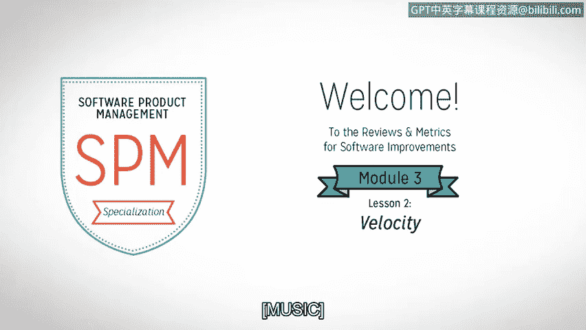
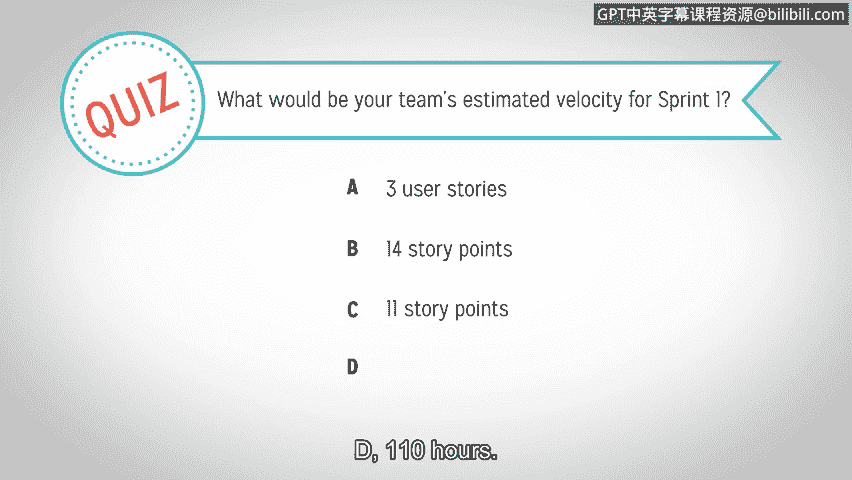

# 艾伯塔大学软件产品管理课程5：《软件改进的评审与度量》｜reviews-and-metrics-for-software-improvements｜ - P45：16_01_5-3-2-velocity.en_subtitled - GPT中英字幕课程资源 - BV1j8411y7q1

🎼。😊。

Velocity is a concept that we've talked about in various places throughout the specialization。

We're going to examine it in more detail in this module。

 since velocity is a great metric to make sure that you are managing your project right。

Velocity is quite a simple concept。 It is the measure of the number of units of work a team completed in a given time interval。

This is commonly measured in story pointss completed per sprint。

We talked about story pointss and how to use them to estimate the sizes of user stories in the Agile Planning for softwareftware Requiments course。

If you are unfamiliar with the concept， you may want to go back and review that lesson。

There are a couple important things to recognize about velocity。First。

 a user story needs to be completed according to your team's definition of done before its story points can be counted towards a team's velocity。

Second， velocity should measure work at the level of user stories and not tasks。

You are calculating your team's velocity achieved for a specific sprint。

Which of the following would count towards your team's velocity？A。

 the number of user stories completed in that sprint。B。

 the story points of the user story completed in that sprint。C。

 a feature that has half of its tasks complete， so you can count half of its story points and or D。

 the story points of a feature that is programmed and documented， but has not yet been tested。

Only user stories that have met the team's definition of done can have their story points counted towards the team's velocity。

You do not want to count the user stories or the story pointss of half done features or tasks。

Only the story points of user stories completed in that sprint can count towards the team's velocity；

 therefore B is the only correct answer。Estimating velocity is not very accurate。

We talked about this a bit in the course on Agile planning for software products。Ideally。

 estimated velocities will be based on previous work。

You can use a previous project to create estimates for velocity。If the team and product are similar。

But what if you don't have that kind of information。

One way to estimate velocity is to break down the work into tasks。

Take the user stories that you are planning to complete in a sprint and create a work breakdown structure for those requirements。

You want to make sure that your estimated task time aligns with your team's available time。

If it doesn't， you may want to add or remove user stories。

Once you've determined which user stories will be completed in your sprint。

 add up the associated story points for those user stories。

 and that will be your goal velocity for your first sprint。

This goal velocity will be used as the estimated velocity for your first sprint。😊。

Your actual velocity is determined by how many story pointss are completed in a sprint。

You and your team are preparing for the first sprint of development。

 You want to calculate an estimated velocity， but your team has never worked together。Also。

 they don't have experience with this type of product。

You have planned to complete four user stories this sprint。

User Story A has been assigned three story pointss。

User stories B and C have both been assigned five story points each。

And user story D has been assigned one story point。

You broke down the user stories into tasks and created task time estimates。

You have estimated that these stories will take 110 hours to complete in total。

Your development team has only 95 available hours this sprint。

You decide to remove user story A from the sprint because it was estimated to take 15 hours。

What would be your team's estimated velocity for sprint one？A 3 user stories， B，14 story points， C。

11 story points， D，110 hours or E，95 hours。

Vellocity estimates should be based on the size measurement used for user stories。In this example。

 we use story pointss。This makes answers A， D， and E incorrect。

 since they are measured by user stories or hours。You decided to remove user story A after you determined that based on your task estimates。

 your team does not have time to complete that user story。Therefore。

 your velocity estimate would be based on the sum of the story points for user stories B， C， and D。

This is 11 story points。 Therefore， C is the correct answer。

A team's actual velocity achieved in each sprint may fluctuate for various reasons。

Your team's first sprint may have a lower velocity than other sprints。

This could occur if the team is still learning how to collaborate with each other。

 or they are learning new technologies。You will also encounter bugs or other risks that can affect your team's velocity。

Over time， however， a team's velocity should stabilize。

A relatively stable velocity demonstrates that your team is following the agile principle of maintaining a sustainable development pace。

The actual velocity is used to create release and iteration burned down charts。

This is what we are going to learn in the next two lessons in this module。

So let's start applying velocity， see you in the next lesson。

