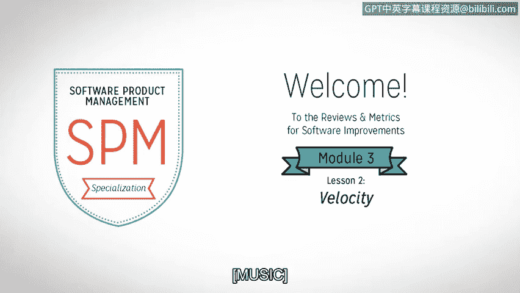
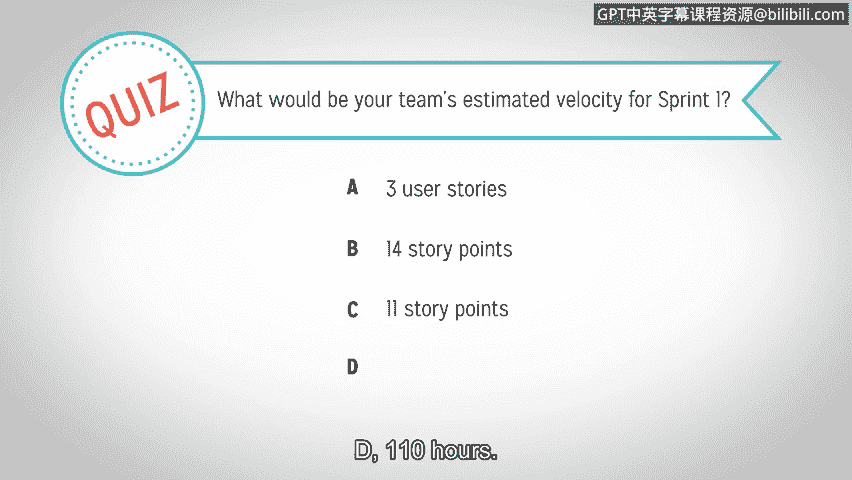

# 软件产品管理：5.3.2：速率（Velocity）🏃‍♂️

在本节中，我们将深入学习敏捷项目管理中的一个核心概念——速率。速率是衡量团队工作效率的关键指标，能有效帮助你确保项目在正确的轨道上运行。

## 什么是速率？

速率是一个相当简单的概念。它衡量的是团队在给定时间间隔内完成的工作单位数量。这通常以每个冲刺（Sprint）完成的**故事点**数来衡量。

我们在《敏捷规划与软件需求》课程中讨论过故事点以及如何使用它们来估算用户故事的规模。如果你不熟悉这个概念，可能需要回顾一下那节课。

关于速率，有几个重要事项需要明确：
*   首先，一个用户故事必须根据团队对“完成”的定义真正完成后，其故事点才能计入团队的速率。
*   其次，速率应在用户故事层面进行衡量，而不是在任务层面。

## 如何计算速率？

以下是计算团队在特定冲刺中实现的速率时，哪些项目可以计入的示例：
*   A. 该冲刺中完成的用户故事数量。
*   B. 该冲刺中完成的用户故事的故事点。
*   C. 一个已完成一半任务的功能，因此可以计入其一半的故事点。
*   D. 一个已完成编程和文档记录但尚未测试的功能的故事点。

只有满足团队“完成”定义的用户故事，其故事点才能计入团队速率。不能计入半成品功能或任务的故事点。因此，只有选项 **B** 是正确答案。

## 如何估算速率？

估算速率并不十分精确。理想情况下，估算的速率应基于以往的工作。如果团队和产品相似，你可以使用之前的项目来估算速率。

但如果没有此类信息怎么办？一种估算速率的方法是将工作分解为任务。取你计划在一个冲刺中完成的用户故事，并为这些需求创建工作分解结构。你需要确保估算的任务时间与团队可用时间相符。如果不符，可能需要增加或移除用户故事。

一旦确定了冲刺中将完成哪些用户故事，将这些用户故事对应的故事点相加，结果就是你第一个冲刺的**目标速率**。这个目标速率将用作你第一个冲刺的**估算速率**。

## 估算速率练习

假设你和你的团队正在为开发的第一个冲刺做准备。你想计算一个估算速率，但你的团队从未合作过，并且对此类产品没有经验。

你计划在本冲刺完成四个用户故事：
*   用户故事 A：分配了 3 个故事点。
*   用户故事 B 和 C：各分配了 5 个故事点。
*   用户故事 D：分配了 1 个故事点。

你将用户故事分解为任务并估算了任务时间。你估计这些故事总共需要 110 小时完成。而你的开发团队本冲刺只有 95 个可用小时。你决定从冲刺中移除用户故事 A，因为它估计需要 15 小时。

那么，你的团队对冲刺一的估算速率是多少？
*   A. 3 个用户故事
*   B. 14 个故事点
*   C. 11 个故事点
*   D. 110 小时
*   E. 95 小时

速率估算应基于用于用户故事的规模度量单位。在本例中，我们使用故事点。因此，以用户故事或小时计量的选项 A、D 和 E 不正确。在根据任务估算确定团队没有时间完成用户故事 A 后，你决定移除它。因此，你的速率估算将基于用户故事 B、C 和 D 的故事点之和，即 **11 个故事点**。所以，**C** 是正确答案。

## 速率的波动与稳定

团队在每个冲刺中实现的实际速率可能会因各种原因而波动。你团队的第一个冲刺速率可能低于其他冲刺。如果团队仍在学习如何协作，或者在学习新技术，就可能发生这种情况。你还会遇到可能影响团队速率的缺陷或其他风险。

然而，随着时间的推移，团队的速率应该会趋于稳定。一个相对稳定的速率表明你的团队遵循了敏捷原则，即**保持可持续的开发节奏**。

实际速率用于创建发布和迭代燃尽图，这将是我们本模块接下来两节课要学习的内容。

---

本节课中，我们一起学习了速率的概念、计算方法、估算技巧及其在敏捷项目管理中的意义。速率是衡量团队稳定交付能力的关键指标，理解并正确运用它，对于把控项目进度至关重要。