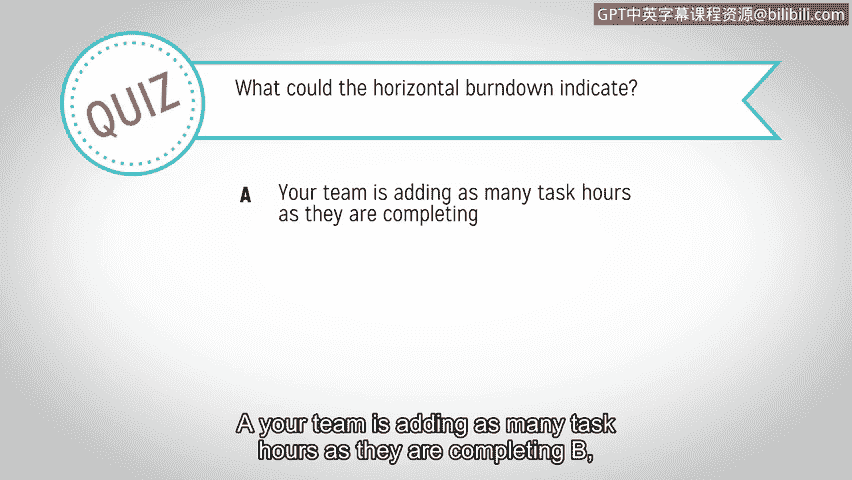
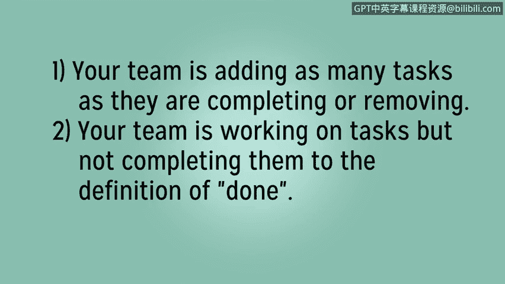

# 艾伯塔大学软件产品管理课程5：《软件改进的评审与度量》｜reviews-and-metrics-for-software-improvements｜ - P48：19_01_5-3-4-iteration-burndown-chart.en_subtitled - GPT中英字幕课程资源 - BV1j8411y7q1

🎼。😊，In this lesson， we are going to look at a few techniques that you can use to track development during a sprint or iteration。

In the last lesson， you learned about a release burn down chart。In this lesson。

 I'm going to show you how a burn down chart can be adapted to track progress during a sprint。

I'm also going to show you how a scrum task board can be used to track progress and how you can use it in conjunction with an iteration burn down chart。

An iteration burn down chart works very similar to a release burn chart。

Here's what a typical iteration burn down chart looks like。

Similar to what we saw in the lesson on release burndowns。

 an iteration burndown has a prediction line。The prediction line demonstrates what sustainable completion of tasks would look like。

An iteration burn down chart can be drawn as a line graph or as a bar graph。

The same as what we saw with release burndowns。Here's what this burn down would look like as a bar graph。

Again， it's a matter of preference。 I like to use bar graphs for release burndowns and line graphs for iteration burndowns to quickly distinguish which one I'm looking at。

I'm going to be using line graphs in this lesson so that you can get familiar with both styles。

Based on this iteration burn down chart， how many person hours of work is the team aiming to complete each day of the sprint。

A220。B 20， C22， or D you need more information。The prediction line shows that the team has 220 total hours of work to complete in the sprint。

Which is 10 days long。Remember， there is no work to be done at the start of day 11。

 so there are only 10 days in the sprint。That means that the team is aiming to complete 22 hours of total work in each day of the sprint。

 therefore C is the correct answer。Let's now look at how the iteration burn down charts and release burn down charts differ。

In an iteration burned down， we have days along the horizontal axis。

 not sprints like we saw in the release burned down。

Along the vertical axis in the iteration burndown， we have the total effort measured in hours。

In the release burn down， total effort is measured in story points。

This changes because in an iteration burndown， we are tracking the completion of tasks。

 whereas in the release burndown， we are tracking the completion of user stories and their corresponding story pointss。

The iteration burn down chart should be updated each day。

This usually occurs at the daily standup where you plot the previous day's work。

Similar to the way that a release burn measures the work to be done at the start of each sprint。

 the total effort for each day represents the work remaining at the beginning of each day。

Only working days should appear on the iteration burned down。

They should not include weekends or holidays unless work is scheduled to be done on those days。

This iteration burndown represents a two week sprint that includes 10 working days。

 You'll notice that the weekend is accounted for， and the dates jump from February 26 to February 29。

You are creating an iteration burn down chart for a development team。

The team does two week sprints and has a two day weekend in the middle of the sprint。

No developers work on the weekend。The team is also attending a conference for one day during the sprint and will not be able to work on the product that day。

How many days should your iteration plan include？A 14 days， B，10 days or C，9 days。

You only include days that your team will be working on the product in the iteration burndown chart。

Since the developers do not work on the two day weekend and the day of the conference。

 they are losing three days in the two week sprint。

 So only nine days should appear in the iteration burned down。 Therefore， C is the correct answer。

Updating the iteration burn down chart usually corresponds to a scrum task board。

Let's take a minute and look at what those are and how they are used before we get into the details of updating an iteration burn down chart。

A scrum task board is very similar to a canban board。

Sometimes a scrum task board is referred to as a whiteboard task board or just simply a task board。

In a Scrum task board， you have all user stories that you intend to complete first print in the first column。

You then break down each user story into developer tasks and create estimates for those tasks。

By creating tasks for each user story， you are ensuring that no tasks are overlooked or missed。

As tasks are in progress， waiting on verification or done， they move across the task board。

 similar to a Kban board。You can have developers write their name on a task as they assign it to themselves。

This will help track who to talk to if you have questions about a certain task。

Once a task moves across the board to the done section， it can be considered complete。

You will then burn up that task on the burndown when it gets updated。

This means that you can deduct the associated hours for that task from the work remaining。

Once all the tasks for a user story are in the complete section。

 then that user story should meet the team's definition of done。

Similar to the way that we only include user stories that have met the team's definition of done is completed on a release burndown。

 we only want to include tasks that are completely done on the iteration burn。

That's why it's a great idea to use an iteration burn down alongside a task board。

 You can see which tasks have been completed and verified。😊。

Let's look at an example of how to use a task board and an iteration burn down together。

Let's add the task of writing tests for a Products login page。

 which corresponds to the third user story on the task board。

We've estimated that this task will take 10 hours。Elllie is the developer who assigns this task to herself。

She moves the task into the in progress column and begins writing the tests。

When she is finished writing the tests， she moves the task the to verify column for another developer to verify。

Another developer， Alfred， looks over Ellie's tests and determine that they are complete。

As he is reviewing Ellie's tests， he moves the task into the verifying column。When he is finished。

 he then moves the task to the done column。At the next daily stand up， Benjamin， the Scrum master。

 marks the task as complete on the iteration burned down。

Elllie's task was the only task that got completed that day。

This is what the updated iteration burndown looks like。

These tasks were moved to the done column of your team's task board on day 6。

You are updating the iteration burn down chart first thing in the morning of day7。

How many task hours are remaining at the start of day 7。A 50 hours， B，40 hours， C，25 hours or D。

15 hours。There were 25 hours worth of tasks completed on day 6。

 That means that you are starting day 7 with 25 fewer hours remaining than you did on day 6。

At the start of day 6， you had 40 hours remaining。If you subtract the 25 hours that were completed that day。

 you are starting day7 with 15 hours of work remaining。Therefore， D is the correct answer。

Let's now consider the question， do you need an adjustable floor on an iteration burn down？

This is up to your team。In most cases， I would say no。However。

 if it is something that your team wants to use， it's definitely something you can easily implement。

The main purpose of an iteration burndown is to have a quick visual of your team's progress within a sprint。

You are not using the iteration burn down to calculate velocity like you can do with a release burn down。

Therefore， adding or removing tasks does not have a big impact on the information that an iteration burndown portrays。

But what if your burn down starts burning up？This happens when you are adding more tasks than you are completing or removing。

This is an indication that your team didn't do careful iteration planning when breaking the user stories into tasks。

Maybe there were tasks that were overlooked or forgotten。Obviously。

 this isn't a good situation to be in， especially if it is occurring late in the sprint。

You can usually avoid the situation by spending adequate time breaking down the user stories into tasks。

If you do find your team adding numerous tasks during an iteration。

 then consider removing or prioritizing some tasks。

This will help to make sure that all your tasks are not in half done states at the end of a sprint。

This is the iteration burndown for your team。What could the horizontal burn down indicate。A。

 your team is adding as many task hours as they are completing。

B， your team is starting tasks， but not completing them。See， your team is not doing any work。

And or D， your team is completing tasks at a constant pace。A horizontal burndown。

 also known as a burn across， can be common and dangerous。Answers A， B。

 and C all represent things that a burn across could indicate。Therefore， answers A， B。

 and C are all correct。A burn across shows that your team is not completing tasks。

 therefore D is incorrect。Like the quiz suggested， a burn cross could indicate three things。One。

 your team is adding as many tasks as say are completing or removing。Two。

 your team is working on tasks， but not completing them to the definition of done。

Or three， your team is on vacation。It is most likely the second case。

When a burndown starts to burn across， it usually means that tasks are getting started but not completed。

If this happens to you， your best solution is to have a discussion with the team to prioritize completing active tasks over starting new tasks。

This could mean that when a team member has free time。

 they could help someone else finish rather than starting an independent new task。

If burn across continues， you risk having user stories in half done states at the end of the iteration。

I like to think of such a project as a poorly run do it yourself home improvement project。

So you want to renovate your house with the intent to upgrade a number of rooms and you start a bunch of tasks at once。

You've torn up the flooring in the living room， Remove the countertops in the bathroom。

 sand at all the interior doors and remove the kitchen sink。

You have multiple rooms in half done states。 The house would be amiss， and unusable。

This would look like a burn across on a burn down chart。

It's not to say that you aren't doing any work， but no rooms are being completed。As you can see。

 an iteration burned down chart highlights in a day or two when things are starting to go wrong。

It is much better for a burndown to identify that tasks are not being completed mid sprint than at the end of the sprint。

Iteration burndowns are an excellent and simple tool to quickly identify when your progress is starting to stray from the expected。

They help to make sure your product is managed right on a day to day basis。

So that wraps up this module on how to make sure your project is managed right。In the next module。

 Bradley is going to take you through retrospectives， enjoy。

