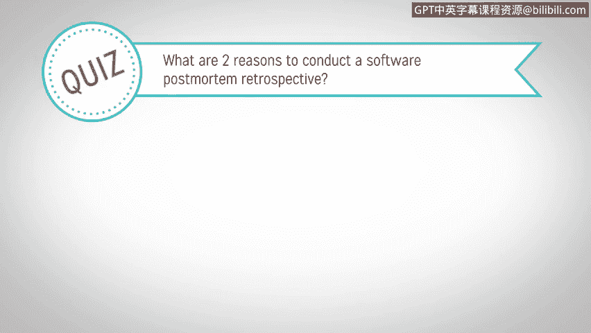

# 软件产品管理：5.4.1：回顾会议

在本节课中，我们将要学习软件开发中的“回顾会议”。这是一种通过反思已完成和未完成的工作，来推动项目持续改进的重要实践。

## 什么是回顾会议？

回顾会议是软件开发社区中使用的一个术语，用于描述对项目中已完成和未完成的工作进行反思的行为。

回顾会议背后有两个基本理念：反思项目中进展顺利的部分，反思项目中进展不顺利的部分，以及思考未来可以采取哪些措施来改进流程。

## 回顾会议的类型

回顾会议主要有两种基本类型：**迭代回顾会议**和**项目回顾会议**。

上一节我们介绍了回顾会议的基本概念，本节中我们来看看这两种具体类型。

### 迭代回顾会议

在迭代回顾会议中，团队通过反思上一个迭代周期内发生的事情来进行回顾。

还记得在敏捷规划与软件项目课程中，我谈到了时间盒，摩根谈到了迭代规划吗？这两种实践都引入了将时间组织成小的、可管理的模块的理念。

在这些时间盒模块之后，至少在敏捷项目中，安排一个计划内的自我评估会议也很重要。这就是迭代回顾会议。

在迭代回顾会议中，从团队自我评估中获得的见解会被应用到下一个迭代中，这使得项目能够定期改进。团队选择什么是重要的，什么应该被重点关注。

这赋予了团队对改进的贡献感，并让他们拥有改进的所有权。它帮助团队从内部获得成功的动力，他们不需要外部力量来推动他们改进。

### 项目回顾会议

在项目回顾会议中，有时也称为事后分析，团队会在整个项目被认为完成时，回顾整个项目。

项目回顾会议的一个主要区别在于，没有下一个迭代可以应用从回顾中获得的经验教训。

但这不应该阻止你进行项目回顾会议。尽管当前项目可能没有下一个迭代，但团队成员很可能还会参与其他项目。这些可能是团队共同参与的其他项目，或者团队解散后各自参与其他项目。这并不重要。

重要的是，整个团队有机会对整个项目进行反思，并将学到的经验教训带入未来的工作中，无论团队是否在一起。进行项目回顾会议的另一个非常重要的原因是，它允许团队宣泄积压的情绪。

在大多数项目中，都会存在个性差异、分歧和妥协。如果在项目结束时，这些问题没有得到解决，可能会产生不健康的影响。进行项目回顾会议使团队能够在协作、开放、无评判的氛围中解决分歧。我们将在下一课中讨论如何确保营造这种氛围。

## 回顾会议的价值与风险

我们已经了解了回顾会议的类型，现在来探讨其价值以及不进行回顾的风险。

进行回顾会议的价值相当明显。但是，当你避免进行回顾时会发生什么？设想一个没有进行迭代回顾会议的Scrum项目。每个迭代之后会发生什么？团队很可能会计划下一个迭代并立即投入开发。事实上，这种情况经常发生。

然而，如果不允许反思，这些项目往往会按照以前的方式继续下去，没有明确意识到项目中哪些进展顺利，哪些不顺利。人们可能有自己的感受，并且可能经常表达这些感受。但是，如果没有一个全团队的回顾会议来捕捉这些感受，就很难就哪些需要改变、哪些应该保持不变做出团队决策。

请记住，无论你的团队多么优秀，总有改进的空间。没有人是完美的，我们不是机器。因此，与其在项目中避免反思，不如鼓励反思。由此产生的改进通常是切实可见的。

## 小测验

以下是关于软件项目回顾会议的两个原因的问题：

A. 将从前一个项目中学到的经验教训应用到未来的项目中。
B. 保证前一个项目中的问题不再发生。
C. 允许团队成员修复彼此受损的关系。
D. 根本不应该进行事后分析。

**答案是A和C。** 事后分析是将经验教训应用到未来项目的好方法，同时也让人们有机会公开谈论他们的经历并修复裂痕。

## 总结

本节课中我们一起学习了回顾会议。我们了解了回顾会议是反思项目工作以推动改进的实践，区分了迭代回顾会议和项目回顾会议两种类型，并探讨了进行回顾会议的价值在于促进持续改进和团队健康，而避免回顾则可能导致问题重复和团队动力不足。

这就是回顾会议的内容以及你应该使用它们的原因。在下一课中，我将讨论围绕回顾会议的一些问题。我们下一课见。