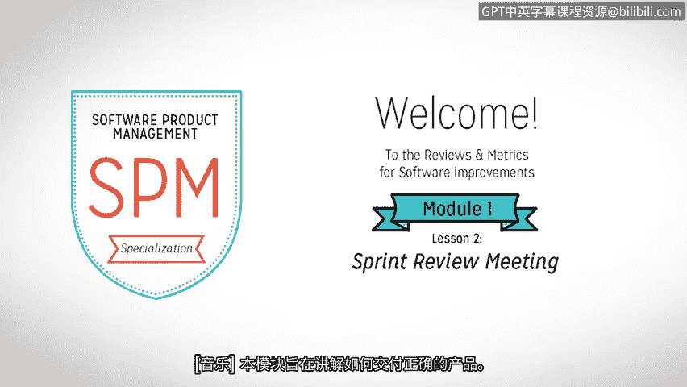
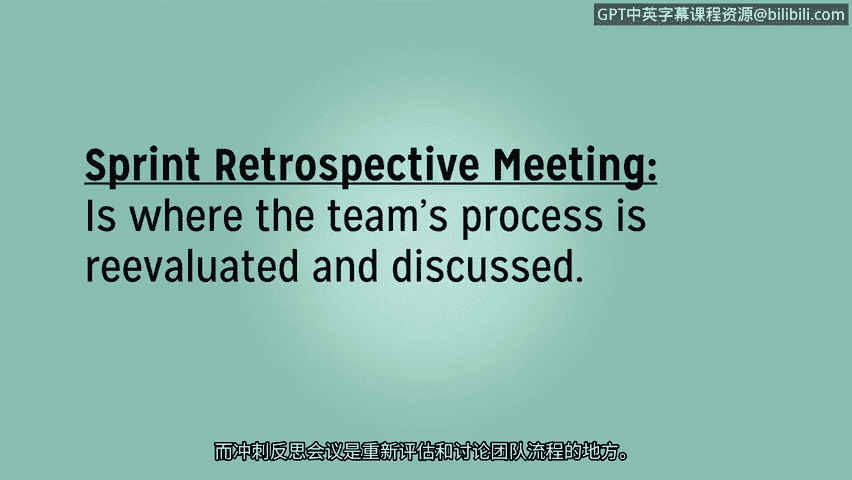
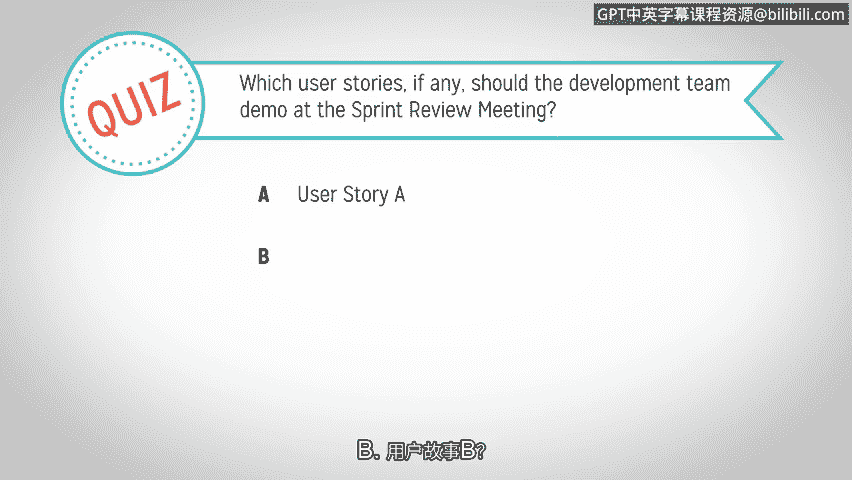
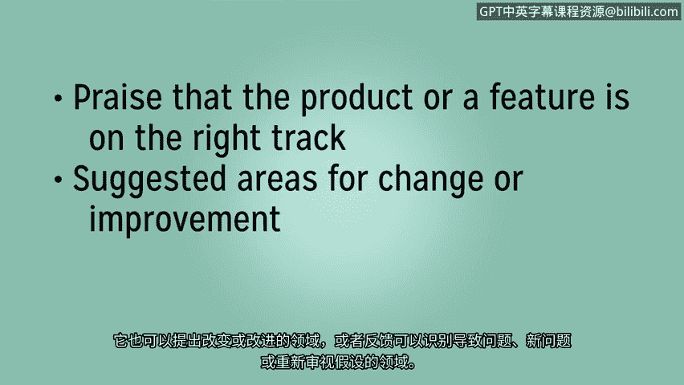
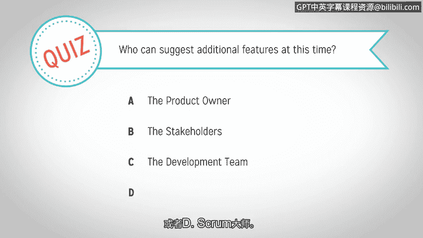

# 艾伯塔大学软件产品管理课程5：《软件改进的评审与度量》｜reviews-and-metrics-for-software-improvements｜ - P4：3_第5.1.2节 冲刺评审会议.zh - GPT中英字幕课程资源 - BV1j8411y7q1

🎼。😊。

This module is all about delivering the right product。

One very important way to determine if this has been achieved is the Sprint review meeting。

A sprint review meeting is a meeting that is held at the end of a sprint。

It is an opportunity for the development team to demonstrate their product。

Before we get into the details， I want to review agile terminology that well be using in this lesson。

A sprint review meeting is a common scrum event。The term Scrum master is used to describe the role responsible for facilitating scrum practices。

Product owner is used to describe the role that is responsible for the product backlog。

Sprints will describe iterations。There are two distinct scrum events that occur at the end of a sprint。

 the sprint review meeting and the printprint retrospective meeting。In simple terms。

 a sprint review meeting is where the product is demonstrated。

 and the sprint retrospective meeting is where the team's process is reevaluated and discussed。

You will learn about the Sprint retrospective meeting in the last module of this course。

The Sprint review meeting occurs prior to the Sprint retrospective meeting。

Let's jump into more detail now。We covered Scrum events in the lesson on Scrum from the course on software processes and agile practices。

Scrum events occur throughout the development process。Sprints， daily standups。

 sprint review meetings and sprint retrospective meetings are all examples of scrum events。

Other than a sprint， the Scrum events are a formal opportunity to gain feedback and evaluate progress。

Scrrum events are all time boxed， meaning they cannot exceed a predetermined amount of time。

The suggested amount of time that you should allot for your sprint review meeting is one hour for each week of the sprint。

Therefore， if you have two week sprints， you should box your sprint review meeting at two hours。

If your sprints are month long， your sprint review meetings should be allotted for hours。

You are scheduling the Sprint review meeting for your development team。

Your team has just finished a three week sprint and they are eager to demonstrate their progress。

What's the maximum time that this meetingn should last？A one hour。B one hour at the end of each week。

See，3 hours。D， however long it should take。You should time box your sprint review meetings to be one hour for each week of the sprint。

 Since your team works in three week long sprints， you should schedule three hours for this meeting。

Your meeting should not exceed three hours， therefore C is the correct answer。

Let's now talk about who gets invited to the Sprint review meeting。The answer is simple。

 Anyone who has any interest in the product is invited。Or using terms from this specialization。

 all stakeholders are invited to the meeting。Typically， the meeting will consist of the Scrum master。

 the product owner， the Scrum team， management， some customers and users。

 and maybe developers from other projects。The meeting is intended to be informal。

 This means no slide presentations and minimal preparation。

Since the meeting is all about demonstrating the product。

 the only preparation needed is to develop the product into working software。

 which is what the development team should be doing during the sprint。

There is very little prep for these meetings because the sprint review meeting should not be a distraction for the development team。

Let's talk about some of the roles in a sprint review meeting。As I mentioned。

 the Scrumma is there to facilitate the meeting。This means that they are there to make sure that it stays within the Sch time box。

The Scrumma will make sure that conversations stay on track。

 the people are voicing relevant comments， and that people are asking questions and providing feedback appropriately。

Although this Scrum master is the one facilitating the meeting。

 the development team will usually run the meeting。

Everyone in the development team should have some input into the meeting since they all played a part。

The product owner is there to approve the features and make sure that the Scrum team is following the overall product vision。

The other stakeholders will have an opportunity at the end of the meeting to suggest feedback and improvements。

You are the scrumma at the Sprint review meeting。As the development team is demoing the product。

 one of the stakeholders offers a suggestion for a new feature。😊，The development team。

 product owner and the stakeholder start discussing this new feature。As the scrum master。

 what should you do？A， join the discussion。B， add the feature to the backlog。C。

 let them finish their discussion or D ask that they save feature suggestions until the end of the meeting。

As the scrub master， you are responsible for facilitating the meeting。This means keeping it on track。

You want to save feature suggestions for the end of the meeting。

This allows the development team to completely demo their product without distractions。

If conversations start to get off topic， you want to direct them back on track or else you risk exceeding your time box。

 Therefore， D is the correct answer。Let's talk about what happens in the meeting。

The Scrumma should start by introducing guidelines for the meeting。

These could be guidelines such as when people are allowed to talk or make suggestions。Following that。

 the scrum team should go over the sprint goal。Once the sprint goal is reapped。

 there are three main events that occur in a sprint review meeting。1， the product demonstration。Two。

 the product owner approval and three stakeholder feedback。First， the Scrum team demos the product。

 the demo should be as realistic as possible using an appropriate platform。For example。

 if the team is creating a mobile app， they should demonstrate it using a mobile device。

The demo should also be authentic。 This means that features are not hard coded to work only for the demonstration。

It should be a live demo of ready and fully completed features。

Features should only be demonstrated when they have met the team's definition of done。

Save incomplete features for future sprint review meetings when they are done。For example。

 the product demo only includes features that are coded， tested， documented， usable。

 and ready to be released。In the current sprint， the development team had four features that were scheduled to be built。

Let's call them user stories A， B， C， and D。User stories A and B met the team's definition of Dun。

User Story C is done and works， but has not yet been fully tested。

User Story D is pretty far from being complete， but the developers could hard code it to make it look like it works in further demo。

Which user stories， if any， should the development team demo at the Sprint review meeting？

A user story， A， B， Use story， B， C， Use story C， and or D， Use story D。

Your development team should only demo user stories that have met the Scrum team's definition of done。

This normally means that they are coded， testable， and usable。

Only user stories A and B meet this criterion。User St C still needs to be tested before it can be demonstrated。

This is important to make sure that the product functions， as expected。

You should never hard code features for a demo， therefore answers A and B are the correct answers。

Following the product demonstration， the product owner then approves completed features from the product backlog。

Once the product owner approves a feature， it is then removed from the product backlog。

The team may choose to have this happen at the meeting。

 or the product owner can approve the feature after spending additional time to evaluate the product。

After the approvals， the scrum master opens the floor to stakeholders。

This is an opportunity for the stakeholders to ask questions， suggest features， and give feedback。

Generally， feedback takes one of three forms。 It could be praised that the product or feature is on the right track。

It could also suggest areas for change or improvement。

Or the feedback could identify areas that lead to questions， new problems， or revisiting assumptions。

Since the backlog is maintained and prioritized by the product owner。

 stakeholders are free to suggest as many features as they want。

It is up to the product owner to determine if or when these features get developed。

This would also be where the product owner can suggest features for the backlog。

We mentioned earlier that suggestions should not be added to the sprint backlog in the middle of a sprint。

This would be an appropriate time for them to add their suggestions。In the Sprint review meeting。

 you have reached the third stage that opens the meeting up for suggestions and feedback。

Who can suggest additional features at this time？A， the product owner。B， the stakeholders。C。

 the development team。 and or D， the scrum master。

At this point in the meeting， anyone can suggest features to be added to the backlog。😊。

The product owner prioritizes the backlog and chooses when and if features get built。

There is no harm in having anyone suggest features， therefore answers A， B， C。

 and D are all correct answers。Sprint review meetings are a great opportunity to demonstrate the hard work of the Scrum team。

 increase transparency and gain valuable feedback。😊。

They also give the scrum team something to work towards and encourage them to produce working software。

In the next lesson， we are going to continue to talk about ways to deliver the right product。

We are going to go over user studies and how they can be used when developing a software product。

