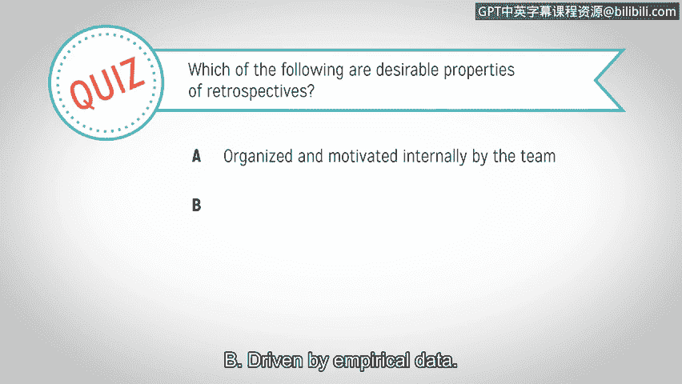

# 软件产品管理：5.4.2：回顾会议的问题与应对 🛠️

在本节课中，我们将探讨软件项目回顾会议（Retrospective）实施过程中可能遇到的常见问题，并学习如何克服这些问题，以建立安全、开放的团队环境，从而有效利用回顾会议推动项目持续改进。

## 回顾会议面临的挑战

上一节我们介绍了回顾会议的概念与价值。本节中，我们来看看在实施回顾会议时，团队可能遇到哪些障碍，以及为何有些团队选择不进行回顾会议。

团队不进行回顾会议的原因多种多样，且都看似合理，但这并不意味着它们是充分的理由。以下是一些常见原因：

*   团队可能出于错误的原因进行回顾，例如仅为满足审计要求。
*   团队可能没有足够的时间。
*   团队可能更倾向于向前看，而非回顾过去。
*   团队成员可能不愿讨论自身问题。
*   团队可能已精疲力竭，不想再思考项目相关事宜。

## 核心障碍：心理安全感

正确实施回顾会议的一个主要障碍是，团队感觉参与其中并不安全。这里的“安全”并非指人身安全，而是指情感与职业上的安全感。

**心理安全感**意味着团队成员能够以真实、坦诚的方式表达自己，而不必担心来自同事或管理层的负面反应。它代表着在确信自己会被倾听、会得到支持的前提下，与队友进行开放沟通的能力，无论你要表达的内容是什么。

为了更清晰地理解这个概念，请看以下示例：

> 皮埃尔是一名开发人员。在每日站会上，他坦诚地告诉团队自己前几天效率低下，原因是工作过度导致精力枯竭。因为他知道不会因效率低下而受到惩罚，所以他感到足够安全，可以向团队公开自己的感受。

反之，如果皮埃尔感到不安全，他可能会倾向于夸大自己前一天的工作量，使自己显得更高效，而不是坦诚沟通精疲力竭的真实问题。这表明他感到工作环境不安全，无法完全表达自己。

## 营造安全环境的策略

那么，如何确保团队感到安全？关键在于为开发者创造一个安全的工作环境。不同组织有类似的方法来实现这一目标，以下是几个关键策略：

首先，明确告知团队你希望营造这样的环境。声明你鼓励一种开放沟通的文化，不排斥新想法或新观点的产生。

其次，确保你对团队成员的贡献表示赞赏。在群体中表达自己并不总是容易的，没有反馈，人们很难知道自己的意见是否被重视。更糟的是，没有反馈时，许多人会默认自己的意见未被重视。因此，对贡献表示赞赏至关重要。这并不意味着你必须同意每个人说的每句话，而是让人们知道他们的贡献是有价值的。

一种方法是直接告诉每个人他们的意见受到重视。然而，如果处理不当，这可能显得不够真诚。通常更有效的方法是鼓励他人对你的观点和想法给予反馈，同时也对他人提供反馈。展示对他人想法赞赏的一个好方法是，在此基础上进一步构建想法，并将原始想法归功于最初提出它的人。这不仅验证了该想法，也肯定了提出想法的人。

另一个鼓励安全环境的关键是积极的领导力。作为产品经理，这种领导力通常从你开始。通过展示对他人的赞赏和保持积极态度，成为团队内的榜样。不要让小麻烦妨碍大局，更不要让你的个人信念妨碍你对每位团队成员给予同等高度的尊重。

## 回顾会议中的实践应用

让我们看看如何将上述原则应用到回顾会议中，确保你创造的安全环境能促进会议中的开放协作。

首先，你需要建立一种**功能性团队文化**，而非功能失调的文化。在功能性文化中，团队中的每个人都努力让其他人看起来出色。没有秘密或戒备性语言，没有信息隐藏，也没有争夺团队明星位置的竞争。在功能性团队中，每个人共享工作的所有权，因此也共享荣誉。每个人都很出色。

在功能性团队中，是团队成员个体驱动会议的成效，而非经理。因为团队知道他们的行为会影响项目，并且他们对项目拥有所有权，所以有动力采取措施进行改进。因此，功能性团队的会议是建设性的，决策来自群体。

另一个需要注意的重要点是：人们参与项目并非为了破坏它。他们是在自身技能和所处环境允许的范围内尽力而为。思考这个问题的一个好方法是类比航空飞行事故调查。航空公司和运输当局不会简单地指责飞行员工作能力差，而是会调查导致失败的所有因素，即使失败是由于人为错误。他们会调查诸如飞行员是否遵循了程序、如果没有是因为缺乏培训还是注意力不集中、或许飞行员睡眠不足等因素。通过以这种客观、可衡量的方式反思事件，更容易做出未来的改进。

## 课程总结

本节课中，我们一起学习了回顾会议实施过程中的主要挑战——心理安全感的缺失，并探讨了如何通过明确沟通意图、赞赏贡献、积极领导以及建立功能性团队文化来营造安全、开放的团队环境。我们了解到，回顾会议不应成为指责游戏，而是反思、改进以及建立信任关系的时机。如果操作得当，回顾会议将成为软件产品经理工具箱中可用于几乎所有项目的强大工具。

现在你已经了解了回顾会议相关的一些问题，接下来我们将深入探讨如何成功执行一次回顾会议。这将是下一节课的内容。