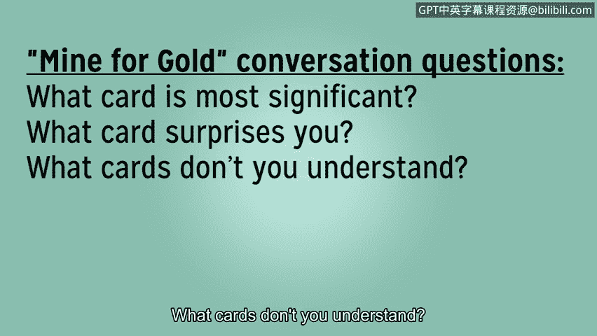

# 软件产品管理课程5：《软件改进的评审与度量》：5-4-4b：项目回顾练习之“回顾过去”

在本节课中，我们将学习项目回顾会议中用于“回顾过去”部分的具体练习方法。这些练习旨在帮助团队系统地回顾项目历程，识别关键事件、总结经验教训并增进团队凝聚力。

## 概述：回顾过去的核心练习

上一节我们介绍了项目回顾会议的整体结构，本节中我们来看看专门用于审视项目历史的几个核心练习。这些练习包括创意时间线、挖掘宝藏、情感地震仪和表达感谢，它们共同构成了深入分析项目过往的基础。

## 创意时间线练习

创意时间线练习旨在可视化项目的完整历程，迫使团队从头回顾项目中发生的所有重要事件。

具体步骤如下：
1.  清理一面墙或白板，并贴上纸张。
2.  给每位成员一叠索引卡或便利贴。
3.  团队成员使用这些卡片在时间线上标记重要事件。
4.  如果适用，先让成员标记自己加入项目的时间点。
5.  如果有成员在项目结束前离开，也标记他们的开始和结束日期。
6.  然后，团队开始共同创建重要事件列表。这是一个包容性的过程，任何成员认为重要的事件都应添加到时间线上。

活动结束时，你将获得一个代表整个项目及其所有事件的视觉化图表。

## 挖掘宝藏练习

在创建时间线之后，下一个练习是挖掘宝藏。在此练习中，团队将按时间顺序分期回顾时间线。

以下是进行此练习的步骤：
1.  在房间内准备五块白板或图表纸，分别标注以下主题：
    *   我们做得很好且不希望忘记的事情。
    *   我们学到的东西。
    *   下次我们应该以不同方式做的事情。
    *   仍然让我们困惑的事情。
    *   我们需要更详细讨论的事情。
2.  在讨论每个时间段时，团队成员可以建议将相关内容添加到这些主题下。
3.  为了促进讨论，在回顾各时期时应提出以下问题：
    *   哪张卡片最重要？
    *   哪张卡片让你感到惊讶？
    *   哪些卡片你不理解？
    *   你看到任何出现的模式吗？
    *   我们应该接下来讨论哪张卡片？
    *   哪张卡片还需要讨论？

这个练习需要投入时间，大约需要5到8小时，最好分两天进行。这是对项目中发生的一切进行深入调查的过程。

将创意时间线练习分两天进行很重要，原因如下：
*   **A**：八小时专注于一个话题时间太长。
*   **B**：给团队时间反思项目。

因此，**A和B都是正确答案**。长时间的专注需要休息，而经过一夜的反思通常能产生更好的结果。

## 情感地震仪练习

在创建时间线并进行反思后，可以进行情感地震仪练习。这个活动有助于探索触发情绪的事件，从而帮助理解项目的深层意义。

具体操作是：让参与者在时间线下方画一条线，用以代表他们在当时的情感波动。这有助于从项目中识别出那些引发强烈情绪的重要事件。

## 表达感谢练习

我们要探讨的最后一个“回顾过去”的练习是表达感谢。这个练习可以在回顾会议中根据需要多次进行，或在任何时间点进行。

表达感谢练习为团队提供了相互表达赞赏的机会。在表达感谢时，措辞应更具个人色彩，例如：“**莎娜，我感谢你帮助我学习Java**”，而不是“我感谢莎娜帮助我学习Java”。使用“我感谢你为了…”的句式更亲切。

以下是进行此练习的步骤：
1.  所有人站成一个圈。
2.  由一个人开始，向圈内的另一个人表达感谢。
3.  接收到感谢的人，再向其他人表达感谢。
4.  如此继续，直到每个人都收到至少一次感谢。

这个练习有助于修复关系并提升团队士气。

## 总结

本节课中我们一起学习了项目回顾会议中“回顾过去”环节的四个关键练习。我们掌握了如何通过**创意时间线**可视化项目全貌，通过**挖掘宝藏**深入分析各阶段并归类见解，通过**情感地震仪**关联事件与团队情绪，以及通过**表达感谢**来加强团队纽带。这些结构化工具能有效引导团队从过往经历中系统性地学习与成长。