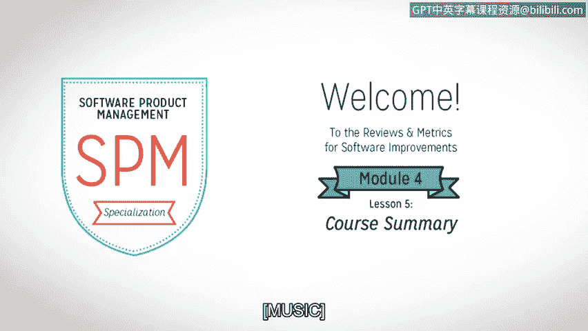

# 艾伯塔大学软件产品管理课程5：《软件改进的评审与度量》｜reviews-and-metrics-for-software-improvements｜ - P56：27_01_5-4-5-course-summary.en_subtitled - GPT中英字幕课程资源 - BV1j8411y7q1

🎼。😊。

So that concludes the module and this course， it's recap。In the first module。

 Morgan discuss how to ensure you're making the right product。She described spring review meetings。

 user studies， product success， and examples of processes used in the industry to create successful。

 well designed products。Then Bradley describe how to make sure the developers have the process done right to achieve a high quality product。

That involved peer review techniques like walkthroughs， technical reviews， and inspections。

Introduce the purpose of metrics。A goal oriented framework to guide their use and some examples of good and bad metrics。

In the third module， Bo detailed how to ensure the project is managed right。

She talked about the daily Scrum。Philoity。Releaaseing the iteration burned down charts and a task board to monitor the status of ongoing and complete work。

In this final module， Brad explained two kinds of retrospectives。

Spprint retrospectives and project retrospectives。Both are aimed at acknowledging issues。

 recognizing contributions， and discovering lessons learned to improve future work。

We covered a lot of approaches in this course to detect ways to improve the product， process。

 and project。To achieve the goals of the right product， done right and managed right。

Since this is the fifth course in this specialization， the next course is the capstone。

If the inocly depicts a structure of the specialization。

 the capsule serves as the all important head， built upon the legs。

 body and arms that represent the preceding courses in the specialization。

The capsule brings together a lot of what you've learned so far。

That's where you participate in a simulated setting to apply an agile methodology。

Interact with users and stakeholders。Toefine the easier stories for a product。

 prioritize a private backlog。Pt's releases。Get feedback。De with change。Follow the progress。

 address risks， and so much more。See you there。