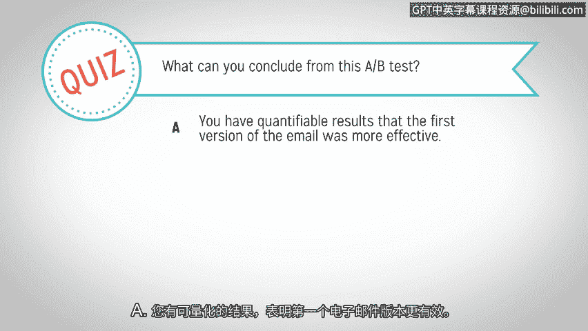
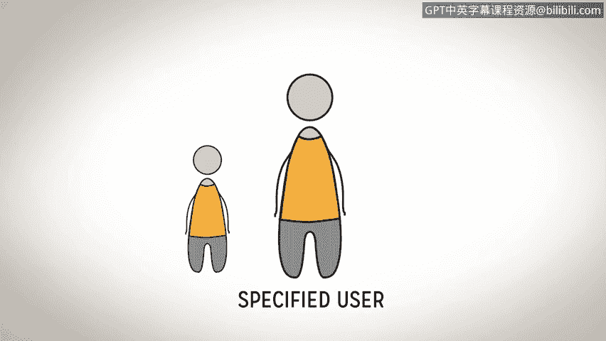

# 艾伯塔大学软件产品管理课程5：《软件改进的评审与度量》｜reviews-and-metrics-for-software-improvements｜ - P5：4_第5.1.3节 用户研究.zh - GPT中英字幕课程资源 - BV1j8411y7q1

🎼。😊。

It's one thing to produce the right product for your client。

But it's another thing to produce the right product for your users。

We talked about usability a bit in the course on client needs and software requirements。

In that course， we are talking more about designing a product that will work for your users In this lesson。

 we will talk about validating that your product works for your users。

Usesability is extremely important to consider when developing software products。

If the users can't use or don't like your product， they won't use it。

One way to validate that you are creating the right product for your users is to conduct user studies。

A user study can measure the usability of a product。

The best definition of usability that I have found comes from a study by the University of Copenhagen on challenges to usability studies and research。

That study does a great job of outlining different kinds of usability studies that are common today。

If you are interested in reading more， you can find a reference to it in the course resources。

They defined usability as the measure of effectiveness。

 efficiency and satisfaction with which specified users can achieve goals in particular environments。

I like this definition because it identifies a few key aspects of user studies。First。

 it identifies that a user study can measure effectiveness， efficiency， and or satisfaction。

Generally， a user study focuses on effectiveness and efficiency and extrapolates that satisfaction would be a result of having an effective and efficient product。

Though there can sometimes be a correlation， that is not always the case。

 and we will talk about this later in this lesson。The other aspect that this definition highlights is that a study consists of achieving goals in a particular environment。

Using a software product is all about achieving goals。

Even if it's not as apparent as in a product such as a game。

There is an intended use or goal for a product。There are many things that a usability study can uncover。

One is whether the user is achieving the specified goal in the intended way。

Another is whether the user is using the product in an unintended way to achieve the goal or a new goal altogether。

If a user is not using the product in the intended way or to achieve the intended goal， then why？

Is that a result of the user interface？Or is there a new。

 maybe better problem that this product can solve。The definition also highlights the specified users in particular environments。

It's important to choose the right users for your study and also to control the environment and test method。

 we will talk about both of these later in this lesson。

You are conducting a user study for your product。In the study。

 you give your subject a goal to achieve。You then review how the users interact with the product。

You are also timing how long it takes them to achieve the goal and how many clicks it takes for them to achieve the goal。

Which factors is this user study measuring？A effectiveness， B， efficiency， and or C satisfaction。

This study is only measuring the effectiveness and the efficiency。Therefore。

 A and B are the correct answers。The effectiveness is measured by whether the subject achieves the goal。

The efficiency is measured by how much time and in how many clicks it takes to achieve the goal。

If you wanted to measure the satisfaction， you could conduct an interview with the users after they have used the product。

You could ask some questions about how they liked the product or how confident they felt that they actually achieved the goal properly。

There are a few ways which user studies can be conducted。

A common way that user studies are conducted is by having a test participant use the product while being observed and recorded by experts。

Sometimes the user is provided goals which they try to achieve。

And sometimes the users can just navigate the product however they want。

Users are often asked to think out loud while they try to achieve the goal。

When a user has a specific goal to meet， a user's study validates whether or not the product is allowing a user to achieve the goal。

It also reveals the parts of the application which may be hindering the user from achieving the goal。

Another type of user study is one where a user is asked to use the product however they feel。

You can learn a lot about the product this way。In this type of study。

 users are often asked to think out loud。From this type of study。

 you can determine what the product is naturally encouraging users to do。

Is this different from the product's intended goal？

You may even discover how the product can be used for different purposes。When this happens。

 you either have to adjust the product to match the product's original intended goal。

Or you can change the focus of the product to match this new purpose。

These types of user studies can allow you to get feedback about your product。

 about how fun your product is to use， its aesthetics， the apparent usability， and the product flow。

Another type of user study is where you would chatow your user and see what an average day looks like for the user。

What task do they complete？Is there a product that would make that easier？

This type of user study can lead you to an innovative product that is right for your user。

Another way that you could test your product is A B testing。In AB testing。

 you compare two versions of the product against each other。Generally。

 this is done by releasing two very similar products with one feature changed。

You will then receive quantifiable results about how the product fares with the new feature compared to the older product。

You are conducting an AB test for an online shopping company。

The company's online mailing list consists of 1000 subscribers。

You send out one version of an email to 500 of those subscribers and a different version of the email to the other 500 subscribers。

Each version of the email has a different coupon code。A week later。

 you check the website' statistics to see how many times each of the coupons has been used。

The first version of the email corresponded to 10 people using the coupon code。

The second version of the email yielded 15 uses of the coupon code。

What can you conclude from this AP test？A， you have quantifiable results that the first version of the email was more effective。

B， you have qualitative results that the first version of the email was more effective。C。

 you have quantifiable results that the second version of the email was more effective， or D。

 you have qualitative results that the second version of the email was more effective。

This AB test provides quantifiable results because we have numbers that we can analyze using statistics。

The results showed us that the second version of the email yielded more sales using the coupon than the first version of the email。

Therefore， C is the correct answer。User studies may also choose to apply quantifiable usability metrics。

For example， these type of metrics could measure the time it takes a user to complete a task。

 the number of page clicks， and the buttons and elements that get clicked the most。

These type of metrics are less subjective than the satisfaction of a product。

But does that make them less significant？Like I mentioned before。

 satisfaction is often not a direct result of an effective and efficient product。

 though that can help。Within user studies， you should carefully choose the people in your studies。

These would be your specified users。You want to make sure that the people you choose are representative of your target audience。

You want your specified users to have similar characteristics to the people you actually intend to use your product。

This could be characteristics such as their background or their computer skill level。For example。

 you don't want to have developers as participants in a study of a product for young children。

Also， as easy as it is to get your friends and family to try your product。

 you need to make sure that they are giving you unbiased feedback and not just telling you what you want to hear。

If you want to see how a user study is conducted firsthand， sign up for one。

Most tech companies conduct user studies and they need participants。

Find a local tech company and see if you can be a part of a user study。

Not only will you get firsthand experience， you are also helping your local tech scene。

There are many other ways that a product's usability can be tested。

 Let's talk about other ways in the course discussion。In the next module。

 we are going to look at some industry examples to see how they validate that they are creating the right product for their users。

