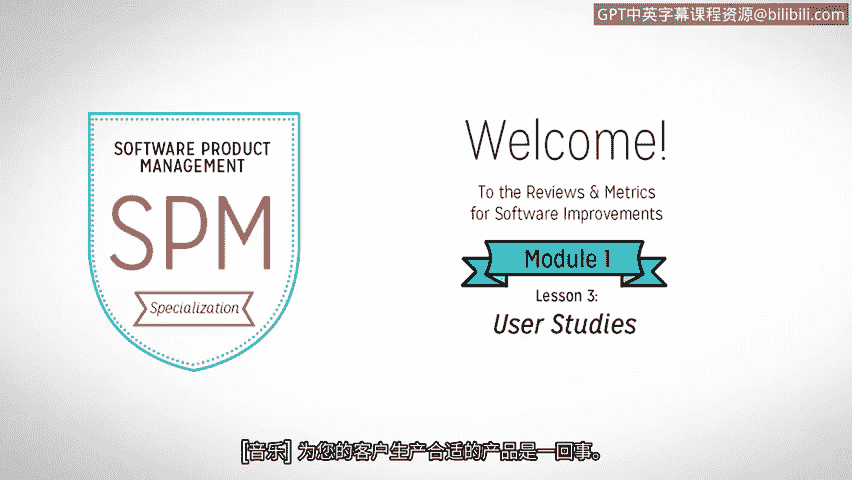
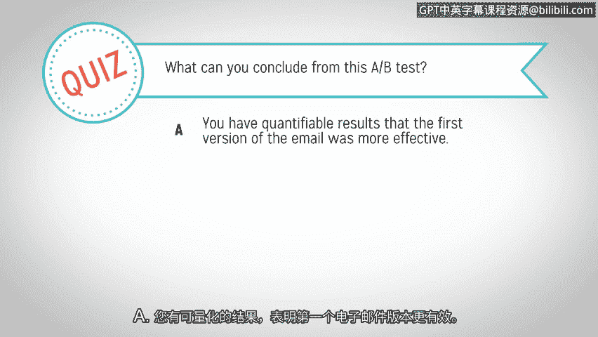
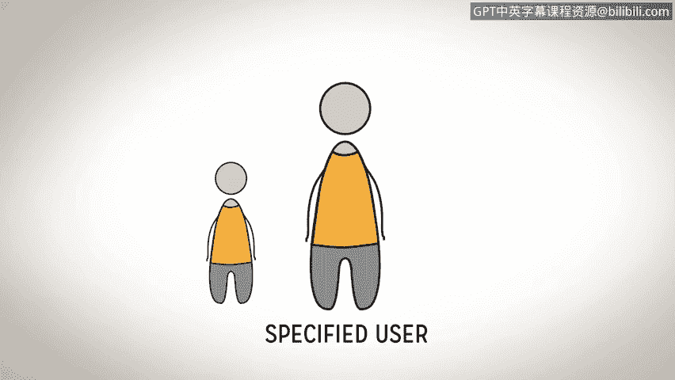

# 软件产品管理：5.1.3：用户研究

在本节课中，我们将学习如何通过用户研究来验证你的软件产品是否真正适合目标用户。我们将探讨用户研究的定义、类型、实施方法以及如何解读其结果。

---

为你的客户生产正确的产品是一回事。为你的用户生产正确的产品是另一回事。我们在关于客户需求和软件要求的课程中已经讨论过一些可用性的内容。在那门课程中，我们更多地讨论了如何设计一个能为用户工作的产品。在本课中，我们将讨论如何验证你的产品能为用户工作。

在开发软件产品时，考虑可用性极其重要。如果用户不会用或不喜欢你的产品，他们就不会使用它。进行用户研究是验证你正在为用户创造正确产品的一种方法。用户研究可以衡量产品的可用性。

我找到的最好的可用性定义来自哥本哈根大学一项关于可用性研究挑战的论文。该研究很好地概述了当今常见的不同类型的可用性研究。如果你有兴趣阅读更多内容，可以在课程资源中找到它的参考文献。

他们将可用性定义为：**特定用户在特定环境中达成目标的效率、效果和满意度的度量**。

我喜欢这个定义，因为它指出了用户研究的几个关键方面。首先，它指出用户研究可以衡量效果、效率和/或满意度。通常，用户研究侧重于效果和效率，并推断出满意度是拥有一个有效且高效产品后的结果。虽然有时可能存在相关性，但情况并非总是如此，我们将在本课后面讨论这一点。

该定义强调的另一个方面是，研究包含在特定环境中达成目标。使用软件产品完全是为了达成目标。即使它不像游戏等产品那样明显，产品也有其预期用途或目标。

可用性研究可以发现许多问题。一是用户是否以预期方式达成了指定目标。另一个是用户是否以非预期方式使用产品来达成目标，或达成一个全新的目标。如果用户没有以预期方式使用产品或达成预期目标，那么原因是什么？是用户界面的结果吗？还是说这个产品可以解决一个新的、可能更好的问题？

该定义还强调了“特定用户”和“特定环境”。为你的研究选择合适的用户，并控制环境和测试方法非常重要，我们将在本课后面讨论这两点。

---

上一节我们介绍了用户研究的核心定义和目的，本节中我们来看看一个具体的测量案例。

你正在为你的产品进行一项用户研究。在研究中，你给受试者一个要达成的目标。然后你观察用户如何与产品交互。你还在计时他们达成目标所需的时间以及达成目标所需的点击次数。

这项用户研究测量了哪些因素？A 效果， B 效率， 和/或 C 满意度。

这项研究只测量了效果和效率。因此，A和B是正确答案。效果通过受试者是否达成目标来衡量。效率通过达成目标所需的时间和点击次数来衡量。如果你想测量满意度，可以在用户使用产品后对他们进行访谈。你可以询问一些关于他们是否喜欢该产品，或者他们对自己是否正确达成目标的信心程度的问题。

---

了解了基本测量维度后，以下是几种常见的用户研究实施方式。

一种常见的用户研究方式是让测试参与者在专家观察和记录下使用产品。有时会为用户提供他们试图达成的目标。有时用户也可以随心所欲地浏览产品。用户在尝试达成目标时，通常被要求进行“出声思考”。

当用户有特定目标要达成时，用户研究验证产品是否允许用户达成目标。它还揭示了应用程序中可能阻碍用户达成目标的部分。

另一种类型的用户研究是要求用户按照自己的感觉使用产品。通过这种方式，你可以了解很多关于产品的信息。在这类研究中，用户通常被要求进行“出声思考”。从这类研究中，你可以确定产品自然地鼓励用户做什么。这与产品的预期目标不同吗？你甚至可能发现产品如何被用于不同的目的。当这种情况发生时，你要么必须调整产品以匹配其原始预期目标，要么可以改变产品的重点以匹配这个新用途。

这些类型的用户研究可以让你获得关于产品的反馈，例如产品使用起来是否有趣、其美观性、明显的可用性以及产品流程。

还有一种类型的用户研究是你会“跟随”你的用户，看看用户的典型一天是什么样的。他们完成什么任务？是否有产品能让这变得更容易？这种类型的用户研究可以引导你开发出适合用户的创新产品。

---

除了直接观察，另一种测试产品的方法是A/B测试。在A/B测试中，你将产品的两个版本相互比较。通常，这是通过发布两个非常相似、仅改变一个功能的产品来实现的。然后，你将获得关于新产品与旧产品相比表现如何的可量化结果。

你正在为一家在线购物公司进行A/B测试。该公司的在线邮件列表有1000名订阅者。你向其中500名订阅者发送一个版本的电子邮件，向另外500名订阅者发送另一个版本的电子邮件。每个版本的电子邮件都有不同的优惠券代码。一周后，你检查网站的统计数据，查看每张优惠券被使用了多少次。第一个版本的电子邮件对应有10人使用了优惠券代码。第二个版本的电子邮件产生了15次优惠券代码使用。

你可以从这个A/B测试中得出什么结论？A， 你有可量化的结果表明第一个版本的电子邮件更有效。B， 你有定性的结果表明第一个版本的电子邮件更有效。C， 你有可量化的结果表明第二个版本的电子邮件更有效。D， 你有定性的结果表明第二个版本的电子邮件更有效。

这个A/B测试提供了可量化的结果，因为我们有可以用统计分析的数字。结果显示，第二个版本的电子邮件比第一个版本产生了更多的优惠券销售。因此，C是正确答案。

---

用户研究也可以选择应用可量化的可用性指标。例如，这类指标可以衡量用户完成任务所需的时间、页面点击次数以及被点击最多的按钮和元素。这类指标比产品的满意度更少主观性。但这会使它们不那么重要吗？正如我之前提到的，满意度通常不是有效和高效产品的直接结果，尽管那可能有所帮助。

在用户研究中，你应该仔细选择研究中的参与者。这些人就是你的“特定用户”。你要确保你选择的人能代表你的目标受众。你希望你的特定用户与你实际打算使用产品的人具有相似的特征。这可能是他们的背景或计算机技能水平等特征。例如，你不希望让开发人员作为针对幼儿产品研究的参与者。

同样，虽然让朋友和家人试用你的产品很容易，但你需要确保他们给你的是公正的反馈，而不仅仅是告诉你你想听的话。

如果你想亲眼看看用户研究是如何进行的，可以报名参加一个。大多数科技公司都会进行用户研究，并且需要参与者。找一家当地的科技公司，看看你是否能成为用户研究的一部分。你不仅能获得第一手经验，还能帮助你当地的科技圈。

---

还有许多其他方法可以测试产品的可用性。让我们在课程讨论中谈谈其他方法。在下一个模块中，我们将看一些行业例子，看看他们如何验证自己正在为用户创造正确的产品。

---

本节课中我们一起学习了用户研究。我们明确了可用性的定义是衡量特定用户在特定环境中达成目标的效率、效果和满意度。我们探讨了用户研究的不同类型，包括目标导向测试、自由探索和A/B测试，并了解了如何选择代表性的用户以及如何解读量化与质化的研究结果。这些方法共同构成了验证产品是否真正适合用户的重要工具。