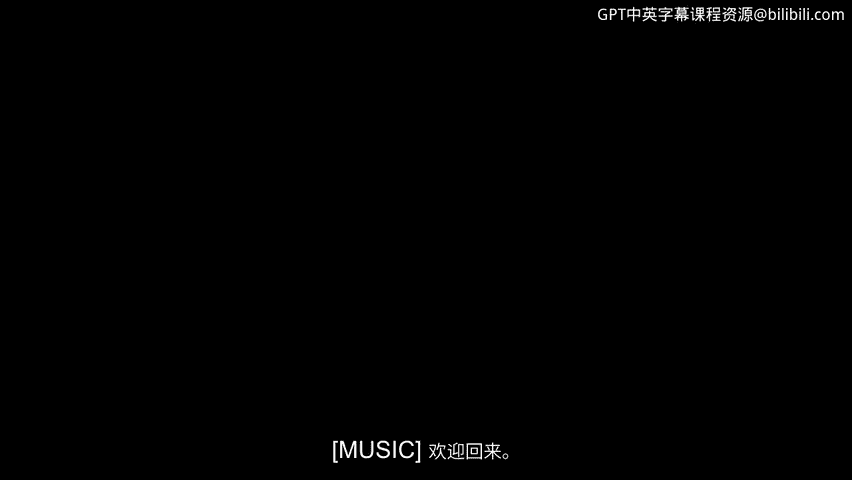
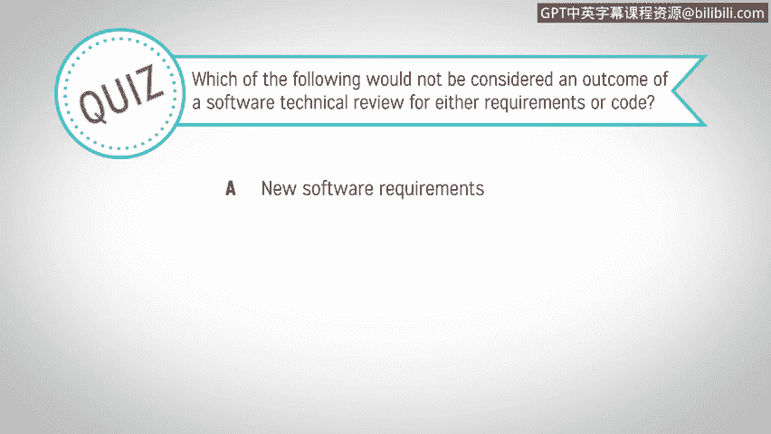

# 艾伯塔大学软件产品管理课程5：《软件改进的评审与度量》｜reviews-and-metrics-for-software-improvements｜ - P8：7_第5.2.1节 评审技术.zh - GPT中英字幕课程资源 - BV1j8411y7q1

Welcome back。

In this module， I'm going to cover how to make sure that your product is done right。

Let's start by going over review techniques that examine the work products made while creating software。

These review techniques will help you to do things like finding defects earlier rather than later。

 when they would be more expensive to fix。Think back to Sprint review meetings。In these meetings。

 developers met with a client in order to go over what had been done in the last sprint and to make sure that they were on track。

In this lesson， I'm going to focus on reviews that are more internal to the development team。

Specifically， I'm going to talk about different types of peer reviews。Pierers， by the way。

 are those who work on the same level。 For example， two developers would be considered peers。

These peer reviews are software technical reviews， inspections， and walkthroughs。As you'll see。

 software peer reviews can range from very formal to very informal。

 and their reach can extend from in depth technical code analysis to high level requirements design。

The least formal peer reviews are software walkthroughs。

Software walkthroughs simply consist of a software developer showing how the code works。

 It's show and tell， where the developer gives a small audience a tour of their code。😊。

Throughout the walkthrough， the audience is allowed to ask questions and point out potential issues。

Walkthroughs are informal because they're meant to give a developer a really quick and easy way to help them improve the quality of their software。

One example of a walkthrough is a developer just built a piece of software that authorizes a payment for a customer by connecting to the company's customer database and pulling the customer's payment information。

After building this functionality， the developer calls over a few peers and asks if they could do a quick code walkthrough。

Everyone gathers around the developer's computer and the developer walks them through the code。

 skipping a lot of the minor details。During the code review。

 the developer's peers will question things like the reliability of the library used to access the database。

Whether the current code is the most resource efficient option or if the code is secure enough to be released to the general public。

Piers also help to make sure that the code is readable and meet the team's coding standards。

On top of this， the developer's peers will also become more familiar with the code。

When they work on other projects， they may integrate some of the knowledge they gained from the walkthrough because of this aspect。

 code walkthroughs are often used as a means to train new team members。All in all。

 the software code walkthrough is a valuable review technique。

They allow individual developers to harness the power of their peers， allowing for suggestions。

 improvements， and familiarization without expending much extra energy。During a software walkthrough。

 a software developer is required to produce which of these work products。A code review summary。B。

 requirements document。C， meeting minutes。Or D， nothing。The answer is D。

 nothing a software walkthrough is intended to be casual。

 and therefore no work products are required to come out of one。

The software technical review is different from the walkthrough。

A software technical review is more formal， and its purpose is to address technical aspects of the product。

How formal a software technical review is depends on the organization implementing it。

A military defense contractor， for example， would be much more rigorous in its review process than say。

 a company building a mobile game。Essentially， the whole purpose of a software technical review is to improve a software product at a technical level。

A software technical review could be used in creating more robust designs。

Forming well defined requirements from a client， or making a number of technical improvements to the code。

A software technical review is discussion oriented and consists of three main roles。

The person whose work is being reviewed is called the decision maker。

The decision maker is responsible for setting the goals of the review and determining whether those goals have been met。

The review leader makes sure that the review is orderly and on track。Finally。

 the recorder is in charge of documenting all the identified issues。

This doesn't mean that they're a minute taker。 The recorder is the person at the meeting who notes the findings of the meeting。

Prior to the review， everyone involved in the review prepares。

The decision maker creates a list of objectives that they would like to see come out of the meeting。

The review leader ensures that everyone has access to the software product to be reviewed。

And all others do their part in reviewing the material they are given beforehand。

In the actual review meeting， the review leader facilitates the conversation between all the relevant parties。

If this were a requirements solicitlicitation meeting。

 the review leader would make sure that the client and their product team were communicating their needs properly and guiding the meeting towards the decision makers's goals。

In the case of the elicitation meeting， those goals would likely be that you have a list of user stories off of which the development team can plan their work。

In a software technical review， one person may have multiple roles。

You could have a contributor to the review be someone who contributes to the overall discussion。

 but also holds the role of a review leader。Someone may be a decision maker and a recorder as well。

It all depends on who volunteers should do what and what makes sense for the situation。

At the end of the software Techn review， a certain goal should have been met。

This could have been to resolve ambiguities or to make improvements upon the current product as a few examples。

The result of the technical review is a set of recommendations to be made for the software product's improvement。

Which of the following would not be considered an outcome of a software technical review for either requirements or code？

A， new software requirements。

B， improved software production processes。C， increased code efficiency or D。

 increased pay for efficient employees。The answer is D， increased pay for efficient employees。

 while a software technical review could lead to increased awareness of employee efficiency。

 the goal is not to focus on individual team members， but to improve the product as a whole。

