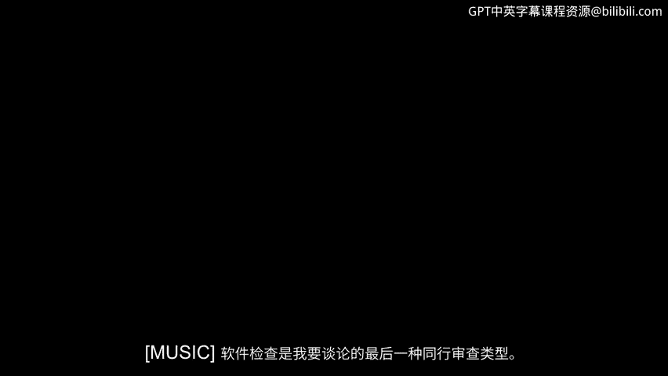
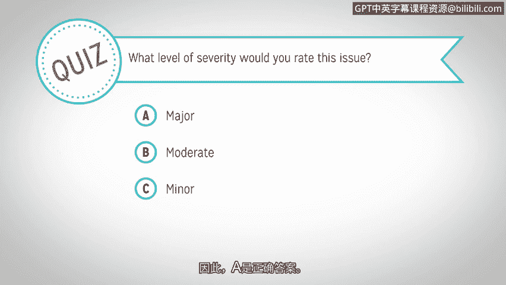

# 艾伯塔大学软件产品管理课程5：《软件改进的评审与度量》｜reviews-and-metrics-for-software-improvements｜ - P9：8_第5.2.1a节 评审技术.zh - GPT中英字幕课程资源 - BV1j8411y7q1

🎼。😊。

Software inspections are the last type of peer review that I'm going to talk about。

They also go by the name of formal technical review。

 so try not to get them confused with software technical reviews。

A software inspection is more formal than the previous two review types。A software inspection。

 like a software technical review， contains multiple roles and follows a rigid structure。

The main purpose of software inspections is to find and fix defects in a work product。

 like a set of requirements for a module of code。To do that。

 software inspections make use of an author， moderator， reader， inspector， and a recorder。

Like the So Technical Review， multiple roles may be assigned to one person。

The author is the person who created the software product under the inspection。

The moderator is like the review leader from the software Tech review。

 they oversee the inspection and make sure that everything goes smoothly。

The reader is responsible for reading the documents to the inspectors who then point out defects in the documents。

The recorder as before， is the person who takes notes。

Software inspections consist of multiple stages， some of which can be repeated until the product has met the appropriate standards。

The first stage is the planning stage。 In this stage。

 the moderator makes themselves familiar with the product that is being reviewed and any primary areas of concern to the author。

The next stage is the overview meeting where all the people filling roles in the review come together and are briefed on the product by the moderator。

It's usually at the end of this stage that the inspectors are given the product to be reviewed。

 which kicks off the preparation stage of the inspection。During the preparation stage。

 the inspectors review the product for defects and make notes。

Completing this stage can take anywhere from a few minutes to a few days。

 depending on the work product that's being reviewed。After the preparation stage。

 the real inspection meeting happens。At this meeting。

 the reader reads through the document in small chunks。

The inspectors then make comments on the defects that they found in each chunk。

 and the recorder makes sure to document all of it。

The author can ask questions and seek clarification， but since an inspection is more rigid。

 discussion is not encouraged。After the inspection meeting。

 the author takes the feedback that they receive from the inspectors and makes the necessary changes。

When that's finished， a follow up is done to ensure that changes have been completed。

 are appropriate， and address the defects found in the inspection meeting。

I said before that some of the inspection stages can be repeated。

The stages that usually get repeated are the rework and follow up stages。

This is because sometimes the work that is done in the rework stage does not sufficiently address the defects raised in the inspection meeting。

When this is pointed out in the follow up stage， the author must then go back and finish their work。

The software inspection also implements strict procedures on how to determine when each stage is complete and when something is ready for the next stage。

For example， to begin the inspection process， there could be a checklist of things that need to get done。

This checklist could include a software walkthrough has been completed。

The code has passed all test cases， or each function contains enough documentation。

This is done to help the moderator and inspectors properly review the work product before it's discussed。

Of the three different types of peer review that I talked about in this lesson。

 which is the most rigid in structure。A software walkthrough。B， softwareft Techical Review or C。

 software inspection。The answer is C， a software inspection。

Software inspections are the most formal type of peer review。

 followed by the software technical review， and then the walkthrough。

Let's talk about a very popular software inspection technique。The requirements technical review。

The requirements technical review is a two stage process。The first stage is the review。

 and the second stage is a discussion meeting。You can conduct this process with more than one inspector or more than one time。

In the review stage， a reviewer examines a set of requirements written by an author。

The author may need to provide each reviewer with a glossary and any other relevant information sources。

Each reviewer examines the requirements document to locate as many defects as possible。

This could include errors or emissions that would prevent the product from performing one or more of its tasks。

Each reviewer also identifies high risk areas in terms of requirements criteria。For example。

 a situation where the requirements seem incomplete， too rigid。

 or too shallow to handle all the situations that might occur。

Each reviewer should also highlight any concerns。For example。

 they might highlight a situation where the requirements are correct and complete。

 but could be improved in terms of complexity or reusability。

Each reviewer should then classify their findings into major， moderate， or minor levels of severity。

A major finding means that the repair for the problem is not obvious and a very careful further exploration is required。

A moderate finding means that the repair for the problem is straightforward。

 but needs to be further reviewed。A minor finding indicates the fix is either unnecessary or obvious。

 and there's no need for further review。Youre performing the review stage for the requirements of another team。

You found an issue that one of their requirements was not feasible within their budget， timeline。

 and resources。You think that they would have to rethink their entire product planning？

What level of severity would you rate this issue。A major。B， moderate。Or C， minor。

This type of issue would be a major level of severity since there is no obvious solution。

 and that team would have to carefully review their product。 Therefore， A is the correct answer。

Once the review stage is complete， you move on to the second stage of the process。

 the discussion meeting。In this meeting， there should be reviewers， the author， a moderator。

 and a recorder。The moderator is responsible for making sure the meeting stays on topic and that criticism is presented in a constructive way。

They ensure that the review is not felt like an attack on the author。

A scrum master could moderate this meeting similar to the way that they would other meetings。

There should be a recorder for the meeting as well。This person could be unrelated to the project。

They're just responsible for recording notes from the meeting。

The authors will consult these notes to fix the identified issues。

It's a good idea to timebox this meeting so that it stays on track and does not take away too much time from the reviewers or author。

In this meeting， the collected findings will be discussed and potentially reclassified。

It's a good idea to keep discussions on minor issues as minimal as possible。

The author is not expected to respond to every question or comment raised。

 but the recorder should note down all issues。The author is present primarily to better understand the findings and ask for clarification when needed。

This will help to keep the meeting within the established time box。

Following the requirements technical review process is a repair process。In the repair process。

 the author of the requirements will take the feedback from the review and make adjustments to the requirements。

They're not required to address all the suggested changes。

Some of the issues raised may not be valid or have already been addressed。

I've found that this requirement's technical review process is extremely helpful to make sure that your team has high quality requirements。

This is very helpful to make sure that the product is done right。

You can also learn a lot about development and about creating good requirements from conducting the review。

Before we finish， let's talk about the requirements inspection。

A requirements inspection is a formal process in which a list of user stories is reviewed for ambiguity。

 consistency and completeness。Abiguity is a big problem with software requirements。

 and often it's useful to have a third party review your requirements to make sure that everything is clear。

If you need a refresher， Morgan covers the different types of ambiguities in the client needs and Soft requirementsments course。

When all the issues with the requirements are identified， it's up to the author to fix them。

Usually the author is a product owner or a software product manager。

 and may also include members of the development team。Sometimes the author is the client。

In all these cases， the defects that are raised in the inspection meeting are then addressed and presented again in the follow up。

Requirements inspections are useful ways to make sure that your requirements are clear。

 consistent and complete。The inspection process makes the task straightforward and easy to understand。

 which probably accounts for its popularity in the industry。

Software peer reviews aren't useful no matter the context， whether they're an informal walkthrough。

 a technical review or a formal inspection， reviews have a place on nearly all software projects。

Now that I've covered some techniques for how to review software。

 let's talk about some common problems with software review processes。

That's what I'll cover in the next lesson。 I'll see you there。

