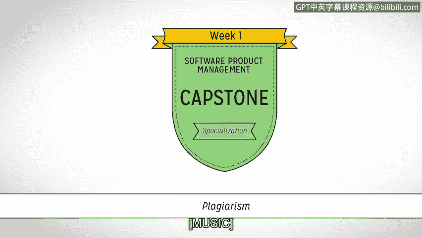

**软件产品管理毕业项目：P3：第0.4节 剽窃**

在本节中，我们将明确课程中关于学术诚信的核心规定，即禁止剽窃行为。我们将了解剽窃的定义、具体表现形式以及如何避免它，以确保你提交的所有作业都是原创的。

---

**什么是剽窃？**

根据课程荣誉准则，剽窃的定义是：在未注明出处的情况下，复制他人作品中的文字、观点或任何其他材料。在任何学术环境中，剽窃都是不可接受的，它严重违反了课程荣誉准则。

剽窃行为可能导致作业不及格、被取消课程资格，甚至被逐出Coursera学习社区。

---

**剽窃的具体表现有哪些？**

以下是几种常见的剽窃行为，请注意避免。

**1. 复制粘贴他人文字**
如果你直接复制粘贴他人撰写的文字，这即构成剽窃，除非你进行了恰当的引用。即使你调整了语序或替换了某些词语，也必须为其原创工作署名。
> **示例**：在作业、测验或讨论区中，复制粘贴其他学员或课程团队成员的答案或发言，并将其作为自己的成果提交，这是被禁止的。

**2. 提交他人创建的文件**
在本专项课程的某些课程中，你可能会被要求提交图片或图表作为作业。提交由其他学员创建或提交过的图片，并声称是自己的作品，这被视为剽窃且不被允许。

**3. 窃取创意**
部分作业可能需要发挥创意。即使你自行撰写了提交的文档，但窃取了他人的创意想法，同样构成剽窃。在学术或商业环境中，多人可能产生相似的想法是常见情况。

---

**如何保护自己免于剽窃指控？**

为了避免被指控剽窃（不仅在本课程中，在你的职业生涯中也同样重要），养成记录工作过程的习惯是一种很好的做法。

你可以通过记录修订历史或某种方式记录你的思考过程来保护自己。例如，维护一份日志来记录每个想法或概念的起源时间。

请确保在整个专项课程中提交的都是你自己的原创作品。

---

**发现剽窃行为怎么办？**

如果你在课程中发现剽窃行为，请举报该作业并提请课程团队注意。

---

**本节总结**

本节课我们一起学习了学术诚信的重要性。我们明确了剽窃的准确定义，列举了复制文字、提交他人文件、窃取创意等具体剽窃形式，并了解了通过记录工作过程来保护自己的方法。请始终牢记，提交原创作品是学习与职业发展的基石。