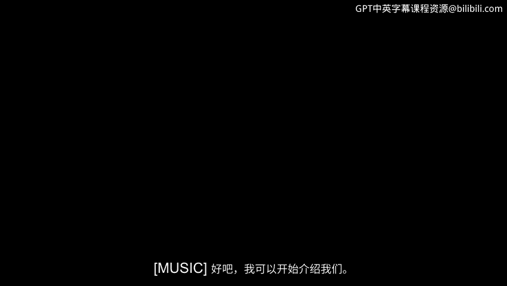
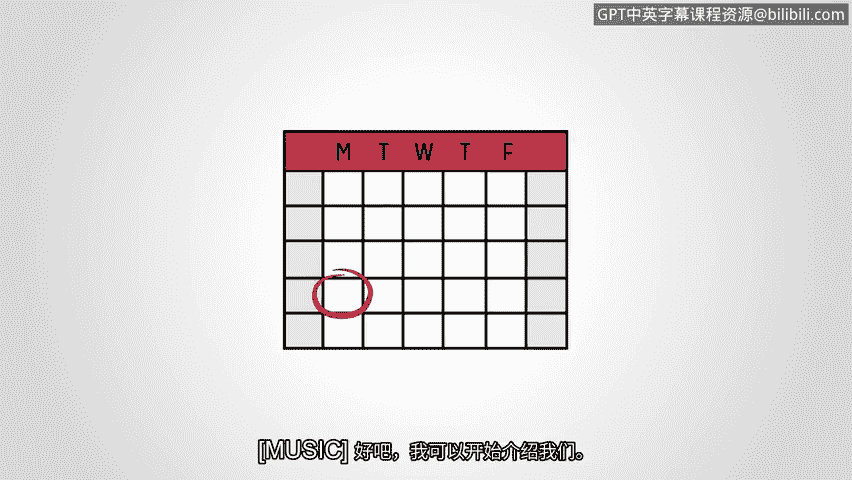

# 004：视频模拟开发团队简介 🎬

在本节中，我们将通过一段模拟视频来认识一个虚拟的软件开发团队成员。了解团队成员的背景、性格和工作风格，对于未来的产品管理和团队协作至关重要。

---

## 团队成员介绍

以下是视频中四位开发团队成员的自我介绍。

### 凯瑟琳 (Kathleen)

我的名字是凯瑟琳，但请叫我凯特，凯瑟琳太正式了。我在这个行业工作了很久。在我的职业生涯中，我很幸运能从许多不同的视角体验软件行业。我从开发人员起步，但也担任过Scrum主管、产品负责人和Scrum教练。但我确实怀念创造的过程。我喜欢与其他团队合作并激励他们做得更好，但我非常怀念编程所带来的创造性表达。所以几年前，我回归了开发的老本行。我是一名热心的瑜伽爱好者，大多数晚上我都会在几个街区外一个很棒的小工作室练习瑜伽。如果你们有人想加入我，我认为这对创造生活平衡非常有益。实际上，我认为这将是一次很好的团队建设活动，我们可以一起去上课。我认为这会使我们在精神和心灵上成为一个非常强大的团队。好了，这就是我。我真的很期待了解大家，并创造出一些非凡的东西。亚历克莎，接下来你介绍一下？

### 亚历克莎 (Alexa)

好的。我是亚历克莎。我在这个行业已经工作了好几年，参与过一些很酷的项目。最近，我主要专注于视频游戏开发。是的，我离开了上一家公司，他们控制欲太强了。他们总是想让我记下所有的工作时间之类的。我的意思是，他们为什么不能相信我在工作呢？我编写的代码比那里任何其他开发人员都多。

**关于业余爱好**：哦，没什么特别的。我弹贝斯，在一个全女子朋克乐队弹贝斯。是的，我们在本地音乐圈实际上越来越受欢迎。我还喜欢画画，喜欢设计服装。不过，我实际上没做过多少衣服，但我有很多设计图，所以也许我会进一步追求这个爱好。

**温迪的回应**：哇，听起来太棒了。也许团队可以去看你的一场演出。请务必告诉我们你下次演出的时间。乔希，接下来你介绍一下？

### 乔希 (Josh)

嗨。我是乔希。我干这行有段时间了。我九岁就开始编程，当时造了一个机器人去监视我的兄弟们。我懂大多数编程语言，至少是那些有用的。业余时间，我通常都在电脑前。不编程的时候，我就在写博客。我真的很喜欢游戏，最近因为《英雄联盟》玩得太好觉得没挑战，又重新玩起了《魔兽世界》。

---

## 总结

本节课我们一起通过模拟视频认识了一个开发团队的核心成员：经验丰富、注重平衡与创造的凯特；才华横溢、追求自由、多才多艺的亚历克莎；以及技术扎实、热爱游戏的乔希。了解团队成员的个人背景与工作风格，是进行有效产品管理和团队协作的第一步。在接下来的课程中，我们将看到这个团队如何协同工作。