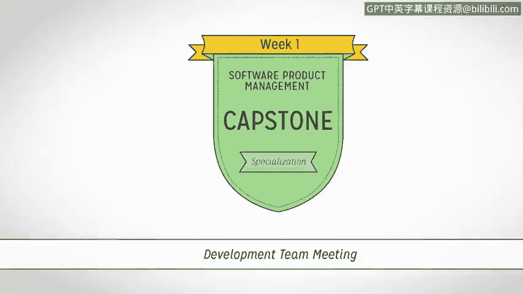

# 005：模拟开发团队会议

在本节课中，我们将通过一个模拟的开发团队会议，学习如何将产品需求转化为具体的技术方案和设计考量。我们将看到开发团队如何讨论功能细节、权衡技术选择，并澄清需求的模糊之处。

---

上一节我们讨论了产品需求，本节中我们来看看开发团队如何围绕这些需求展开技术讨论。

会议开始时，团队首先评估了项目的整体情况。大部分功能，例如浏览和搜索，被认为是标准功能，实现起来相对直接。

因此，团队决定将讨论重点放在那些定义较为模糊、需要进一步澄清的功能上。

以下是团队讨论的第一个核心功能：用户互动方式。

*   **问题提出**：团队成员对用户如何在应用内交流感到困惑。这与单纯的阅读应用有何区别？是否可以简化为一个消息功能？
*   **初步分析**：有成员指出，如果只是发消息，就失去了“为他人朗读”的意义。
*   **方案探讨**：团队提出了视频聊天的想法，但立即考虑到视频会消耗大量移动数据。
*   **最终方案**：团队决定设计一个**音频通话**作为主要互动方式，并将其作为视频通话的备用方案。同时，为了实现连接，应用需要包含一个**好友列表**功能。

这个讨论自然引出了对用户账户系统的思考。

*   **必要性确认**：创建好友列表意味着需要用户账户。团队进一步确认，为了存储用户历史记录、已读书籍以及跟踪阅读能力，账户系统是必不可少的。
*   **关联功能**：账户系统将附带登录、重置密码等一系列标准功能。

接下来，团队讨论了另一个复杂功能：阅读能力跟踪。

*   **需求回顾**：产品负责人丹尼尔提到了跟踪阅读能力。
*   **技术担忧**：有开发人员对实现语音识别技术表示担忧，因为这是其不熟悉的领域。
*   **风险应对**：团队决定暂时将此功能标记为“可做”，但会在设计阶段开始前，将其作为一项潜在的技术挑战向产品负责人提出。

随后，会议转向了“传递共读”功能。

*   **功能理解**：团队最初认为这就像普通的电子书阅读器，缺乏互动性。
*   **价值挖掘**：为了增加价值，需要集成某种交互技术。
*   **技术方案**：有人建议通过**蓝牙**无线连接两台设备，并在每台设备上同步显示相同内容。团队认为这个方案可行。
*   **功能定位**：团队同时确认，应用仍需保留单人阅读功能，作为电子阅读器使用。

明确了核心功能后，团队开始讨论产品的硬件和平台载体。

*   **载体选择**：考虑到产品需要“像一本书”，且智能手机阅读体验较差，团队一致认为应专门为**平板电脑**设计。
*   **平台决策**：关于开发Android、iOS还是两者兼顾，团队认为客户可能希望两者都有，但这将带来大量工作。他们决定向客户确认优先级，并希望暂时只开发一个平台。

关于应用的具体设计，团队也进行了构思。

*   **显示模式**：应用应同时支持**竖屏**和**横屏**模式。横屏时并排显示两页，竖屏时单页显示但字体更大。
*   **交互细节**：团队还提出了添加**页面翻动动画**以增强阅读体验的想法。

最后，团队讨论了内容数据的存储与管理策略。

*   **数据源**：内容将来自客户提供的数据库。
*   **存储策略**：将所有内容存储在设备上是不现实的，会占用过多空间。因此，团队决定：
    1.  应用只从数据库拉取**书籍标题和元数据**进行浏览。
    2.  当用户开始阅读一本书时，才将内容**下载并临时存储**在设备上。
    3.  **收藏夹**和**待读列表**应保存在设备本地，以便用户离线时也能选择阅读这些书籍。
    4.  用户应能**从设备上删除已下载的内容**，管理存储空间。
*   **词典功能**：针对儿童用户，团队否决了内置词典的想法。取而代之的方案是：当用户**长按或选中某个单词**时，弹出该单词的定义。这模拟了向共读伙伴询问词义的过程。

---

本节课中，我们一起学习了开发团队如何通过会议将产品需求具体化。团队系统地讨论了用户互动、账户系统、阅读跟踪、硬件平台、UI设计及数据管理等关键问题，将模糊的需求转化为清晰、可执行的技术方案和设计要点，为后续的设计与开发工作奠定了基础。