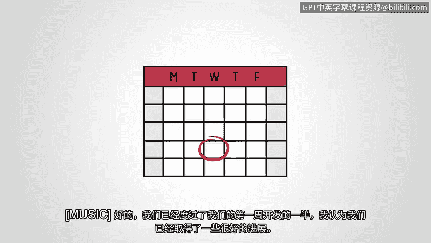

# 009：第4.1节 视频模拟站立会议

## 概述
在本节中，我们将通过一个模拟的站立会议视频，学习敏捷开发中每日站会的实际流程与沟通要点。我们将观察一个开发团队在项目第一周中期如何同步进度、提出障碍并协作。

---

我们正处于开发第一周的中期，并且已经取得了一些很好的进展。

谁想开始我们今天的站会？我可以先开始。昨天我开始着手“阅读器连接”功能的工作。这个功能基本上已经完成了。我的意思是，我今天大概就能完成它，然后我会开始添加音频功能。是的，我目前没有任何阻碍。

好的。我昨天在处理页面格式化。这被证明有点困难。一些功能，它们不太对劲，事情没有按照我想要的方式排列。我已经设置了在纵向和横向模式下都能工作，但是图片把布局打乱了。所以我今天会继续处理这个问题。至于障碍，是的，这比我预想的要花更长时间。

我昨天设置了iOS开发工具，所以那些已经准备好了。今天我将为进行中的功能编写验收测试和标准，这样当你们完成那些功能的编码时，就可以运行这些测试了。我们本应该从这开始，但没关系，我相信我们能完成。是的，我没有任何阻碍。

如果有人需要帮助处理那个页面布局，请告诉我。我可以和某人交换一下，帮忙进行结对编程。你知道的，也许我们只需要一双新的眼睛。我感觉我快要搞定了，但如果今天下午我还在挣扎，也许我们可以调整一下。我不介意帮忙处理验收相关的工作。

好的，无论如何请告诉我。我想我们可以结束会议了，大家都开始工作吧。

---

## 总结
本节课我们一起观察了一个模拟的敏捷站立会议。我们看到了团队成员如何依次汇报昨日工作、今日计划以及遇到的障碍。会议中包含了进度同步、问题提出、协作提议（如结对编程）以及测试工作的重要性提醒。这种简短的每日同步是保持团队信息透明和快速响应变化的关键实践。