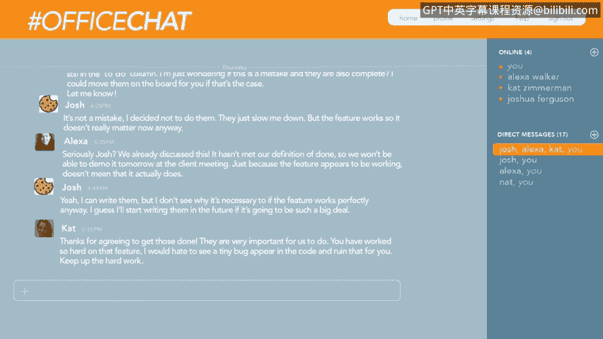

软件产品管理：6：软件产品管理毕业项目

## 概述
在本节课中，我们将学习如何通过模拟办公聊天对话来收集用户反馈。我们将了解这种方法的定义、实施步骤、优点与缺点，并探讨如何有效利用收集到的反馈。

## 什么是模拟办公聊天对话？
上一节我们介绍了多种用户反馈收集方法，本节中我们来看看一种非正式的、模拟真实工作场景的方法——模拟办公聊天对话。

模拟办公聊天对话是一种非结构化的用户研究方法。它通过模仿同事间在即时通讯工具（如Slack、Teams）中的日常对话，来观察和收集用户对某个产品或功能的想法、感受和潜在问题。

## 如何实施模拟聊天？
了解定义后，我们来看看具体如何操作。实施模拟聊天对话通常包含以下几个步骤。

以下是实施模拟聊天对话的关键步骤：
1.  **设定场景与角色**：设计一个简短的工作场景，例如“需要向团队介绍一个新功能”或“解决一个使用中的问题”。明确参与对话的“用户”角色。
2.  **准备对话脚本**：编写一个看似自然、非正式的对话开头。脚本应简短，仅提供初始话题，为自由发挥留出空间。例如：“嘿，你试过我们新上线的报告生成功能了吗？”
3.  **选择参与人员**：邀请目标用户或同事参与。向他们说明这是非正式的反馈收集活动，鼓励他们像平时聊天一样回应。
4.  **引导与记录**：作为发起者，根据用户的回复自然推进对话，深入探讨他们的观点。同时，需完整记录整个对话过程。
5.  **分析对话内容**：对话结束后，仔细分析记录，提取关于用户体验、痛点、需求及潜在改进点的关键信息。

## 这种方法的优点与缺点
任何方法都有其适用场景。接下来，我们分析一下模拟聊天对话这种方法的优势与局限性。

以下是模拟办公聊天对话的主要优点：
*   **环境自然**：用户在熟悉的聊天环境中更放松，容易给出自发、真实的反馈。
*   **成本低廉**：无需复杂设备或专门场地，只需基本的通讯工具。
*   **发现深层需求**：非正式对话可能引出用户在正式访谈中不会提及的细节和潜在需求。

以下是模拟办公聊天对话的主要缺点：
*   **样本偏差**：参与者可能无法代表全部用户群体。
*   **信息分散**：非结构化对话可能导致信息杂乱，分析起来耗时。
*   **缺乏量化数据**：该方法主要产生定性见解，难以获得可统计的量化数据。

## 如何利用收集到的反馈？
收集反馈是第一步，更重要的是如何运用它们。最后，我们探讨如何将聊天中获得的洞察转化为产品行动。

收集到的反馈应被系统整理，并用于：
*   **生成用户故事**：将用户的痛点或愿望转化为格式化的用户故事，例如：`作为一个<用户角色>，我想要<达成某个目标>，以便于<获得某种价值>`。
*   **优化产品路线图**：确认或调整功能开发的优先级。
*   **改进功能设计**：为具体的界面或流程设计提供直接输入。

## 总结
本节课中，我们一起学习了模拟办公聊天对话这一用户反馈收集方法。我们了解了它的定义、实施步骤、优缺点，以及如何将分析结果转化为实际的产品改进措施。掌握这一方法，可以帮助你在轻松的氛围中获得有价值的用户洞察。