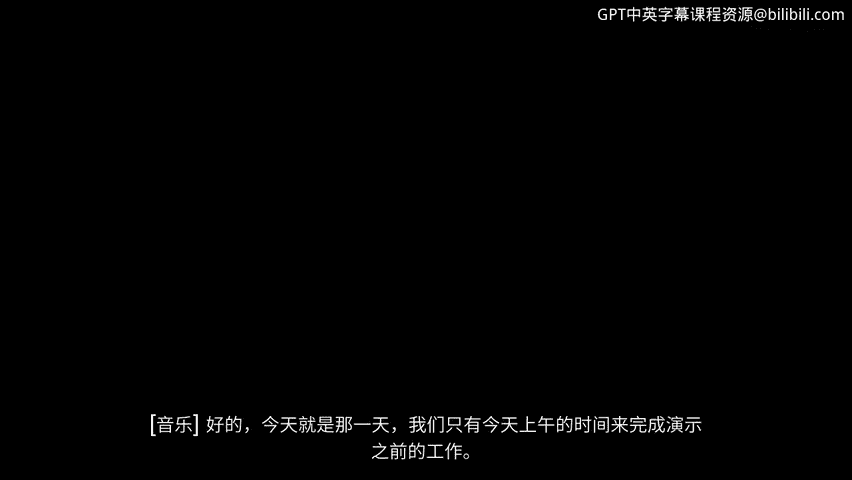
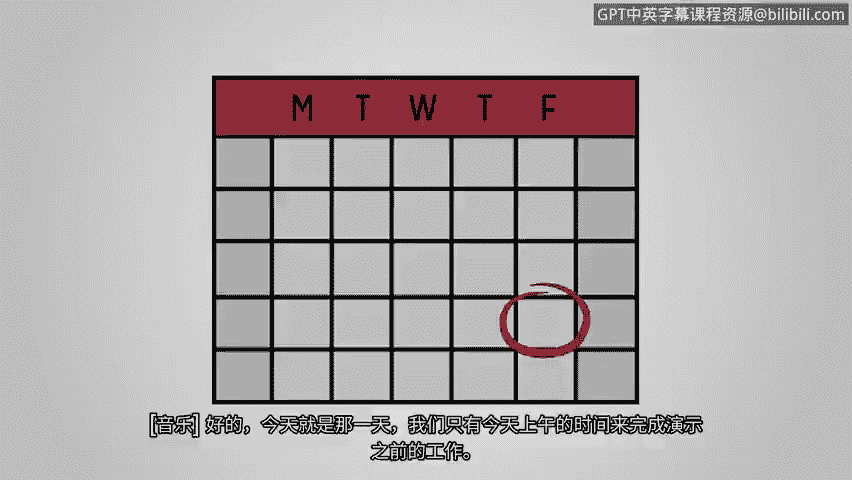

# 011：视频模拟站立会议

在本节课中，我们将通过一个模拟的站立会议视频，学习在软件产品开发冲刺（Sprint）末期，团队如何同步进度、识别障碍并协调工作，以确保演示（Demo）的顺利进行。

---

## 会议开场与目标同步

会议主持人开场，明确了当前的时间节点和目标。

“今天是演示前的最后一个上午，我们只有这段时间来完成所有收尾工作。”

---

## 团队成员进度汇报

以下是团队成员依次汇报昨日完成的工作、今日计划以及遇到的障碍。

**成员A汇报：**
“我昨天完成了所有页面布局功能。现在页面看起来像书籍页面，背景是米白色，支持横屏和竖屏显示，所有图片可见，并且字体大小可调。这样用户就可以独立阅读了。我完成了所有单元测试，并且在昨天结束时它们都通过了。我唯一还没做的是编写文档，我计划今天完成。目前我没有遇到任何阻碍。”

**主持人确认：**
“很好。那些功能的验收测试都已完成。我今天早上早些时候验证了验收测试，所以对你来说应该都能顺利运行。”

**追问与细节：**
“你什么时候做的测试？你到办公室多久了？”
“我今天早上5点参加了一个很棒的日出瑜伽课，7点就到办公室了。”
“听起来挺可怕的。”
“那让人精神焕发。你应该试试，可能有助于你集中注意力，找到内心的平静。”
“好了，我们跑题了。言归正传，我昨天完成了所有验收测试。我和Alexa结对编程了一会儿，并且如我所说，验证了验收测试。所以一切看起来都很顺利。”

**成员B汇报：**
“昨天我完成了音频连接功能，已经启动并运行了。Ka，你今天早上试过了吗？挺酷的。”
“试过了，没问题。”
“好的。总之，我猜我会开始着手那些单元测试。”

**主持人提醒：**
“现在音频功能已经完成，再做单元测试意义不大吧？”
“但你仍然需要它们。你昨晚就说要完成的。”
“是，是，好吧。总之，我昨天写了一点文档，但我觉得在演示前没时间完成了。有人能帮我一下吗？”

**协作请求：**
“我可以帮你。我可能需要澄清一些事情。你介意我坐你旁边工作吗？这样我有问题可以随时问你。”
“没问题，可以。”

---

## 会议总结与行动分配

主持人在所有成员汇报后，进行总结并确认最终行动。

“还有人在演示前有其他需要完成的事情吗？”
“太好了。那我们开始工作吧。”

---

本节课中，我们一起学习了冲刺末期站立会议的典型流程。会议聚焦于**进度同步**、**障碍清除**和**任务协调**。通过简短的沟通，团队确认了“页面布局”、“验收测试”和“音频功能”已完成，而“单元测试”和“文档编写”是待办事项，并现场形成了结对协作来解决文档问题。这种高效的沟通模式是确保产品按时交付、演示成功的关键。